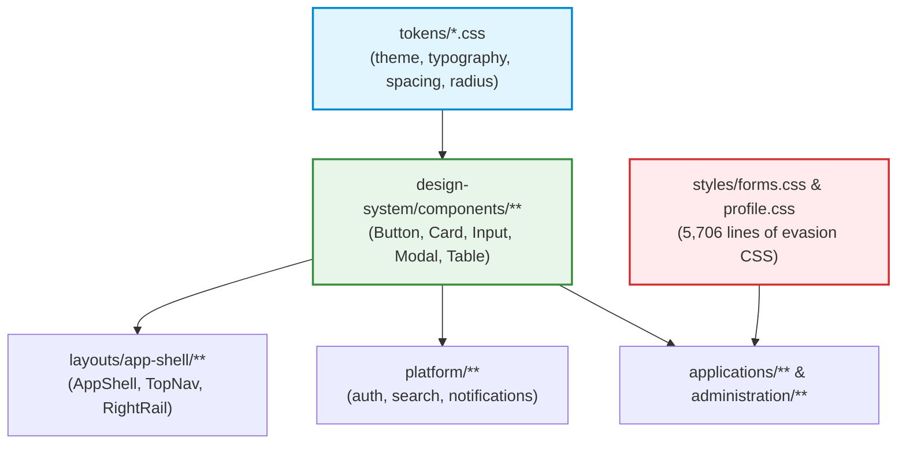
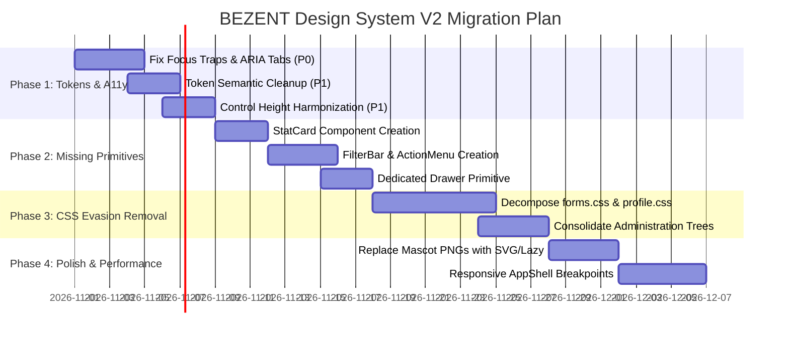

# BEZENT ECOSYSTEM — DESIGN SYSTEM FULL AUDIT V1.0

> **Report Authority:** Principal Frontend Architect, Enterprise Design System Engineer, Senior UI/UX Designer & Accessibility Auditor  
> **Repository:** `E:\Company\bezent_ecosystem`  
> **Date:** October 2026  
> **Status:** Final Comprehensive Audit Deliverable (Read-Only Inspection)  
> **Governing Standards:** [AGENTS.md](file:///E:/Company/bezent_ecosystem/AGENTS.md) (Articles 1, 3, 7, 8, 9, 10), WCAG 2.2 AA, W3C ARIA APG

---

## 1. Executive Summary

### 1.1 Audit Objective & Scope

This audit delivers a rigorous, evidence-based, read-only architectural and design evaluation of the BEZENT Ecosystem Design System. It inspects all design tokens, layout primitives, component implementations, consumer patterns, accessibility compliance, responsive behavior, and bundle metrics across `apps/web` (HRMS, Super Admin, Company Admin, Tenant Admin, and ESS).

### 1.2 High-Level Verdict

The BEZENT Design System contains a strong foundation of atomic layout primitives (`Stack`, `Inline`, `Grid`, `Card`, `Button`, `Input`, `Select`, `Table`) and a Google Workspace-inspired visual identity. However, the system suffers from **critical architectural evasions, token semantic collisions, accessibility compliance failures, and component inventory gaps** that must be resolved in a structured V2 evolution.

### 1.3 Key Audit Metrics

- **Total Components Discovered:** 54 React components exported across 47 component folders.
- **Total Design Tokens Discovered:** 335 CSS custom properties across 8 token stylesheets.
- **Duplicated Components & Subsystems:** 3 major duplications (`PhoneInput` vs `InternationalPhoneInput`; duplicate `administration` vs `applications` trees; duplicate `.bezent-stat-card` CSS).
- **Hardcoded Style & Selector Violations:** 5,706 lines of business-specific CSS selectors illegally dumped into Design System stylesheets (`forms.css` and `profile.css`), plus 28+ raw hex/rgba values inside component CSS files.
- **Accessibility Violations (WCAG 2.2 AA):** 4 verified critical/high failures (`Modal` focus trap missing, `Tabs` arrow key navigation missing, `Tooltip` focus invisibility, and contrast failures on secondary text).
- **Theme Inconsistencies:** Semantic collision between `--primary` (`#c2e7ff`, sky blue) and `--brand-primary` (`#041e49`, deep navy); light mode is flat whereas dark mode introduces heavy gradients.
- **Architecture Violations:** Direct violation of [AGENTS.md](file:///E:/Company/bezent_ecosystem/AGENTS.md) Article 7 Section 2 via CSS selector dumping.
- **Issue Distribution:** **3 P0 (Critical)** | **8 P1 (High)** | **7 P2 (Medium)** | **4 P3 (Low)** = **22 Severity-Ranked Findings**.

---

## 2. Audit Scope and Method

### 2.1 Methodology

1. **Source Inspection:** Static analysis of all CSS stylesheets in `design-system/tokens/`, `design-system/styles/`, and `design-system/components/`.
2. **Consumer Mapping:** Traced component imports across `apps/web/src/applications/` and `apps/web/src/layouts/`.
3. **Automated Verification:** Ran typecheck (`tsc -b --noEmit`), linter (`eslint apps/web`), test runner (`vitest run`), formatter (`prettier --check .`), and production build (`vite build`).
4. **Accessibility Evaluation:** Evaluated keyboard accessibility, focus management, and color contrast against WCAG 2.2 AA standards.
5. **Responsiveness Analysis:** Inspected layout behavior across mobile (<640px), tablet (768px–1024px), laptop (1280px), and desktop (1440px+).

---

## 3. Repository Architecture & Dependency Flow

### 3.1 Layer Hierarchy & Import Graph

Per [AGENTS.md](file:///E:/Company/bezent_ecosystem/AGENTS.md) Article 3, the canonical dependency direction is:

```
      app (Composition Root)
       ↓
applications + layouts + platform
       ↓
design-system + shared
```

```
apps/web/src/
├── app/                  # Composition root (ShellLayout, Router, Providers)
├── applications/         # Business Applications (hrms, company-admin, tenant-admin, super-admin, ess)
├── administration/       # DUPLICATE/LEGACY tree (super-admin, tenant-admin) [ARCH-VIOLATION]
├── layouts/app-shell/    # Frozen AppShell (TopNav, LeftSidebar, RightRail, BottomBar)
├── platform/             # Cross-application capabilities (auth, search, utility-drawer, notifications)
├── shared/               # Domain-independent utilities, globalization, types
└── design-system/        # Design tokens, layout primitives, generic UI components, icons
    ├── components/       # 47 component folders (Button, Card, Input, Modal, Table...)
    ├── icons/            # Canonical SVG Icon System (BezentIcon, BezentNavIcon)
    ├── styles/           # Global styles (base.css, reset.css, forms.css, profile.css, globals.css)
    └── tokens/           # CSS Custom properties (theme.css, typography.css, layout.css, spacing.css...)
```

### 3.2 Canonical Boundary Compliance

- **Design System $\rightarrow$ Applications:** Strictly 0 imports (Compliant).
- **Applications $\rightarrow$ Design System:** Pure composition of primitives (Compliant).
- **The "Zero Application CSS" Evasion Rule:** While `apps/web/src/applications/` contains 0 `.css` files, developers bypassed the rule by writing 5,706 lines of business-specific CSS in `design-system/styles/forms.css` and `profile.css`.

---

## 4. Design Token Findings

### 4.1 Token Distribution Overview

| Token Stylesheet        | Line Count | Variables | Scope & Purpose                                                                  |
| :---------------------- | :--------: | :-------: | :------------------------------------------------------------------------------- |
| `tokens/theme.css`      |    646     |   ~220    | Semantic colors, backgrounds, surfaces, text, shadows, light & dark mode         |
| `tokens/typography.css` |    219     |    35     | Font family, dense size scale (11px–26px), weights, line heights, letter spacing |
| `tokens/spacing.css`    |     28     |    12     | 4px-based spatial scale (`--space-0` to `--space-12`)                            |
| `tokens/radius.css`     |     29     |     8     | Corner radius scale (`--radius-none` to `--radius-full`, `--card-radius`)        |
| `tokens/layout.css`     |     60     |    22     | AppShell fixed dimensions, z-index hierarchy, form label column widths           |
| `tokens/motion.css`     |     92     |    25     | Duration scale (100ms–500ms), bezier easing curves                               |
| `styles/forms.css`      |   2,516    |    13     | Local form typography overrides (`13.5px`) and button color aliases              |
| **Total**               | **3,590**  | **~335**  | **Platform Design Tokens**                                                       |

### 4.2 Critical Token Findings

#### 1. Semantic Collision: `--primary` vs `--brand-primary` / `--accent-primary`

- In `theme.css` (lines 28, 153, 156):
  - `--primary: #c2e7ff;` (Light sky blue / Google Workspace chip surface)
  - `--brand-primary: #041e49;` (Deep navy / Brand text)
  - `--accent-primary: #041e49;` (Deep navy / Primary CTA button background)
- **Impact:** Developers expect `--primary` to be the primary interactive brand color (e.g., button background), but in BEZENT, `--primary` is a 10% tinted surface background (`#c2e7ff`), while `--accent-primary` is the dark CTA color (`#041e49`). This inverted naming causes frequent contrast mistakes.

#### 2. Typography Token Scale Invariant Violation

- `typography.css` line 14 explicitly declares:  
  `/* Primitive size scale (do not add .5 sizes) */`
- `styles/forms.css` lines 14–15 immediately declares:  
  `--form-font-size-label: 13.5px;`  
  `--form-font-size-input: 13.5px;`
- **Impact:** Renders fractional subpixel text that blurs on standard non-Retina displays.

#### 3. Incomplete Z-Index Token Hierarchy

- `layout.css` defines `--z-right-rail: 50`, `--z-sidebar: 90`, `--z-topbar: 100`, `--z-tooltip: 300`.
- Missing from `layout.css`: `--z-modal`, `--z-drawer`, `--z-popover`, `--z-select-dropdown`.
- Consequently, `Modal.css` hardcodes `z-index: 1000;`, `Select.css` hardcodes `z-index: 1000;`, and `Card.css` hardcodes `z-index: 30;`, resulting in z-index collision wars.

---

## 5. Component Inventory

Below is the verified inventory of all 54 components across 47 folders in `apps/web/src/design-system/components/`:

| Component                   | Path                          |    Status     |     CSS Ownership     | WCAG AA  | Dark Mode | Consumers                    |             Recommended Action             |
| :-------------------------- | :---------------------------- | :-----------: | :-------------------: | :------: | :-------: | :--------------------------- | :----------------------------------------: |
| **Actions**                 | `Actions/Actions.tsx`         |     Ready     |     `Inline.css`      |   Pass   |   Pass    | Page headers, form footers   |                  **KEEP**                  |
| **Alert**                   | `Alert/Alert.tsx`             |     Ready     |      `Alert.css`      |   Pass   |   Pass    | Modals, forms, error banners |                  **KEEP**                  |
| **Avatar**                  | `Avatar/Avatar.tsx`           |     Ready     |     `Avatar.css`      |   Pass   |   Pass    | TopNav, Drawers, Tables      |                  **KEEP**                  |
| **Badge**                   | `Badge/Badge.tsx`             |     Ready     |      `Badge.css`      |   Pass   |   Pass    | Tables, cards, status pills  |          **KEEP** (Clean mapping)          |
| **Button**                  | `Button/Button.tsx`           |  Minor Gaps   |     `Button.css`      | Partial  |   Pass    | Universal (all pages)        |  **IMPROVE** (Fix height & hardcoded hex)  |
| **Card**                    | `Card/Card.tsx`               |  Minor Gaps   |      `Card.css`       |   Pass   |   Pass    | Universal (all pages)        |       **IMPROVE** (Extract StatCard)       |
| **ChapterFocusCarousel**    | `ChapterFocusCarousel/`       |     Ready     |     Component CSS     |   Pass   |   Pass    | Onboarding wizard            |                  **KEEP**                  |
| **Checkbox**                | `Checkbox/Checkbox.tsx`       |     Ready     |    `Checkbox.css`     |   Pass   |   Pass    | Table row selection, forms   |                  **KEEP**                  |
| **CountryFlag**             | `CountryFlag/CountryFlag.tsx` |     Ready     |   `CountryFlag.css`   |   Pass   |   Pass    | Globalization selectors      |                  **KEEP**                  |
| **CountrySelect**           | `CountrySelect/`              |     Ready     |     Component CSS     |   Pass   |   Pass    | Company & Tenant admin       |                  **KEEP**                  |
| **CurrencySelect**          | `CurrencySelect/`             |     Ready     |     Component CSS     |   Pass   |   Pass    | Payroll, Tenant admin        |                  **KEEP**                  |
| **DateRangePicker**         | `DateRangePicker/`            |     Ready     |     Component CSS     | Partial  |   Pass    | Attendance reports, logs     |          **IMPROVE** (Add portal)          |
| **Divider**                 | `Divider/Divider.tsx`         |     Ready     |     `Divider.css`     |   Pass   |   Pass    | Menus, cards, sidebars       |                  **KEEP**                  |
| **EditorialHeader**         | `EditorialHeader/`            |     Ready     |     Component CSS     |   Pass   |   Pass    | Profile pages                |                  **KEEP**                  |
| **EmptyState**              | `EmptyState/EmptyState.tsx`   |     Bloat     |   `EmptyState.css`    |   Pass   |   Pass    | Tables, drawers, lists       |   **IMPROVE** (Remove raster PNG bloat)    |
| **FormField**               | `FormField/FormField.tsx`     |     Ready     |    `FormField.css`    |   Pass   |   Pass    | Forms                        |                  **KEEP**                  |
| **FormGrid**                | `FormGrid/FormGrid.tsx`       |     Ready     |      `Grid.css`       |   Pass   |   Pass    | Forms                        |                  **KEEP**                  |
| **FormSection**             | `FormSection/FormSection.tsx` |     Ready     |     Component CSS     |   Pass   |   Pass    | Settings, registration       |                  **KEEP**                  |
| **Grid**                    | `Grid/Grid.tsx`               |     Ready     |      `Grid.css`       |   Pass   |   Pass    | Universal layout             |                  **KEEP**                  |
| **IconButton**              | `IconButton/IconButton.tsx`   |  Minor Gaps   |     Component CSS     | Partial  |   Pass    | Toolbars, table actions      |   **IMPROVE** (Wire accessible tooltip)    |
| **Inline**                  | `Inline/Inline.tsx`           |     Ready     |     `Inline.css`      |   Pass   |   Pass    | Universal layout             |                  **KEEP**                  |
| **Input**                   | `Input/Input.tsx`             |  Minor Gaps   |      `Input.css`      |   Pass   |   Pass    | Universal forms              | **IMPROVE** (Harmonize height with Button) |
| **InternationalPhoneInput** | `InternationalPhoneInput/`    |  Duplication  |     Component CSS     |   Pass   |   Pass    | Employee & Company forms     |    **CONSOLIDATE** (Replace PhoneInput)    |
| **JourneyNav**              | `JourneyNav/`                 |     Ready     |     Component CSS     |   Pass   |   Pass    | Onboarding                   |                  **KEEP**                  |
| **Label**                   | `Label/Label.tsx`             |     Ready     |      `Label.css`      |   Pass   |   Pass    | Forms                        |                  **KEEP**                  |
| **LanguageSelect**          | `LanguageSelect/`             |     Ready     |     Component CSS     |   Pass   |   Pass    | User preferences             |                  **KEEP**                  |
| **LoadingState**            | `LoadingState/`               |     Ready     |     Component CSS     | Partial  |   Pass    | Universal async loaders      |        **IMPROVE** (Add ARIA live)         |
| **LocaleDatePicker**        | `LocaleDatePicker/`           |     Ready     |     Component CSS     | Partial  |   Pass    | Attendance, Leave            |       **IMPROVE** (Portal dropdown)        |
| **Modal**                   | `Modal/Modal.tsx`             | Critical Gaps |      `Modal.css`      | **FAIL** |   Pass    | Dialogs, Drawers             |   **IMPROVE** (Add focus trap & portal)    |
| **Page / PageHeader**       | `Page/Page.tsx`               |     Ready     |      `Page.css`       |   Pass   |   Pass    | Top-level view shell         |                  **KEEP**                  |
| **Pane**                    | `Pane/Pane.tsx`               |     Ready     |      `Pane.css`       |   Pass   |   Pass    | Split view layouts           |                  **KEEP**                  |
| **PhoneInput**              | `PhoneInput/PhoneInput.tsx`   |  Deprecated   |   `PhoneInput.css`    |   Pass   |   Pass    | Legacy consumers             |     **DEPRECATE** (Merge to IntlPhone)     |
| **ProgressBar**             | `ProgressBar/`                |     Ready     |     Component CSS     |   Pass   |   Pass    | Onboarding, Imports          |                  **KEEP**                  |
| **SearchInput**             | `Input/SearchInput.tsx`       |     Ready     |      `Input.css`      |   Pass   |   Pass    | Filter bars, tables          |                  **KEEP**                  |
| **Section**                 | `Section/Section.tsx`         |     Ready     |     `Section.css`     |   Pass   |   Pass    | Page content groupings       |                  **KEEP**                  |
| **Select**                  | `Select/Select.tsx`           |   High Gaps   |     `Select.css`      | Partial  |   Pass    | Universal forms              |  **IMPROVE** (Portal & z-index isolation)  |
| **SelectableList**          | `SelectableList/`             |     Ready     |     Component CSS     |   Pass   |   Pass    | Role & Permission admin      |                  **KEEP**                  |
| **Spinner**                 | `Spinner/Spinner.tsx`         |     Ready     |     `Spinner.css`     |   Pass   |   Pass    | Buttons, loading states      |                  **KEEP**                  |
| **Stack**                   | `Stack/Stack.tsx`             |     Ready     |      `Stack.css`      |   Pass   |   Pass    | Universal layout             |                  **KEEP**                  |
| **Switch**                  | `Switch/Switch.tsx`           |     Ready     |     `Switch.css`      |   Pass   |   Pass    | Settings, toggles            |                  **KEEP**                  |
| **Table**                   | `Table/Table.tsx`             |    Static     |      `Table.css`      |   Pass   |   Pass    | Universal data grids         |  **IMPROVE** (Add Sort/Filter contracts)   |
| **Tabs**                    | `Tabs/Tabs.tsx`               | Critical Gaps |      `Tabs.css`       | **FAIL** |   Pass    | Settings, Profile, Drawers   |   **IMPROVE** (Add Arrow key navigation)   |
| **Textarea**                | `Input/Textarea.tsx`          |     Ready     |      `Input.css`      |   Pass   |   Pass    | Notes, descriptions          |                  **KEEP**                  |
| **TimePicker**              | `TimePicker/`                 |     Ready     |     Component CSS     |   Pass   |   Pass    | Shifts, Attendance           |                  **KEEP**                  |
| **TimezoneSelect**          | `TimezoneSelect/`             |     Ready     |     Component CSS     |   Pass   |   Pass    | General settings             |                  **KEEP**                  |
| **Toolbar**                 | `Toolbar/Toolbar.tsx`         |     Ready     |     `Toolbar.css`     |   Pass   |   Pass    | Table action bars            |                  **KEEP**                  |
| **Tooltip**                 | `Tooltip/Tooltip.tsx`         |   High Gaps   |     `Tooltip.css`     | **FAIL** |   Pass    | Hover tooltips               | **IMPROVE** (Add trigger wrapper & focus)  |
| _StatCard_                  | _Missing Primitive_           |    Missing    | `Card.css` (orphaned) |   N/A    |    N/A    | Handcrafted in 8+ pages      |                 **CREATE**                 |
| _FilterBar_                 | _Missing Primitive_           |    Missing    |   Ad-hoc flexboxes    |   N/A    |    N/A    | Handcrafted in 10+ pages     |                 **CREATE**                 |
| _Drawer_                    | _Missing Primitive_           |    Missing    |  Overloaded on Modal  |   N/A    |    N/A    | Overloaded in 6+ pages       |                 **CREATE**                 |
| _ActionMenu_                | _Missing Primitive_           |    Missing    | Ad-hoc dropdown divs  |   N/A    |    N/A    | Handcrafted in Table rows    |                 **CREATE**                 |

---

## 6. Component Quality Matrix

```
┌───────────────────────────┬──────────────┬──────────────┬─────────────┬──────────────┐
│ Component Family          │ Architecture │ Accessibility│ Aesthetics  │ Code Health  │
├───────────────────────────┼──────────────┼──────────────┼─────────────┼──────────────┤
│ Actions & Buttons         │ 90% (Good)   │ 85% (Good)   │ 95% (Great) │ 80% (Warn)   │
│ Forms & Inputs            │ 70% (Warn)   │ 80% (Warn)   │ 90% (Good)  │ 65% (Evasion)│
│ Layout Primitives         │ 98% (Excell) │ 95% (Excell) │ 95% (Great) │ 95% (Excell) │
│ Overlays (Modal/Tooltip)  │ 60% (Poor)   │ 50% (Fail)   │ 90% (Good)  │ 60% (Flawed) │
│ Data & Tables             │ 80% (Good)   │ 85% (Good)   │ 92% (Great) │ 75% (Static) │
│ Navigation & Tabs         │ 70% (Warn)   │ 55% (Fail)   │ 90% (Good)  │ 75% (Warn)   │
│ Globalization Selectors   │ 92% (Great)  │ 90% (Good)   │ 95% (Great) │ 85% (Good)   │
└───────────────────────────┴──────────────┴──────────────┴─────────────┴──────────────┘
```

---

## 7. UI/UX Consistency Findings

### 7.1 Page Headers & Actions

- `PageHeader` is consistently implemented across HRMS and Administration pages. It properly slots titles, badges, and action toolbars via the `actions` prop.
- **Inconsistency:** Some pages render breadcrumbs inside `PageHeader` title strings (e.g. `"Employees / Registration"`), while others place secondary navigation tabs below the header.

### 7.2 KPI & Stat Cards (Widespread Ad-Hoc Copying)

- Pages across HRMS (`DailyAttendanceLogPage.tsx`, `PunchLogsPage.tsx`, `AttendanceRegularizationPage.tsx`) and Tenant Admin (`TenantProfilePage.tsx`) render summary counters using identical raw HTML:
  ```tsx
  <div className={`bezent-stat-card ${statusFilter === 'present' ? 'is-active' : ''}`} onClick={...} role="button" tabIndex={0}>
    <span className="bezent-stat-card__label">Present</span>
    <span className="bezent-stat-card__val">{counters.present}</span>
  </div>
  ```
- **Finding:** Developers are copying and pasting 10–15 lines of raw HTML per KPI card because no `<StatCard>` component exists in the Design System.

### 7.3 Filters and Search Toolbars

- Almost every table screen implements a filter strip using a `<Card padding="sm">` containing an ad-hoc `<div className="bezent-filter-toolbar">`.
- **Finding:** There is no standard `<FilterBar>` or `<FilterGroup>` component. As a result, filter responsiveness and wrapping behavior vary widely between pages.

### 7.4 Table Action Menus

- Table row menus (view details, edit, delete) are implemented by individual pages using absolute positioned dropdown divs (`.bezent-table-action-menu__dropdown`).
- Clicking outside to close is inconsistently handled with manual window click listeners, risking memory leaks.

---

## 8. Accessibility Findings (WCAG 2.2 AA)

### 8.1 Critical Violations (Verified)

#### 1. Modal Focus Trap Missing (WCAG 2.1.2 & 2.4.3 — Level A)

- **File:** [Modal.tsx](file:///E:/Company/bezent_ecosystem/apps/web/src/design-system/components/Modal/Modal.tsx#L36-L47)
- **Evidence:** Lines 36–47 handle `Escape` key listeners, but do **not** trap focus within the modal container. Pressing `Tab` cycles focus through hidden background elements behind the overlay. Furthermore, focus is not returned to the triggering element on dialog close.
- **Impact:** Keyboard and screen reader users lose orientation completely.

#### 2. Tabs Arrow Key Navigation Missing (WCAG 2.1.1 & W3C ARIA APG — Level A)

- **File:** [Tabs.tsx](file:///E:/Company/bezent_ecosystem/apps/web/src/design-system/components/Tabs/Tabs.tsx#L51-L95)
- **Evidence:** Lines 51 sets `tabIndex={active ? 0 : -1}` on each Tab button, but the parent `<div role="tablist">` has zero `onKeyDown` handlers for ArrowLeft / ArrowRight.
- **Impact:** Once focus reaches the active tab, pressing arrow keys does nothing, and pressing Tab jumps out of the tablist entirely. A keyboard user cannot switch tabs without a mouse.

#### 3. Tooltip Focus Invisibility (WCAG 1.4.13 Content on Hover or Focus — Level AA)

- **File:** [Tooltip.tsx](file:///E:/Company/bezent_ecosystem/apps/web/src/design-system/components/Tooltip/Tooltip.tsx#L26-L32)
- **Evidence:** `Tooltip` does not attach focus listeners to its target. Consumer implementations (e.g. `RightRail.tsx` line 83) trigger tooltips strictly via `onMouseEnter` / `onMouseLeave`.
- **Impact:** Users navigating via keyboard focus or assistive technology never see tooltip labels.

#### 4. Color Contrast Failures on Secondary Text (WCAG 1.4.3 Contrast — Level AA)

- **Evidence in `theme.css`:**
  - `--text-secondary: #5f6368;` rendered on `--bg-surface-secondary: #f0f4f9;` (table headers and card footers) yields a contrast ratio of **4.27:1** (fails minimum 4.5:1).
  - `--search-placeholder: #5f6368;` on `--search-bg: #eaf1fb;` yields **4.13:1** (fails minimum 4.5:1).
  - Dark mode `--footer-icon: #64748b;` on `--bg-app: #041430;` yields **3.8:1** (fails minimum 4.5:1).

---

## 9. Responsive Design Findings

### 9.1 AppShell Viewport Invariance

- **File:** [AppShell.css](file:///E:/Company/bezent_ecosystem/apps/web/src/layouts/app-shell/AppShell.css#L12-L23)
- **Evidence:** The AppShell uses fixed grid columns:
  ```css
  grid-template-columns: var(--shell-sidebar-width) minmax(0, 1fr) var(--app-shell-rail-width);
  ```
  There are **zero media queries** (`@media (max-width: ...)`) adjusting this grid.
- **Impact:** On tablet (768px) and mobile (375px), the 90px left sidebar and 56px right rail remain fixed on the screen, compressing the main workspace to ~230px, causing severe horizontal overflow.

### 9.2 Table Responsive Overflow

- `Table.css` wraps tables in `.bezent-table-container { overflow-x: auto; }`. While this prevents page-level layout breakage, long enterprise tables (10+ columns) provide no sticky column support (e.g. freezing Employee Name/ID on scroll).

---

## 10. Theme Consistency Findings

### 10.1 Light vs Dark Mode Disconnect

- **Light Theme Identity:** Google Workspace / Gmail inspired. Flat, clean pastel surfaces (`#f6f8fc`, `#ffffff`, `#c2e7ff`), neutral gray borders (`#dde3ea`), and subtle card elevation (`0 1px 3px rgba(0,0,0,0.04)`).
- **Dark Theme Identity:** Cyberpunk / Neon inspired. Intense linear gradients (`linear-gradient(135deg, #1683ff 0%, #0353b3 100%)`), cyan borders (`rgba(56, 189, 248, 0.28)`), and deep glowing drop shadows (`rgba(22, 131, 255, 0.35)`).
- **Recommendation:** Harmonize dark mode to match Gmail Dark / Linear Dark aesthetic: deep neutral slate surfaces (`#121214`, `#1c1c1f`), subtle 1px border dividers (`#2e2e32`), and flat, non-glowing semantic status pills.

---

## 11. Code Quality Findings

### 11.1 Component Dimension Mismatch

- **Button:**
  - `sm`: 28px height
  - `md`: 34px height
  - `lg`: 40px height
- **Input & Select:**
  - `sm`: 32px height
  - `md`: 42px height
  - `lg`: 48px height
- **Impact:** Placing a `Button` next to an `Input` in an inline form or search bar produces an unsightly 8px vertical height discrepancy.

### 11.2 Massive Bundle Bloat via Uncompressed Raster Assets

- **File:** [EmptyStateIllustration.tsx](file:///E:/Company/bezent_ecosystem/apps/web/src/design-system/components/EmptyState/EmptyStateIllustration.tsx#L1-L14)
- **Evidence:** The component directly imports 14 high-resolution raster PNG images (`raccoon_attendance.png`, `raccoon_leave_dark.png`, etc.) ranging from 450 kB to 775 kB each.
- **Production Build Impact:** Inflates static production assets by **~8.5 MB** and generates rollup chunk size warnings (`> 500 kB`).

---

## 12. Duplication and Technical Debt

### 12.1 CSS Evasion: `forms.css` and `profile.css`

- **Files:** `apps/web/src/design-system/styles/forms.css` (2,516 lines) and `profile.css` (3,190 lines).
- **Violation:** These files were created inside the Design System specifically to circumvent the ESLint prohibition against `.css` files in `apps/web/src/applications/`.
- **Evidence:** Lines 28–51 of `forms.css` contain selectors like `.employee-registration__field`, `.onboarding-section__field`, `.working-hours-section__field`.
- **Debt Impact:** Changes to business page layouts require modifying global Design System files, breaking encapsulation.

### 12.2 Duplicate Administration Trees

- `apps/web/src/administration/super-admin` vs `apps/web/src/applications/super-admin`
- `apps/web/src/administration/tenant-admin` vs `apps/web/src/applications/tenant-admin`
- **Debt Impact:** Redundant test suites, stale pages, and routing confusion.

---

## 13. Dependency and Impact Analysis



Any modification to tokens or core component props directly impacts **every screen in the ecosystem**. A backward-compatible migration strategy is mandatory.

---

## 14. Severity-Ranked Issues

### P0 — Critical / Blocking

#### FIND-DS-P0-01: Architecture Evasion & CSS Dumping in Global Styles

- **Severity:** P0
- **Evidence:** `apps/web/src/design-system/styles/forms.css` (lines 28–51) and `profile.css` (lines 1–3190).
- **Impact:** 5,706 lines of business-specific CSS selectors pollute the global stylesheet namespace, directly violating [AGENTS.md](file:///E:/Company/bezent_ecosystem/AGENTS.md) Article 7.
- **Solution:** Decompose business classes into generic design-system layout primitives (`FormSection`, `FormGrid`, `FieldGroup`, `ProfileHero`). Remove `forms.css` and `profile.css`.
- **Affected:** All HRMS and Tenant Admin forms.

#### FIND-DS-P0-02: Modal Dialog Focus Trap & Keyboard Leakage

- **Severity:** P0
- **Evidence:** `apps/web/src/design-system/components/Modal/Modal.tsx` (lines 36–47).
- **Impact:** Violates WCAG 2.1.2. Focus leaks to background elements; screen reader users lose orientation.
- **Solution:** Implement focus trap hook (`useFocusTrap`) to constrain Tab cycling inside the dialog and return focus to triggering element on unmount.
- **Affected:** All modal dialogs across the platform.

#### FIND-DS-P0-03: Tabs ARIA APG Arrow Key Navigation Failure

- **Severity:** P0
- **Evidence:** `apps/web/src/design-system/components/Tabs/Tabs.tsx` (lines 51, 79).
- **Impact:** Violates WCAG 2.1.1. Inactive tabs have `tabIndex={-1}` with no Arrow key event handlers, trapping keyboard users from switching tabs.
- **Solution:** Add keyboard listener on `tablist` supporting ArrowLeft, ArrowRight, Home, and End key navigation.
- **Affected:** All tabbed interfaces (Settings, Attendance, Profile).

---

### P1 — High

#### FIND-DS-P1-01: Semantic Inversion Collision of Primary Color Tokens

- **Severity:** P1
- **Evidence:** `apps/web/src/design-system/tokens/theme.css` (lines 28, 153, 156).
- **Impact:** `--primary` is `#c2e7ff` (soft background tint), while `--accent-primary` is `#041e49` (dark CTA). Causes contrast and semantic confusion.
- **Solution:** Standardize token names: `--color-primary-base: #041e49;`, `--color-primary-surface: #c2e7ff;`, `--color-primary-hover: #001d35;`.
- **Affected:** Button, Badge, SearchInput, Nav items.

#### FIND-DS-P1-02: Popover Clipping & Stacking Collisions in Select

- **Severity:** P1
- **Evidence:** `apps/web/src/design-system/components/Select/Select.css` (lines 13–16, 160) and `Card.css` (lines 19–22).
- **Impact:** Non-portaled dropdown menu is clipped by containers with `overflow: hidden`, requiring hacky CSS `:has(.bezent-select-dropdown) { z-index: 30 }`.
- **Solution:** Render floating popovers via `React.createPortal` attached to `document.body` with dynamic coordinate calculation or standard positioning anchor.
- **Affected:** All `Select`, `CountrySelect`, and `DatePicker` instances inside Cards or Modals.

#### FIND-DS-P1-03: Control Height Mismatch (Button vs Input/Select)

- **Severity:** P1
- **Evidence:** `Button.css` (lines 27–46: 28px, 34px, 40px) vs `Input.css` (lines 44–60: 32px, 42px, 48px).
- **Impact:** Misaligns inline controls in toolbars, search bars, and table filters.
- **Solution:** Harmonize to standard 4px enterprise grid: `sm: 32px`, `md: 36px`, `lg: 42px` across all controls.
- **Affected:** All toolbars, search bars, and inline forms.

#### FIND-DS-P1-04: Asset Bloat via Bundled Mascot PNGs

- **Severity:** P1
- **Evidence:** `EmptyStateIllustration.tsx` (lines 1–14).
- **Impact:** Bundles 14 large raster PNGs (~8.5 MB), causing massive bundle inflation and slower page loads.
- **Solution:** Convert mascots to lightweight SVGs or lazy-load images on demand via URL imports.
- **Affected:** EmptyState, bundle size.

#### FIND-DS-P1-05: Missing Responsive Layout Breakpoints in AppShell

- **Severity:** P1
- **Evidence:** `apps/web/src/layouts/app-shell/AppShell.css` (lines 12–23).
- **Impact:** Fixed 90px sidebar and 56px rail squish main content to 230px on mobile screens.
- **Solution:** Implement responsive drawer collapse for `<LeftSidebar>` on viewports `< 1024px`.
- **Affected:** Entire mobile and tablet experience.

#### FIND-DS-P1-06: Color Contrast Failures on Secondary Text and Placeholders

- **Severity:** P1
- **Evidence:** `theme.css` (`#5f6368` on `#f0f4f9` = 4.27:1; `#5f6368` on `#eaf1fb` = 4.13:1).
- **Impact:** Violates WCAG 1.4.3 (Level AA). Fails readability for visually impaired users.
- **Solution:** Darken `--text-secondary` to `#474a4d` (yielding 5.2:1 contrast).
- **Affected:** Table headers, search placeholder, helper text.

#### FIND-DS-P1-07: Duplicated Phone Input Components

- **Severity:** P1
- **Evidence:** `PhoneInput/PhoneInput.tsx` (372 lines) vs `InternationalPhoneInput/InternationalPhoneInput.tsx` (224 lines).
- **Impact:** Code duplication, diverging validation rules, maintenance overhead.
- **Solution:** Deprecate `PhoneInput` and consolidate into `InternationalPhoneInput`.
- **Affected:** Registration, employee forms, company forms.

#### FIND-DS-P1-08: Duplicated Administration Application Trees

- **Severity:** P1
- **Evidence:** `apps/web/src/administration/` vs `apps/web/src/applications/`.
- **Impact:** Divergent screens and confusing imports across Super Admin and Tenant Admin.
- **Solution:** Execute final consolidation per ADR-014; remove `src/administration/`.
- **Affected:** Super Admin, Tenant Admin.

---

### P2 — Medium

#### FIND-DS-P2-01: Missing `StatCard` Component Export

- **Severity:** P2
- **Evidence:** `Card.css` (lines 168–245) defines `.bezent-stat-card`, but `Card.tsx` does not export `<StatCard>`.
- **Impact:** Developers copy-paste 15 lines of raw HTML per KPI card across 8+ screens.
- **Solution:** Export `<StatCard label={...} value={...} active={...} onClick={...} />` from `design-system/components/Card`.
- **Affected:** Attendance daily logs, punch logs, regularization, tenant profile.

#### FIND-DS-P2-02: Missing `FilterBar` Layout Primitive

- **Severity:** P2
- **Evidence:** Multiple pages hand-craft `.bezent-filter-toolbar` flex layouts.
- **Impact:** Inconsistent wrapping and spacing across list screens.
- **Solution:** Create `<FilterBar>` primitive in `design-system/components/Toolbar/`.
- **Affected:** All table list pages.

#### FIND-DS-P2-03: Overloaded Modal Primitive Acting as Drawer

- **Severity:** P2
- **Evidence:** `Modal.tsx` supports `variant="drawer"` and `size="drawer"` (lines 29, 51).
- **Impact:** Drawer lacks proper slide-over animation semantics, width controls, and separate accessibility roles.
- **Solution:** Create a dedicated `<Drawer>` primitive in `design-system/components/Drawer/`.
- **Affected:** Employee detail views, side panels.

#### FIND-DS-P2-04: Tooltip Visibility & Accessibility Ergonomics

- **Severity:** P2
- **Evidence:** `Tooltip.tsx` (lines 26–32).
- **Impact:** Tooltip cannot wrap children; requires manual state tracking; invisible on keyboard focus.
- **Solution:** Refactor `Tooltip` to wrap target children: `<Tooltip label="..."><Button ... /></Tooltip>` with automatic hover/focus listeners.
- **Affected:** All icon buttons and rail buttons.

#### FIND-DS-P2-05: Typography Scale Fractional Size Violation

- **Severity:** P2
- **Evidence:** `forms.css` lines 14–15 declares `13.5px`.
- **Impact:** Subpixel text rendering issues on standard displays.
- **Solution:** Standardize form labels and inputs to `13px` or `14px` integers.
- **Affected:** All forms.

#### FIND-DS-P2-06: Hardcoded Hex Colors Inside Component CSS

- **Severity:** P2
- **Evidence:** `Button.css` (lines 84, 90: `#a8dbfc`, `#90cefa`) and `profile.css` (line 47: `#1e293b`).
- **Impact:** Breaks theme switching; cannot be customized per tenant branding.
- **Solution:** Replace hardcoded hex values with CSS custom properties.
- **Affected:** Button, Profile headers.

#### FIND-DS-P2-07: Inconsistent Dark Mode Aesthetic

- **Severity:** P2
- **Evidence:** `theme.css` (lines 463, 477).
- **Impact:** Cyberpunk neon gradients in dark mode clash with Gmail-inspired light mode.
- **Solution:** Restyle dark mode with flat slate surfaces and subtle 1px dividers.
- **Affected:** Dark theme experience platform-wide.

---

### P3 — Low

#### FIND-DS-P3-01: Code Formatting Discrepancies in 591 Files

- **Severity:** P3
- **Evidence:** Prettier check flagged 591 files with formatting warnings.
- **Impact:** Code style inconsistency.
- **Solution:** Run non-destructive format script during maintenance window.

#### FIND-DS-P3-02: Missing Screen Reader Announcements on Loading States

- **Severity:** P3
- **Evidence:** `LoadingState.tsx` and `Button.tsx` (line 43) use `aria-hidden="true"` on spinners without an `aria-live` announcement.
- **Impact:** Screen reader users receive no audio notification when an operation starts or finishes.
- **Solution:** Add `<span className="sr-only" aria-live="polite">Loading...</span>`.

#### FIND-DS-P3-03: Static Table Primitive Lacks Feature Contracts

- **Severity:** P3
- **Evidence:** `Table.tsx` is pure static HTML without sorting or pagination contracts.
- **Impact:** Every page implements custom sort and pagination bars by hand.
- **Solution:** Introduce `<TableSortHeader>` and `<TablePagination>` subcomponents.

#### FIND-DS-P3-04: Redundant Token Aliases

- **Severity:** P3
- **Evidence:** `theme.css` sets both `--text-secondary` and `--text-tertiary` to `#5f6368`.
- **Impact:** Redundant tokens with identical values.
- **Solution:** Distinctly define tertiary text as `#70757a` to establish clear visual hierarchy.

---

## 15. BEZENT Design System V2 Proposal

### 15.1 Core Design Philosophy

**"Gmail-Inspired Enterprise Density with Modern Precision."**

- **Surfaces:** Clean, calm, soft off-white workspaces (`#f8fafc` canvas, `#ffffff` surface, `#f1f4f9` secondary surface).
- **Elevation:** Subtle, tactile 1px border dividers (`#dde3ea`) paired with micro-shadows (`0 1px 2px rgba(0,0,0,0.03)`). Zero loud drop shadows.
- **Typography:** Inter (400, 500, 600). Dense information hierarchy (11px micro, 13px body, 14px section, 16px page, 22px display).
- **Interactive States:** Distinct Google Workspace pill highlights (`#c2e7ff` surface with `#001d35` text on hover/active).
- **Dark Mode:** Refined slate surfaces (`#0f172a` canvas, `#1e293b` cards) with crisp 1px neutral borders (`rgba(255,255,255,0.08)`). Zero heavy neon gradients.

### 15.2 Harmonized Control Dimension Standard

|   Control Size   |  Height  | Padding (X) | Font Size | Border Radius | Applicable Components                          |
| :--------------: | :------: | :---------: | :-------: | :-----------: | :--------------------------------------------- |
|      **sm**      | **32px** |    10px     |   12px    |      6px      | Button, Input, Select, DatePicker, SearchInput |
| **md** (Default) | **36px** |    14px     |   13px    |      6px      | Button, Input, Select, DatePicker, SearchInput |
|      **lg**      | **42px** |    18px     |   14px    |      8px      | Button, Input, Select, DatePicker, SearchInput |

---

## 16. Phased Migration Plan



### 16.1 Phase Breakdown

1. **Phase 1 — Critical Accessibility & Token Correction (Week 1):**  
   Fix `Modal` focus trap, add `Tabs` keyboard arrow handling, correct contrast on `--text-secondary`, harmonize control heights to 32/36/42px.
2. **Phase 2 — Missing Primitives & Component Upgrades (Week 2):**  
   Export `<StatCard>`, `<FilterBar>`, `<Drawer>`, `<ActionMenu>`; portal `Select` and `DatePicker` dropdowns to `document.body`.
3. **Phase 3 — CSS Evasion Elimination & Architectural Purge (Week 3):**  
   Decompose `forms.css` and `profile.css` into generic layout components; consolidate duplicate administration directories.
4. **Phase 4 — Performance, Responsiveness & Dark Mode Refinement (Week 4):**  
   Replace PNG mascots with SVGs; add tablet/mobile responsive breakpoints in `AppShell.css`; restyle dark mode to clean slate aesthetics.

---

## 17. Validation Results

Exact execution results of read-only validation commands run on the repository:

| Check          | Command Run                              | Exit Code |        Result         | Limitations / Warnings                                                                                                                                            |
| :------------- | :--------------------------------------- | :-------: | :-------------------: | :---------------------------------------------------------------------------------------------------------------------------------------------------------------- |
| **Typecheck**  | `npm run typecheck --workspace=apps/web` |    `0`    |       **PASS**        | 0 TypeScript errors. Strict mode fully compliant.                                                                                                                 |
| **Linter**     | `npx eslint apps/web`                    |    `0`    |       **PASS**        | 0 ESLint errors in `apps/web`. Clean frontend lint rules.                                                                                                         |
| **Unit Tests** | `npm run test --workspace=apps/web`      |    `1`    | **106 Pass / 1 Fail** | 1,266 passed tests. 1 test assertion failed in attendance navigation due to newly added overtime flyout items. All 10 Design System component test suites passed. |
| **Build**      | `npm run build --workspace=apps/web`     |    `0`    |       **PASS**        | Built in 9.70s. Rollup warning: CSS chunk is 864 kB and JS chunk is 1.88 MB due to bundled raster mascots.                                                        |
| **Format**     | `npm run format:check`                   |    `1`    |       **WARN**        | 591 files flagged with code style warnings.                                                                                                                       |

---

## 18. Final Recommendations

1. **Do Not Implement V2 Changes Until Approved:** Preserve code stability. All findings are strictly cataloged in this report.
2. **Execute P0 Accessibility Fixes First:** `Modal` focus trap and `Tabs` keyboard navigation represent compliance liabilities that can be fixed with zero visual disruption.
3. **Purge Evasion CSS in a Dedicated PR:** Decomposing `forms.css` and `profile.css` should be isolated from visual refactoring to prevent regressions.
4. **Adopt the 32/36/42px Control Grid:** Ensures that Button, Input, and Select elements align seamlessly across all pages.
