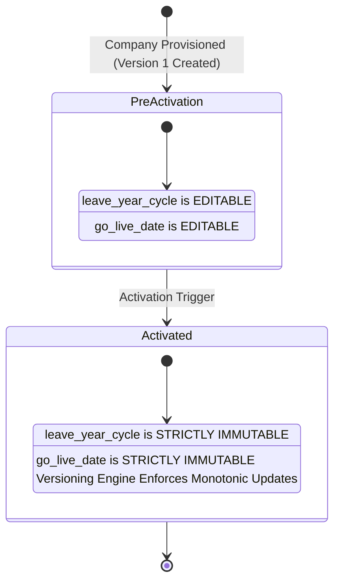

# BEZENT HRMS Leave Module — General Settings V1 Specification

> **Document Canonical Identifier:** `BEZENT_HRMS_LEAVE_GENERAL_SETTINGS_V1_SPEC.md`  
> **Document Lifecycle Status:** `PENDING_PRODUCT_OWNER_APPROVAL`  
> **Document Version:** `2.1.0-CANONICAL-SPEC`  
> **Effective Baseline:** Commit `47c667c` on branch `feat/auto-provision-employee-user-access`  
> **Reference Safety Archive:** Commit `d571700` on branch `backup/leave-module-pre-cleanup`  
> **Target Engineering Scope:** `apps/web/src/applications/hrms/settings/leave` & `apps/api/src/applications/hrms/leave`  
> **Governance:** Subservient to `AGENTS.md` and repository architectural decision records (ADR-001 through ADR-018).

---

## 1. Document Governance and Status

### 1.1 Purpose

This document establishes the authoritative, binding, implementation-ready functional specification and technical contract for **Tab 1: General Settings V1** of the BEZENT HRMS Leave Module. It specifies company-level governance rules, configuration schemas, date arithmetic, deterministic balance calculations, versioning models, cross-domain integration contracts (ESS, Leave Operations, Attendance, Payroll), security boundaries, and testable acceptance criteria.

### 1.2 Lifecycle State & Change Control

- **Status:** `PENDING_PRODUCT_OWNER_APPROVAL`
- **Implementation Phase:** **Requirements Finalization Only.**
- **Change Control Boundary:** No application source code, frontend components, backend services, database schemas, Drizzle migrations, API endpoints, tests, or seed data may be created or modified until this specification receives explicit Product Owner sign-off.
- **Review Mandate:** This document is self-contained. It reconciles all prior review drafts and supersedes earlier working notes.

---

## 2. Product Scope and Exclusions

### 2.1 In Scope for General Settings V1

1. **Operational Calendar Boundaries:** Defining company-wide leave year cycle parameters (`leave_year_cycle`, `custom_year_start_date`).
2. **System Authority Boundary:** Anchoring live company cut-over (`go_live_date`).
3. **Schedule Day Deductions:** Establishing company baseline working-day deduction rules (`day_counting_method`).
4. **Precision & Rounding:** Configuring UI display precision (`balance_precision`) and pro-rata accrual mathematical rounding rules (`balance_rounding_rule`).
5. **Submission Boundary Windows:** Enforcing standard submission windows (`max_backdated_days`, `max_advance_booking_days`).
6. **Versioning & Audit Engine:** Governing immutable snapshot versioning, change justification, submission-time version resolution, monotonic chronological scheduling, and sealed calculation snapshots.

### 2.2 Explicit Exclusions (Deferred or Allocated to Other Tabs)

1. **Hour-Based Leave:** Excluded from V1. All leaves in V1 are accounted for in **days** (`0.5` half-day or `1.0` full-day increments).
2. **Leave Types & Quotas:** Allocated strictly to the **Leave Types** tab (Annual, Sick, Casual, Maternity, Unpaid quotas, paid/unpaid status, color tokens).
3. **Eligibility Rules:** Allocated strictly to the **Leave Policies** tab (probation rules, grade/department assignments).
4. **Accrual Engine & Carry-Forward Policies:** Allocated strictly to the **Accrual & Carry Forward** tab (monthly/quarterly accrual formulas, maximum carryover caps, encashment).
5. **Approval Routing:** Allocated strictly to the **Approval Workflow** tab (approval tiers, SLA escalation, multi-stage routing).
6. **Restrictions & Sandwich Rules:** Allocated strictly to the **Restrictions** tab (sandwich rules, clubbing rules, minimum gap between leaves).
7. **Holiday Calendars:** Allocated strictly to the **Holidays** tab (location-specific declared holidays and optional/floating holidays).
8. **Editable Status Badges:** Status codes and color tokens are immutable Design System constants; not editable via General Settings.
9. **Cross-Year Applications:** Deferred. Requests crossing leave-year boundaries are rejected; employees must submit separate requests for each leave year.
10. **Location-Specific Overrides:** V1 enforces a single company-wide leave year cycle. Location/subsidiary overrides are deferred to V2.
11. **Multi-Day Half-Day Requests:** Deferred. Half-day leave in V1 is strictly supported for single-date requests only (`startDate === endDate`).
12. **Advance-Booking Bypass:** In V1, no user (including HR Administrators) may bypass `max_advance_booking_days`.

---

## 3. Confirmed Product Owner Decisions

The following thirteen architectural decisions are finalized and binding:

- **PO Decision #1 (Leave-Year Scope):** One company-wide leave-year configuration. Location-specific overrides are excluded from V1.
- **PO Decision #2 (Leave-Year Cycle Changes):** In V1, block changes to the leave-year cycle after initial company activation. A future controlled transition workflow requires a separate approved specification.
- **PO Decision #3 (Cross-Year Requests):** Reject requests spanning leave-year boundaries. Employees must submit separate requests for each leave year. Do not automatically split requests.
- **PO Decision #4 (Payroll-Locked Backdated Leave):** Block employee ESS submissions for payroll-locked periods. Authorized HR exceptions require explicit permissions, audit logging, and a defined Prior Period Adjustment (PPA) procedure without rewriting closed payroll or locked attendance.
- **PO Decision #5 (HR Backdated Override Cap):** Maximum 90 calendar days before the current company-local date. Requests beyond this cap are rejected, even with override permissions.
- **PO Decision #6 (Settings Versioning):** Use versioned settings with effective dates and change reasons. Historical requests retain their original calculated duration and deductions when settings change.
- **PO Decision #7 (Calculation Snapshot Immutability):** Preserve full calculation snapshots on requests upon submission. Approval does not recalculate; later HR adjustments create distinct adjustment records without overwriting original snapshots.
- **PO Decision #8 (Half-Day Sessions):** Capture `first_half` or `second_half` for half-day requests, aligned with the employee's applicable work schedule.
- **PO Decision #9 (Single-Date Half-Day Scope):** V1 supports half-day requests for a single date only (`startDate === endDate`). Multi-day requests with partial first or last days are deferred.
- **PO Decision #10 (Leave Unit):** Days only in V1. Hour-based leave is excluded.
- **PO Decision #11 (Accrual Rounding):** Use a fixed 0.5-day increment. `nearest` is the default, with half-up tie-breaking (`1.25 -> 1.50`, `1.75 -> 2.00`).
- **PO Decision #12 (Pending Reservation):** Pending leave always reserves available balance in V1. This behavior is fixed and is not configurable in General Settings.
- **PO Decision #13 (Deterministic Arithmetic):** Use fixed-point decimal or integer half-day arithmetic for balance calculations. IEEE 754 floating-point arithmetic is prohibited for authoritative ledgers.

---

## 4. Existing Repository Baseline and Verification Findings

Every technical finding below has been directly verified against current source on branch `feat/auto-provision-employee-user-access` (commit `47c667c`):

| Component / Artifact          | Verification Status          | Source Reference                              | Technical Finding & Architecture Baseline                                                                                                                                                                                    |
| :---------------------------- | :--------------------------- | :-------------------------------------------- | :--------------------------------------------------------------------------------------------------------------------------------------------------------------------------------------------------------------------------- |
| **`employee_leave_balances`** | **Verified**                 | `apps/api/src/db/schema.ts:3040`              | Existing columns: `tenantId`, `companyId`, `employeeId`, `leaveType`, `totalDays` (int), `usedDays` (int), `pendingDays` (int), `year` (int). Compound unique index on `(tenantId, companyId, employeeId, leaveType, year)`. |
| **`employee_leave_requests`** | **Verified**                 | `apps/api/src/db/schema.ts:3078`              | Existing columns: `leaveType`, `startDate`, `endDate`, `totalDays` (int), `status` (`pending`, `approved`, `rejected`, `cancelled`).                                                                                         |
| **Pending Reservation**       | **Verified**                 | `leave.service.ts:140`                        | In-service reservation logic executes: `pendingDays = pendingDays + totalDays` upon submission. `cancelLeave` executes `GREATEST(0, pendingDays - totalDays)`.                                                               |
| **Overlap Detection**         | **Verified**                 | `leave.service.ts:68`                         | Queries existing requests where `status IN ('pending', 'approved')` and date spans overlap; aborts with `ConflictError (409)`.                                                                                               |
| **Attendance `on_leave`**     | **Verified**                 | `apps/api/src/db/schema.ts:1966`              | Table `employee_attendance` enum contains `['present', 'absent', 'half_day', 'on_leave', 'holiday', 'incomplete']`. Does NOT contain `half_day_leave`.                                                                       |
| **Attendance Period Locks**   | **Verified**                 | `apps/api/src/db/schema.ts:2927`              | Table `attendance_periods` contains `period_code`, `status` (`open`, `locked`, `finalized`).                                                                                                                                 |
| **Core RBAC Permissions**     | **Verified**                 | `accessCatalog.ts:365, 447`                   | Catalog contains `hrms.leave.view`, `hrms.leave.approve`, `ess.leave.view`, `ess.leave.apply`, `hrms.settings.view`, `hrms.settings.manage`.                                                                                 |
| **Design System Components**  | **Verified**                 | `apps/web/src/design-system/components/`      | All primitives exist (`Card`, `Stack`, `Grid`, `Table`, `Select`, `Input`, `Button`, `Modal`, `Tabs`, `Badge`, `Alert`).                                                                                                     |
| **Zero Application CSS Rule** | **Verified**                 | `AGENTS.md` (Article 7) & ADR-011             | Strict repository invariant: zero `.css` files in `applications/hrms`, zero inline `style={{}}`.                                                                                                                             |
| **General Settings Schema**   | **Proposed (Unimplemented)** | N/A                                           | No `leave_general_settings` or `leave_general_settings_versions` table exists on HEAD.                                                                                                                                       |
| **Decimal & Session Schema**  | **Proposed (Unimplemented)** | `schema.ts:3052, 3092`                        | Existing balance and request days are typed as `int`. Requires Drizzle migration to `decimal(6,2)`, `decimal(5,2)`, and `session` enum.                                                                                      |
| **Settings Permissions**      | **Proposed**                 | N/A                                           | Permissions `hrms.leave.settings.*`, `apply_on_behalf`, `backdated_override`, `payroll_override` do not exist in current catalog.                                                                                            |
| **Prior Period Adjustments**  | **Proposed (Unimplemented)** | N/A                                           | PPA handover queue and tables do not exist in current API source.                                                                                                                                                            |
| **Settings Version Engine**   | **Proposed Reference**       | `backup/leave-module-pre-cleanup` (`d571700`) | Draft versioning table exists in backup branch archive; not present on active HEAD.                                                                                                                                          |

---

## 5. Eight-Setting Catalog and Defaults

```
┌──────────────────────────────────────────────────────────────────────────────────┐
│                             GENERAL SETTINGS V1 CATALOG                          │
├──────────────────────────┬──────────────────────────┬────────────────────────────┤
│ 1. leave_year_cycle      │ 2. custom_year_start_date│ 3. go_live_date            │
├──────────────────────────┼──────────────────────────┼────────────────────────────┤
│ 4. day_counting_method   │ 5. balance_precision     │ 6. balance_rounding_rule   │
├──────────────────────────┼──────────────────────────┼────────────────────────────┤
│ 7. max_backdated_days    │ 8. max_advance_booking_days                           │
└──────────────────────────┴───────────────────────────────────────────────────────┘
```

### 5.1 `leave_year_cycle`

- **Setting Key:** `leave_year_cycle`
- **Business Purpose:** Establishes the company-wide 12-month calendar cycle for leave entitlements, annual accruals, and carry-forward reset execution.
- **Data Type & Allowed Values:** String enum:
  - `calendar_year`: January 1 to December 31.
  - `financial_year`: April 1 to March 31.
  - `custom`: User-specified fixed month/day cycle.
- **Recommended V1 Default:** `calendar_year`
- **UI Control:** `Select` dropdown.
- **Required / Optional:** Mandatory.
- **Dependencies:** None.
- **Activation Immutability (PO Decision #2):** Once a company reaches activation, `leave_year_cycle` is **strictly locked against modification**. Modifying it post-activation displays: `"Leave year cycle cannot be altered after company activation in V1. Transition workflows require a separate approved procedure."`
- **Downstream Impact:** Drives annual balance quota displays, used/remaining progress bars, and reset countdown banners on ESS dashboards. Anchors workforce balance rollups and audit reporting periods.
- **Backend Persistence Requirement:** Stored in settings table / version JSON payload.

### 5.2 `custom_year_start_date`

- **Setting Key:** `custom_year_start_date`
- **Business Purpose:** Defines the specific calendar month and day when a custom annual leave cycle begins.
- **Data Type & Allowed Values:** String in `MM-DD` format (e.g. `07-01` for July 1).
- **Recommended V1 Default:** `null` (disabled when `leave_year_cycle !== 'custom'`).
- **UI Control:** Single Input / Sub-select (`Month` + `Day`).
- **Required / Optional:** Conditional. Mandatory if `leave_year_cycle === 'custom'`; otherwise hidden/disabled and stored as `null`.
- **Validation & Error Handling:**
  - Must satisfy `MM-DD` syntax: `^(0[1-9]|1[0-2])-(0[1-9]|[12][0-9]|3[01])$`.
  - Calendar-day validity: Must reject impossible dates (`04-31`, `06-31`, `09-31`, `11-31`, `02-30`, `02-31`).
  - Leap day `02-29` is disallowed; error: `"Leap day (Feb 29) cannot be used as an annual cycle start. Please select March 1."` (Enforced to ensure annual calendar integrity, as Feb 29 does not exist in non-leap years).
- **Downstream Impact:** Shifts annual balance period start to the specified month/day. Automated annual rollover jobs trigger on this day.
- **Backend Persistence Requirement:** Stored in settings table / version JSON payload.

### 5.3 `go_live_date`

- **Setting Key:** `go_live_date`
- **Business Purpose:** Declares the official cut-over date when BEZENT Leave becomes authoritative for the company. Historical transactions before this date belong to legacy imports.
- **Data Type & Allowed Values:** ISO Date string (`YYYY-MM-DD`).
- **Recommended V1 Default:** Company provisioning / creation date.
- **UI Control:** Date picker (`Input[type="date"]`).
- **Required / Optional:** Mandatory.
- **Activation Immutability:**
  - _Pre-Activation:_ Editable during setup by administrators with `hrms.leave.settings.manage`.
  - _Post-Activation:_ Once activated (see Section 6.1), `go_live_date` becomes **strictly immutable**. Tenant Super Admin elevation cannot silently bypass this rule via API; modifying an active cut-over date invalidates already-posted balance ledgers and historical audits. Rare corporate database corrections require an offline, auditable system migration, not an API-level runtime edit.
- **Downstream Impact:** ESS date picker restricts selection: $\text{startDate} \ge \text{go\_live\_date}$. Attendance engine suppresses `on_leave` calculation for dates prior to `go_live_date`.
- **Backend Persistence Requirement:** Stored in settings table / version JSON payload.

### 5.4 `day_counting_method`

- **Setting Key:** `day_counting_method`
- **Business Purpose:** Standard baseline method for calculating total leave duration across a requested date range.
- **Data Type & Allowed Values:** String enum:
  - `working_days`: Excludes scheduled weekly offs and declared public holidays falling within the date range.
  - `calendar_days`: Counts every calendar day in the range, regardless of weekends or holidays.
- **Recommended V1 Default:** `working_days`
- **UI Control:** `Select` dropdown.
- **Required / Optional:** Mandatory.
- **Effective-Date Resolution Rule (Submission-Time Invariant):**
  - Evaluated using the **authoritative server-side submission timestamp** of the request in UTC.
  - Applies to all requests _submitted_ on or after the settings version's `effectiveFrom` timestamp.
  - Future-dated leave requests submitted today evaluate under today's active settings version.
  - Historical requests permanently preserve their original calculated days in their sealed calculation snapshot.
- **Downstream Impact:** ESS dynamically calculates deductible days. Prevents deducting balances on days where an employee was already scheduled for a weekly-off or holiday.
- **Backend Persistence Requirement:** Stored in settings table / version JSON payload.

### 5.5 `balance_precision`

- **Setting Key:** `balance_precision`
- **Business Purpose:** Standard decimal precision used strictly when displaying leave balances, quotas, and ledger transactions on user interfaces.
- **Data Type & Allowed Values:** String enum:
  - `whole_numbers`: Formatted with 0 decimal places if exact integer.
  - `half`: Formatted with up to 1 decimal place (`12.5`).
  - `two_decimals`: Formatted with 2 decimal places (`12.50`).
- **Recommended V1 Default:** `two_decimals`
- **UI Control:** `Select` dropdown.
- **Required / Optional:** Mandatory.
- **Lossless Display Behavior:**
  - `whole_numbers` suppresses trailing zeroes for integer balances (e.g. `14.00` renders as `"14"`).
  - **Critical Lossless Invariant:** If an employee possesses a non-zero fractional balance (e.g. `14.50`), `whole_numbers` **must not truncate or falsely round** the balance to `"14"` or `"15"`. The UI must losslessly render the fractional value (`"14.5"`). Formatting is strictly a presentation transformation, distinct from rounding the underlying entitlement.
- **Downstream Impact:** Formats balance cards and ledger statements in ESS without altering the underlying raw numeric balance. Standardizes administrative balance tables and reports.
- **Backend Persistence Requirement:** Stored in settings table / version JSON payload.

### 5.6 `balance_rounding_rule`

- **Setting Key:** `balance_rounding_rule`
- **Business Purpose:** Mathematical rule applied during periodic pro-rata accrual calculations when fractional entitlements are generated.
- **Data Type & Allowed Values:** String enum:
  - `nearest`: Rounds to the nearest calculation increment (`0.5` days in V1; PO Decision #11).
  - `round_up`: Always rounds fractional balances up to the next `0.5` increment.
  - `round_down`: Always rounds fractional balances down (truncates to previous `0.5` increment).
- **Recommended V1 Default:** `nearest`
- **UI Control:** `Select` dropdown.
- **Required / Optional:** Mandatory.
- **Downstream Impact:** Eliminates recurring decimal discrepancies (e.g. `1.6667` becomes `1.50`). Guarantees deterministic accrual batch results during automated payroll cut-off jobs. Applies strictly to future accrual executions evaluated on or after `effectiveFrom`.
- **Backend Persistence Requirement:** Stored in settings table / version JSON payload.

### 5.7 `max_backdated_days`

- **Setting Key:** `max_backdated_days`
- **Business Purpose:** Maximum number of calendar days in the past from the current company-local date for which an employee can start a retrospective leave request.
- **Data Type & Allowed Values:** Integer between `0` and `90`.
- **Recommended V1 Default:** `7` days.
- **UI Control:** `NumberInput` (Min: `0`, Max: `90`).
- **Required / Optional:** Mandatory. Setting to `0` completely prohibits employee backdated submissions.
- **Boundary Semantics:** Governs the request's **`startDate`**. Inclusive boundary: $\text{minStartDate} = \text{today} - \text{max\_backdated\_days}$ in company operating timezone.
- **Downstream Impact:** Date picker enforces inclusive boundary. Earlier start dates are disabled. Evaluated independently from the 90-day HR override cap (see Section 9). Replaces past attendance exceptions with `on_leave` or `half_day_leave` status once approved.
- **Backend Persistence Requirement:** Stored in settings table / version JSON payload.

### 5.8 `max_advance_booking_days`

- **Setting Key:** `max_advance_booking_days`
- **Business Purpose:** Maximum number of calendar days into the future from the current company-local date to which an employee can extend a future leave request.
- **Data Type & Allowed Values:** Integer between `1` and `365`.
- **Recommended V1 Default:** `180` days (approx. 6 months).
- **UI Control:** `NumberInput` (Min: `1`, Max: `365`).
- **Required / Optional:** Mandatory.
- **Boundary Semantics:** Governs the request's **`endDate`**. Inclusive boundary: $\text{maxEndDate} = \text{today} + \text{max\_advance\_booking\_days}$ in company operating timezone.
- **Universal Enforceability:** In V1, no user (including HR Administrators) may bypass `max_advance_booking_days`.
- **Downstream Impact:** Date picker enforces inclusive boundary. Later end dates are disabled. Prevents speculative, distant leave applications that tie up team capacity planning.
- **Backend Persistence Requirement:** Stored in settings table / version JSON payload.

---

## 6. Mandatory Technical Reconciliation & Architecture Contracts

### 6.1 Company Activation and Immutability Lifecycle Contract

To ensure enterprise integrity and prevent conflicting states across the codebase, General Settings enforces a single deterministic activation contract:



1. **Initial Provisioning (Version 1):**
   - When a company is provisioned, Settings Version 1 (`versionNumber = 1`) is created automatically.
   - `effectiveFrom` is set to the company creation UTC timestamp.
   - `go_live_date` defaults to the company creation date (or an administrator-selected future date).
   - Status is initialized to `pre_activation`.
2. **Pre-Activation Editing Rules:**
   - An administrator with `hrms.leave.settings.manage` may modify `leave_year_cycle`, `custom_year_start_date`, and `go_live_date` freely prior to activation.
   - If `go_live_date` is future-dated, it may be revised forwards or backwards (provided it remains $\ge \text{today}$).
3. **The Activation Cut-Over Trigger:**
   A company transitions irreversibly from `pre_activation` to `activated` at the **earliest** occurrence of any of the following three events:
   - **Trigger A (Wall-Clock Arrival):** The arrival of `00:00:00` on `go_live_date` in the company's operating timezone (`company.timezone`).
   - **Trigger B (Opening Balance Posting):** The creation of the first live opening balance record in `employee_leave_balances` for any employee in that company.
   - **Trigger C (First Request Submission):** The submission of the first live employee leave request in `employee_leave_requests`.
4. **Post-Activation Invariants:**
   - Once activated, `leave_year_cycle` and `go_live_date` become **strictly immutable via UI and API**.
   - Any API payload attempting to modify either value returns `422 Unprocessable Entity`: `"Leave year cycle and go-live date cannot be modified after company activation in V1. Transition workflows require a separate approved procedure."`
   - Tenant Super Admin elevation cannot bypass this runtime constraint.
   - Emergency corporate database corrections require an audited, offline migration script; never an online API update.

---

### 6.2 Date Semantics, Timezones, and Calendar Arithmetic

To eliminate timezone drift, midnight boundary bugs, and DST anomalies:

1. **Company-Local Calendar Dates:**
   - Leave request `startDate` and `endDate` are stored as `varchar(10)` strings in `YYYY-MM-DD` format.
   - They represent **inclusive calendar dates** in the company's operating timezone (`company.timezone`).
   - Example: A request with `startDate = '2026-11-10'` and `endDate = '2026-11-12'` covers November 10, 11, and 12 inclusively.
2. **Half-Open Intervals for Cycle Boundaries:**
   - Leave year cycles are evaluated as half-open calendar intervals:
     $$[\text{periodStartDate } 00:00:00, \text{nextPeriodStartDate } 00:00:00)$$
     evaluated in `company.timezone`. Second-based boundaries (`23:59:59`) are prohibited.
3. **UTC Timestamps for Settings Versioning:**
   - Settings `effectiveFrom` timestamps are stored and compared strictly as **UTC instants** (`timestamp` in MySQL / ISO-8601 UTC string `YYYY-MM-DDTHH:mm:ss.sssZ`).
   - The server's authoritative UTC timestamp at request submission time ($T_{\text{submit}}$) determines the applicable settings version:
     $$\text{ActiveVersion} = \max(V.\text{versionNumber}) \quad \text{where} \quad V.\text{effectiveFrom} \le T_{\text{submit}}$$
   - If $T_{\text{submit}} === V.\text{effectiveFrom}$, the condition $\le$ holds true; Version $V$ becomes active at that exact millisecond.
4. **Daylight Saving Time (DST) Handling:**
   - Date arithmetic must use IANA timezone identifiers (e.g., `'America/New_York'`, `'Asia/Kolkata'`) via a robust date-time library (such as Luxon or date-fns-tz).
   - Day stepping across date ranges ($\text{date} + 1 \text{ day}$) must perform **calendar-day stepping**, NOT fixed 24-hour millisecond additions ($+86,400,000 \text{ ms}$). This prevents 23-hour or 25-hour DST transition days from causing date slippage.
5. **Calendar-Day Operational Window Limits:**
   - `max_backdated_days` and `max_advance_booking_days` are calculated using calendar date offsets from `today` in `company.timezone`:
     - $\text{minStartDate} = \text{today} - \text{max\_backdated\_days}$ (inclusive).
     - $\text{absoluteMinStartDate} = \text{today} - 90 \text{ calendar days}$ (inclusive HR override cap).
     - $\text{maxEndDate} = \text{today} + \text{max\_advance\_booking\_days}$ (inclusive universal cap).

---

### 6.3 Leave-Year Boundaries and Cycle Labeling

Deterministic algorithms for leave year cycles:

1. **Calendar Year:**
   - Span: `[YYYY-01-01 00:00:00, (YYYY+1)-01-01 00:00:00)` in `company.timezone`.
   - Canonical Label: `YYYY` (e.g., `2026`).
2. **Financial Year:**
   - Span: `[YYYY-04-01 00:00:00, (YYYY+1)-04-01 00:00:00)` in `company.timezone`.
   - Canonical Label: `FY YYYY-(YY+1)` (e.g., `FY 2026-27`).
   - Membership: Dates in Jan–Mar 2027 belong to `FY 2026-27`. Dates in Apr–Dec 2027 belong to `FY 2027-28`.
3. **Custom Cycle:**
   - Span: Defined by `custom_year_start_date` (`MM-DD`). For start date `07-01`, cycle for year `YYYY` is `[YYYY-07-01 00:00:00, (YYYY+1)-07-01 00:00:00)`.
   - Canonical Label: `Cycle YYYY-(YY+1)` (e.g., `Cycle 2026-27`).
4. **Leap Year and February 29 Rule:**
   - `custom_year_start_date = '02-29'` is strictly prohibited. Error: `"Leap day (Feb 29) cannot be used as an annual cycle start. Please select March 1."`
   - Reason: Non-leap years do not contain February 29; an annual cycle starting on Feb 29 would lack a valid calendar start date in 3 out of every 4 years.
   - If a custom cycle spans across February (e.g., `11-01` to `11-01`), leap years naturally encompass 366 calendar days while non-leap years encompass 365 calendar days without date shifting.
5. **Cross-Year Request Rejection (PO Decision #3):**
   - If a requested date range crosses a cycle boundary ($\text{cycle}(\text{startDate}) \ne \text{cycle}(\text{endDate})$), the request is rejected immediately:
     `"Requests cannot span across leave year boundaries. Please submit separate requests for cycle {priorCycleLabel} and cycle {nextCycleLabel}."`
   - Requests are never automatically split by the system.

---

### 6.4 Working-Day and Calendar-Day Calculation Engine

1. **Working Days Formula:**
   $$\text{Deductible Days} = \sum_{d \in [\text{startDate}, \text{endDate}]} \text{isWorkingDay}(d, \text{employeeId})$$
   Where $\text{isWorkingDay}(d, \text{employeeId}) = 1$ if and only if:
   - Day $d$ is not a scheduled Weekly Off in the employee's active shift roster; **AND**
   - Day $d$ is not a declared Public Holiday in the employee's assigned location holiday calendar.
2. **Authoritative Schedule Sources & Fail-Safe Missing Data Behavior:**
   - Shift assignment is queried for each date $d$ from the employee's assigned shift roster. Mid-range transfers evaluate date-by-date.
   - Location holiday calendar is queried for the employee's assigned work location.
   - **Fail-Safe Block:** If shift roster or holiday calendar data is missing, unpublished, contradictory, or inaccessible for any date in range, submission is **strictly blocked with a validation error**:
     `"Unable to calculate leave duration: Missing shift schedule or holiday calendar for date {date}. Please contact HR Administration."`
     Silent fallback to generic Monday–Friday schedules is strictly prohibited.
3. **Overlapping Weekly-Off and Holiday Recording:**
   - When a public holiday falls on a scheduled weekly off, it is recorded in `scheduleBreakdown.exclusionReasons` as `['weekly_off', 'holiday']`.
   - Neither day is charged, and the audit log records both reasons without precedence ambiguity.
4. **Zero-Charge Working-Day Ranges:**
   - If a date range contains zero working days under `working_days` (e.g., applying across Saturday and Sunday only), `calculatedDurationDays = 0.0`.
   - The submission is rejected: `"Selected date range contains 0 working days. No leave balance can be deducted."`
   - Zero-day leave records are not created.
5. **Half-Day Deductions on Non-Working Days:**
   - _Under `working_days`:_ Applying for half-day leave on a weekly off or holiday is rejected: `"Cannot apply for leave on a non-working day (Weekly Off or Public Holiday) when working-day counting is active."`
   - _Under `calendar_days`:_ Calendar counting charges all days. Applying for half-day leave on a weekend or holiday deducts exactly `0.5` days from the leave balance.
   - **Critical Invariant:** Deducting `0.5` days on a non-working day under `calendar_days` **must not create attendance punch expectations or false absence exceptions**, because the employee has no scheduled shift on that date.
6. **Half-Day Request Scope & Session Validation:**
   - Half-day leave is supported for **single-date requests only** (`startDate === endDate`).
   - Requires mandatory `session` selection: `'first_half'` or `'second_half'`. Full-day requests store `session = null`.

---

### 6.5 Attendance Half-Day Behavior & Punch Validation

1. **Excused Half vs Working Half:**
   For an employee assigned to a standard shift (e.g., 09:00–18:00 with shift midpoint at 13:00 / 13:30 defined by the shift schedule):
   - **`first_half` Leave:** The first half of the shift is excused. The employee is expected to punch in and work the second half.
     - Punches are validated against the second-half shift start (e.g., 13:00).
     - Late In exceptions are suppressed for morning punches and evaluate relative to the second-half start.
     - Failure to punch in for the second half generates a partial absence exception.
   - **`second_half` Leave:** The second half of the shift is excused. The employee is expected to punch in and work the first half.
     - Punches are validated against the first-half shift start (09:00) and first-half shift end (e.g., 13:00).
     - Early Exit exceptions are suppressed for afternoon departures at or after first-half shift end.
     - Failure to punch in for the first half generates a partial absence exception.
2. **Schedule Midpoint Convention:**
   - Shift halves and midpoints are determined strictly by the shift definition in `shift_schedules` (e.g. scheduled break time or half-duration). Arbitrary punch tolerances or grace periods not defined in the repository are prohibited.
3. **Attendance Status Contract:**
   - _Full-Day Leave:_ Approved full-day leave sets attendance status to `on_leave` (`employee_attendance.status = 'on_leave'`).
   - _Half-Day Leave:_ In the current schema, `employee_attendance.status` contains `['present', 'absent', 'half_day', 'on_leave', 'holiday', 'incomplete']`. Using `half_day_leave` is a **proposed integration requirement**. Until coordinated with the Attendance domain, half-day leaves will record `status = 'half_day'` and persist `{ leaveSession: 'first_half' | 'second_half', leaveRequestId: '...' }` in `calculation_metadata`.

---

### 6.6 Deterministic Decimal Representation & Arithmetic

1. **Prohibition of IEEE 754 Floating-Point Arithmetic:**
   Authoritative balances, ledgers, and deductions must never be calculated using native JavaScript IEEE 754 floating-point arithmetic.
2. **Fixed-Point Calculation Engine:**
   - Application calculations must use fixed-point arithmetic (e.g., integer half-day units $\times 2$, or dedicated arbitrary-precision library scaled to at least 4 decimal places for accruals).
3. **Database Types & Capacity (Proposed vs Verified):**
   - _Verified Current Schema:_ `employee_leave_balances.total_days`, `used_days`, `pending_days` and `employee_leave_requests.total_days` are stored as `int` on HEAD (`schema.ts:3052, 3092`).
   - _Proposed Migration:_
     - `employee_leave_balances`: `decimal(6,2)` (Capacity: `-9999.99` to `+9999.99`, max half-day `9999.50`).
     - `employee_leave_requests`: `decimal(5,2)` (Capacity: `-999.99` to `+999.99`, max half-day `999.50`).
   - Drizzle maps MySQL `decimal` to TypeScript `string`. Application services must parse strings into fixed-point representations, execute arithmetic, and serialize back to strings for Drizzle persistence.
4. **Accrual Rounding Rules (PO Decision #11):**
   - Operates on pro-rata fractional accruals using fixed `0.5-day` increments:
     - `nearest`: Rounds to closest `0.5` increment with **half-up tie-breaking** ($1.25 \to 1.50$, $1.75 \to 2.00$).
     - `round_up`: Rounds any non-zero fractional remainder up to the next `0.5` increment ($1.10 \to 1.50$).
     - `round_down`: Truncates fractional remainder down to preceding `0.5` increment ($1.40 \to 1.00$).
5. **Display Precision vs Stored Balances:**
   - `balance_precision` controls UI formatting only; it never modifies stored numbers.
   - `whole_numbers` suppresses decimals for exact integers (`14.00 -> "14"`), but renders non-zero fractions losslessly (`14.50 -> "14.5"`).

---

### 6.7 Balance Reservation and Ledger Integrity (PO Decision #12)

1. **Authoritative Available Balance Formula:**
   $$\text{Available Balance} = \text{Total Entitlement} - \text{Used Days} - \text{Pending Reserved}$$
   Where $\text{Total Entitlement} = \text{Opening Balance} + \text{Accrued} + \text{Adjustments}$.
2. **Transaction-Safe Reservation Lifecycle:**
   - **Submission (Reservation):** Atomically reserves balance within a transaction:
     ```sql
     UPDATE employee_leave_balances
     SET pending_days = pending_days + :requestedDays
     WHERE tenant_id = :tenantId
       AND company_id = :companyId
       AND employee_id = :employeeId
       AND leave_type = :leaveType
       AND year = :year
       AND (total_days - used_days - pending_days) >= :requestedDays;
     ```
     If zero rows are affected, transaction aborts with `409 Conflict: Insufficient available leave balance`.
   - **Approval (Consumption):** Pending reservation is transferred to used days atomically:
     ```sql
     UPDATE employee_leave_balances
     SET pending_days = pending_days - :requestedDays,
         used_days = used_days + :requestedDays
     WHERE tenant_id = :tenantId
       AND company_id = :companyId
       AND employee_id = :employeeId
       AND leave_type = :leaveType
       AND year = :year;
     ```
     This prevents double-decrementing reservations or double-counting used leave.
   - **Rejection / Cancellation (Release):**
     ```sql
     UPDATE employee_leave_balances
     SET pending_days = GREATEST(0.00, pending_days - :requestedDays)
     WHERE tenant_id = :tenantId
       AND company_id = :companyId
       AND employee_id = :employeeId
       AND leave_type = :leaveType
       AND year = :year;
     ```
3. **Ledger Immutability:** Historical requests and calculation snapshots are sealed upon creation. Adjustments create distinct `leave_adjustment` ledger records without altering past snapshots.

---

### 6.8 Settings Versioning and Monotonic Scheduling Engine

1. **Complete Snapshot Storage:**
   Every published settings version stores a complete snapshot of all eight settings in `leave_general_settings_versions`, along with `versionNumber`, `effectiveFrom` (UTC), `changeReason` (min 10 chars), `createdByUserId`, and `createdAt`.
2. **Version Resolution Algorithm:**
   For any request submitted at UTC instant $T_{\text{submit}}$:
   $$\text{ActiveVersion} = \arg\max_{V} \{ V.\text{versionNumber} \mid V.\text{effectiveFrom} \le T_{\text{submit}} \text{ and } V.\text{tenantId} = :tenantId \text{ and } V.\text{companyId} = :companyId \}$$
3. **Latest Published vs Active Version:**
   - `latestPublishedVersion`: The version with the highest `versionNumber` in `(tenantId, companyId)`. This may be a scheduled future version if $V.\text{effectiveFrom} > \text{now}()$.
   - `activeVersion`: The latest published version whose $V.\text{effectiveFrom} \le \text{now}()$.
4. **Monotonic Scheduling Invariants:**
   - `versionNumber` increments strictly sequentially ($1, 2, 3 \dots$).
   - `effectiveFrom` must be strictly greater than the preceding published version's `effectiveFrom` ($V_{N+1}.\text{effectiveFrom} > V_N.\text{effectiveFrom}$).
   - Duplicate effective timestamps are rejected with `409 Conflict`.
   - Published future-effective versions cannot be edited, cancelled, or deleted in V1.
   - Optimistic concurrency is enforced via `expectedCurrentVersionNumber`.

---

### 6.9 Operational Limits, Overrides, and Permissions

1. **Submission Boundary Invariants:**
   - `max_backdated_days`: Configurable $0$ to $90$ calendar days. ESS and HR without override: $\text{startDate} \ge \text{today} - \text{max\_backdated\_days}$.
   - HR Backdated Override: Requires `hrms.leave.backdated_override`. Bypasses `max_backdated_days` up to an **absolute hard cap of 90 calendar days**: $\text{startDate} \ge \text{today} - 90 \text{ calendar days}$. Requests earlier than 90 days are rejected for all roles.
   - `max_advance_booking_days`: Configurable $1$ to $365$ calendar days. Universal enforcement: $\text{endDate} \le \text{today} + \text{max\_advance\_booking\_days}$. **No bypass in V1 for any role.**
   - `go_live_date`: Requests crossing cut-over ($\text{startDate} < \text{go\_live\_date}$) are rejected.
2. **Permission Matrix (Verified vs Proposed):**

| Permission Key                  | Action / Scope                                     | Target Roles              | Status                                        |
| :------------------------------ | :------------------------------------------------- | :------------------------ | :-------------------------------------------- |
| `hrms.leave.view`               | View workforce leave requests and balances         | HR, Managers              | **Verified on HEAD** (`accessCatalog.ts:365`) |
| `hrms.leave.approve`            | Approve or reject leave requests                   | HR, Managers              | **Verified on HEAD** (`accessCatalog.ts:368`) |
| `ess.leave.view`                | View personal leave balances and history           | All Employees             | **Verified on HEAD** (`accessCatalog.ts:447`) |
| `ess.leave.apply`               | Submit personal leave requests                     | All Employees             | **Verified on HEAD** (`accessCatalog.ts:450`) |
| `hrms.settings.view`            | View HR settings overview                          | HR Administrators         | **Verified on HEAD** (`accessCatalog.ts:331`) |
| `hrms.settings.manage`          | Manage HR settings general configuration           | HR Administrators         | **Verified on HEAD** (`accessCatalog.ts:337`) |
| `hrms.leave.settings.view`      | View Leave General Settings and version history    | HR Admins, Auditors       | **Proposed** (Requires catalog entry)         |
| `hrms.leave.settings.manage`    | Update Leave General Settings and publish versions | HR Admins                 | **Proposed** (Requires catalog entry)         |
| `hrms.leave.apply_on_behalf`    | Submit leave on behalf of employees                | HR Executives, HR Admins  | **Proposed** (Requires catalog entry)         |
| `hrms.leave.backdated_override` | Bypass `max_backdated_days` up to 90-day cap       | HR Managers, Super Admins | **Proposed** (Requires catalog entry)         |
| `hrms.leave.payroll_override`   | Submit leave for locked payroll periods            | HR Managers, Super Admins | **Proposed** (Requires catalog entry)         |

3. **On-Behalf Approval Contract:**
   Submitting on behalf of an employee with `hrms.leave.apply_on_behalf` creates a request in `pending` status. It **does not auto-approve** the request; normal manager/HR approval routing applies.

---

### 6.10 Payroll Lock Boundary & Prior Period Adjustments (PPA)

1. **Attendance Cut-Off Lock Enforcement:**
   - An attendance period covering a request's date range has status in `attendance_periods`: `'open'`, `'locked'`, or `'finalized'`.
   - If status is `'locked'` or `'finalized'`:
     - ESS submission is strictly blocked.
     - HR submission without `hrms.leave.payroll_override` is strictly blocked.
     - HR submission with `hrms.leave.payroll_override` is permitted with mandatory audit justification (`overrideReason`, min 20 chars).
2. **Synchronous PPA Record Generation upon Final Approval:**
   - When an authorized payroll-locked override request reaches **final approval**, a Prior Period Adjustment (PPA) record is generated **synchronously**.
   - Closed payroll batches and locked attendance records are **never mutated**.
   - PPA creation executes within the approval database transaction (or via transactional outbox) with idempotency key (`requestId + approvalTimestamp`).
   - Repeated approval calls or retry worker executions cannot create duplicate PPA records.
   - If PPA creation fails, the approval transaction rolls back or flags an observable outbox error.
3. **Payload Contract Status:**
   - The exact JSON/file schema for PPA export to payroll is marked **`REQUIRES_PRODUCT_OWNER_DECISION`** pending Payroll domain design.

---

### 6.11 General Settings UI/UX and Design System Compliance

1. **Zero Application CSS Rule:**
   Composed exclusively using global Design System primitives (`apps/web/src/design-system/components/`). Zero `.css` files and zero inline styles in `applications/hrms/settings/leave`.
2. **Leave Settings Tab Hierarchy:**
   Leave Settings features 7 planned tabs (General Settings, Leave Types, Leave Policies, Accrual & Carry Forward, Approval Workflow, Restrictions, Holidays). In V1, Tab 1 is **General Settings**.
3. **Settings Save Flow:**
   - Form tracks dirty state.
   - Clicking `"Save Settings"` opens the confirmation `Modal`:
     - Displays summary of changed settings.
     - Input for `effectiveFrom` (defaults to current time).
     - Mandatory `changeReason` (min 10 characters).
     - Enforces `expectedCurrentVersionNumber` for concurrency protection.
   - If `effectiveFrom > now()`, UI displays scheduled status badge (`"Scheduled (Effective {date})"`), not "Active immediately".

---

## 7. Acceptance Criteria and QA Matrix

### Scenario 1: Leave Year Boundary & Dynamic Span Rejection (PO Decision #3)

- **Given** a company configured with `leave_year_cycle = 'financial_year'` (Apr 1, 2026 – Mar 31, 2027)
- **When** an employee attempts to submit a request from `2027-03-30` to `2027-04-03` (spanning two leave years)
- **Then** the request is rejected with error: `"Requests cannot span across leave year boundaries. Please submit separate requests for cycle FY 2026-27 and cycle FY 2027-28."`
- **And** the request is not automatically split.

### Scenario 2: Working Days Counting with Holiday and Weekly-Off

- **Given** `day_counting_method = 'working_days'`, an employee working Monday–Friday, and Thursday `2026-11-19` is a declared public holiday
- **When** applying for leave from Wednesday `2026-11-18` to Friday `2026-11-20`
- **Then** `totalDays` evaluates to `2.0` (Wednesday + Friday; Thursday holiday excluded).

### Scenario 3: Accrual Rounding with Half-Up Tie-Breaking (PO Decision #11)

- **Given** `balance_rounding_rule = 'nearest'`, calculation increment `0.5`, and fixed-point calculation precision
- **When** an accrual calculation generates `2.2500` days
- **Then** the half-up tie-breaker rounds to **`2.50` days**.
- **And When** an accrual calculation generates `2.1500` days
- **Then** it rounds to the closest increment: **`2.00` days**.

### Scenario 4: Lossless Whole Numbers Display

- **Given** `balance_precision = 'whole_numbers'`
- **When** an employee has a balance of `14.00` days, it renders as `"14"`.
- **And When** an employee has a balance of `14.50` days
- **Then** it renders as `"14.5"` (lossless display preserved; not truncated or rounded to `"14"` or `"15"`).

### Scenario 5: Single-Date Half-Day Session Selection (PO Decisions #8 & #9)

- **Given** an employee applies for a half-day leave on `2026-11-12`
- **When** the employee selects `session = 'first_half'`
- **Then** the request is accepted with `totalDays = 0.5`.
- **And When** an employee attempts to submit a multi-day half-day request from `2026-11-12` to `2026-11-13`
- **Then** the submission is blocked with: `"Multi-day half-day requests are not supported in V1. Please submit single-date requests for half-days."`.

### Scenario 6: Half-Day Eligibility on Non-Working Day

- **Given** `day_counting_method = 'working_days'`, and Sunday `2026-11-15` is a scheduled Weekly Off
- **When** an employee attempts to apply for a half-day leave on `2026-11-15`
- **Then** the submission is blocked with: `"Cannot apply for leave on a non-working day (Weekly Off or Public Holiday) when working-day counting is active."`.
- **And When** `day_counting_method = 'calendar_days'`, applying on Sunday `2026-11-15` evaluates to `0.5` days deducted without expecting attendance punches.

### Scenario 7: Submission-Time Version Resolution & Future-Dated Leaves

- **Given** active Version 1 (`day_counting_method = 'working_days'`), and Version 2 is scheduled for `2027-01-01 00:00:00 UTC` (`day_counting_method = 'calendar_days'`)
- **When** an employee submits a request on `2026-11-15` for leave dates in February 2027
- **Then** the request evaluates under Version 1 (`working_days`) because submission timestamp is prior to Version 2's effective timestamp.
- **And When** a request is submitted on `2027-01-01 00:00:01 UTC`
- **Then** it evaluates under Version 2 (`calendar_days`).

### Scenario 8: Settings Version Resolution at Submission & Approval Invariance

- **Given** a request is submitted on `2026-11-10` resolving Version 1 with `calculatedDurationDays = 3.0`
- **When** Version 2 activates on `2026-11-12` changing day counting rules
- **And When** the manager approves the request on `2026-11-13`
- **Then** the approved request applies the exact sealed calculation snapshot (`3.0` days) without re-evaluating Version 2.

### Scenario 9: Real-Time Pending Reservation & Over-Booking Prevention (PO Decision #12)

- **Given** an employee has `10.0` available Annual Leave days
- **When** they submit a request for `6.0` days
- **Then** `pendingDays` increments to `6.0` and immediate `Available Balance` drops to `4.0` days.
- **And When** they immediately attempt to submit a second request for `5.0` days
- **Then** the second request is rejected with `409 Conflict: Insufficient available leave balance`.

### Scenario 10: Payroll-Locked Period Hard Block (ESS) (PO Decision #4)

- **Given** attendance period `2026-10` is marked as `locked` in `attendance_periods`
- **When** an employee attempts to submit a backdated sick leave request for `2026-10-28`
- **Then** the request is blocked with error: `"Submission blocked: The attendance period covering 2026-10-28 has been locked for payroll processing. Please contact HR Administration."`.

### Scenario 11: Authorized HR Override on Locked Period with PPA Record

- **Given** attendance period `2026-10` is marked as `locked`
- **When** an HR Administrator with `hrms.leave.apply_on_behalf` and `hrms.leave.payroll_override` submits leave on behalf of the employee with an audit reason
- **And When** the request reaches final approval
- **Then** closed attendance records remain un-mutated, and a Prior Period Adjustment (PPA) record is generated synchronously for the payroll handover queue.
- **And When** the request is rejected or cancelled before final approval
- **Then** no PPA record is created.
- **And When** an approval retry occurs
- **Then** PPA creation is idempotent and zero duplicate records are created.

### Scenario 12: Advance Booking Inclusive Boundary & HR Non-Bypass

- **Given** `max_advance_booking_days = 180` and today is `2026-11-01` in company timezone
- **When** an employee submits leave ending `2027-04-30` (exactly 180 calendar days ahead)
- **Then** the request is accepted.
- **And When** any user (including HR Admin) attempts to submit leave ending `2027-05-01` (181 calendar days ahead)
- **Then** the request is rejected with: `"Leave requests cannot be scheduled more than 180 days in advance."`.

### Scenario 13: Backdated Booking Inclusive Boundary Validation

- **Given** `max_backdated_days = 7` and today is `2026-11-10` in company timezone
- **When** an employee submits leave starting `2026-11-03` (exactly 7 days back)
- **Then** the request is accepted.
- **And When** an employee submits leave starting `2026-11-02` (8 days back)
- **Then** the request is rejected with: `"Leave requests cannot be backdated more than 7 days."`.

### Scenario 14: Absolute 90-Day HR Backdated Override Cap (PO Decision #5)

- **Given** today is `2026-11-10` in company timezone
- **When** an HR Administrator with `hrms.leave.apply_on_behalf` and `hrms.leave.backdated_override` submits leave starting `2026-08-12` (exactly 90 calendar days back)
- **Then** the request is accepted with mandatory audit reason.
- **And When** the HR Administrator attempts to submit leave starting `2026-08-11` (91 calendar days back)
- **Then** the submission is rejected with: `"Requests cannot be backdated beyond the absolute system cap of 90 calendar days."`.

### Scenario 15: Go-Live Boundary and Split Requirement

- **Given** `go_live_date` is `2026-11-01`
- **When** an employee attempts to submit leave from `2026-10-30` to `2026-11-03`
- **Then** the request is rejected with: `"Leave requests cannot cross company go-live date boundary (2026-11-01). Please submit separate requests for pre-go-live legacy adjustments and live leave."`.

### Scenario 16: Post-Activation Go-Live Date Immutability

- **Given** a company has reached `go_live_date` of `2026-11-01` and live requests exist
- **When** any administrator (including Tenant Super Admin) attempts to modify `go_live_date` via the settings API
- **Then** the request is rejected with: `"Go-live date is strictly immutable once company activation is complete."`.

### Scenario 17: Out-of-Order Version Scheduling & Duplicate Timestamp Rejection

- **Given** Version 1 is active, and Version 2 is scheduled for `2027-01-01 00:00:00 UTC`
- **When** an administrator attempts to publish Version 3 with timestamp `2026-12-01 00:00:00 UTC` (out-of-order)
- **Then** the request is rejected with: `"Effective timestamp must be strictly later than the latest scheduled version (2027-01-01 00:00:00 UTC)."`.
- **And When** an administrator attempts to publish Version 3 with duplicate timestamp `2027-01-01 00:00:00 UTC`
- **Then** the request is rejected with `409 Conflict: A settings version with effective timestamp 2027-01-01 00:00:00 already exists`.

### Scenario 18: Invalid Custom Calendar Dates

- **Given** `leave_year_cycle = 'custom'`
- **When** an administrator inputs `custom_year_start_date = '04-31'`
- **Then** save is blocked with: `"Invalid calendar date: 04-31 does not exist."`.
- **And When** an administrator inputs `custom_year_start_date = '02-29'`
- **Then** save is blocked with: `"Leap day (Feb 29) cannot be used as an annual cycle start. Please select March 1."`.

### Scenario 19: Missing Schedule or Holiday Data Failure

- **Given** `day_counting_method = 'working_days'`
- **When** an employee applies for leave on a date where no shift roster is assigned
- **Then** submission is blocked with: `"Unable to calculate leave duration: Missing shift schedule or holiday calendar for date {date}. Please contact HR Administration."`.

### Scenario 20: Half-Day Attendance Punch Validation

- **Given** an employee has approved `first_half` leave for shift 09:00–18:00
- **When** the employee punches in at 13:00 and punches out at 18:00
- **Then** daily attendance status records `half_day` with zero late exceptions.
- **And When** the employee fails to punch in at 13:00
- **Then** attendance records a partial absence exception for the unworked second half.

### Scenario 21: Calendar-Day Half-Day on Weekend Attendance Behavior

- **Given** `day_counting_method = 'calendar_days'`, and an employee applies for half-day leave on Saturday `2026-11-14` (a scheduled Weekly Off with no shift)
- **When** the request is approved
- **Then** `totalDays` evaluates to `0.5` days deducted from balance.
- **And** attendance records an excused half-day credit without expecting shift punches or generating absence exceptions.

### Scenario 22: PPA Creation Failure & Idempotent Retry

- **Given** a payroll-locked override request reaches final approval, but downstream PPA queue dispatch fails
- **When** the system retry worker or administrator retries the approval event
- **Then** the PPA record is created with idempotency key (`requestId + approvalTimestamp`).
- **And** zero duplicate PPA records are created.

### Scenario 23: On-Behalf Submission Requires Normal Approval Flow

- **Given** an HR Administrator with `hrms.leave.apply_on_behalf` submits leave for Employee A
- **When** submission succeeds
- **Then** the request status is `pending` and routes to Employee A's manager.
- **And** the request is not auto-approved.

### Scenario 24: Concurrent Version Publishing Conflict

- **Given** Administrator A and Administrator B both view Version 1 (`currentVersion = 1`)
- **When** Administrator A publishes Version 2 successfully
- **And When** Administrator B attempts to publish changes with `expectedCurrentVersionNumber = 1`
- **Then** Administrator B's save is rejected with `409 Conflict: Settings were modified by another administrator. Please refresh and review latest version.`

---

### Scenario 25: Initial Settings Version 1 and Company Activation Lifecycle

- **Given** a new company is provisioned on `2026-11-01`
- **When** company initialization finishes
- **Then** Settings Version 1 is created with `versionNumber = 1`, `effectiveFrom = 2026-11-01T00:00:00Z`, `go_live_date = '2026-12-01'`, and status `pre_activation`.
- **And When** an HR administrator changes `go_live_date` to `'2026-12-15'` and `leave_year_cycle` to `'financial_year'` before activation
- **Then** the changes are accepted and updated in Version 1.
- **And When** the first live opening balance record is created for an employee
- **Then** the company status becomes `activated`, and both `leave_year_cycle` and `go_live_date` become strictly locked against future edits.

### Scenario 26: Settings Permission Enforcement and Multi-Tenant Isolation

- **Given** User X belongs to Tenant A / Company 1 with permission `hrms.leave.settings.view` only (no manage permission)
- **When** User X attempts to publish an update to General Settings via `POST /api/v1/hrms/leave/settings/general`
- **Then** the request is rejected with `403 Forbidden: Insufficient permissions to manage leave settings`.
- **And When** User Y belonging to Tenant B attempts to fetch settings for Tenant A / Company 1
- **Then** the query explicitly enforces `WHERE tenant_id = 'tenant_b'` and returns `404 Not Found`.

### Scenario 27: Effective Timestamp Equality and UTC Instant Comparison

- **Given** Settings Version 2 has `effectiveFrom = '2027-01-01T00:00:00.000Z'`
- **When** an employee submits a leave request with authoritative server timestamp exactly `2027-01-01T00:00:00.000Z`
- **Then** the version resolution evaluates $V.\text{effectiveFrom} \le T_{\text{submit}}$, resolving Version 2.
- **And When** another request is submitted at `2026-12-31T23:59:59.999Z` (1 ms earlier)
- **Then** it resolves Version 1.

### Scenario 28: Future-Effective Settings Versions vs Latest-Published-Version Semantics

- **Given** Version 1 is currently active, and Version 2 is published with future `effectiveFrom = '2027-01-01T00:00:00Z'`
- **When** the settings management UI loads
- **Then** `latestPublishedVersion` is displayed as Version 2 with a status badge `"Scheduled (Effective 2027-01-01)"`, while `activeVersion` is identified as Version 1.
- **And When** a leave request is submitted on `2026-11-15`
- **Then** it evaluates against active Version 1.

### Scenario 29: Lossless Formatting Across Integer and Non-Integer Balances

- **Given** `balance_precision = 'whole_numbers'`
- **When** an employee views a balance of `18.00` days
- **Then** the UI formats the display as `"18"`.
- **And When** another employee views a balance of `18.50` days
- **Then** the UI formats the display losslessly as `"18.5"`, rather than rounding to `"18"` or `"19"`.
- **And When** `balance_precision = 'two_decimals'`
- **Then** the balances render as `"18.00"` and `"18.50"`.

### Scenario 30: Fail-Safe Handling of Missing or Inaccessible Roster/Holiday Data

- **Given** `day_counting_method = 'working_days'`
- **When** an employee requests leave for dates `2026-11-10` to `2026-11-12`, but no shift roster has been assigned for `2026-11-11`
- **Then** leave calculation aborts immediately with `422 Unprocessable Entity`: `"Unable to calculate leave duration: Missing shift schedule or holiday calendar for date 2026-11-11. Please contact HR Administration."`
- **And** no balance reservation or pending request is created.

### Scenario 31: Concurrent Balance Reservation and Race Condition Prevention

- **Given** an employee has `5.0` days of available Annual Leave
- **When** two requests for `3.0` days each are submitted simultaneously in parallel threads
- **Then** the database atomic check-and-reserve query updates `pending_days = pending_days + 3.0` for the first request, reducing available to `2.0`.
- **And** the second request finds available balance `2.0 < 3.0`, updating 0 rows and aborting with `409 Conflict: Insufficient available leave balance`.

### Scenario 32: Pending Reservation Reversal on Rejection and Cancellation

- **Given** an employee has a pending leave request of `4.0` days with `pending_days = 4.0`
- **When** the manager rejects the request (or the employee cancels it)
- **Then** `pending_days` is decremented by `4.0` to `0.0` using `GREATEST(0, pending_days - 4.0)`.
- **And** `used_days` remains unchanged.

### Scenario 33: Request Calculation Snapshot Immutability Across Settings Version Migrations

- **Given** Request #101 was submitted under Version 1 (`day_counting_method = 'working_days'`) with calculated duration `4.0` days
- **When** Version 2 activates, changing `day_counting_method` to `'calendar_days'`
- **And When** Request #101 is viewed, audited, or approved under Version 2
- **Then** Request #101's sealed `calculation_snapshot` still reflects `working_days` and `4.0` days.
- **And** approving the request deducts exactly `4.0` days from the balance.

### Scenario 34: Duplicate Approval Event Handling and Idempotent PPA Dispatch

- **Given** Request #202 is an approved HR override for a locked payroll period with an existing PPA record (idempotency key `REQ202_1700000000`)
- **When** a network retry or duplicate approval API call is triggered for Request #202
- **Then** the system detects the existing idempotency key and returns success without creating a duplicate PPA record or incrementing deduction counters again.

### Scenario 35: Settings Change Reason and Monotonic Effective-Date Validation

- **Given** active Version 2 has `effectiveFrom = '2026-12-01T00:00:00Z'`
- **When** an administrator attempts to save settings with an empty change reason (or `< 10` characters)
- **Then** save is blocked with: `"Change reason must be at least 10 characters."`
- **And When** the administrator provides `changeReason = "Updated policy"` but sets `effectiveFrom = '2026-11-15T00:00:00Z'` (prior to Version 2)
- **Then** save is blocked with: `"Effective timestamp must be strictly later than the latest scheduled version (2026-12-01 00:00:00 UTC)."`.

### Scenario 36: Custom Annual Leave Cycle Across Leap Years

- **Given** `leave_year_cycle = 'custom'` with `custom_year_start_date = '03-01'`
- **When** calculating cycle boundaries for leap year 2028
- **Then** the cycle interval evaluates to `[2028-03-01 00:00:00, 2029-03-01 00:00:00)` containing 365 calendar days.
- **And When** calculating cycle boundaries for cycle starting `2027-03-01`
- **Then** it evaluates to `[2027-03-01 00:00:00, 2028-03-01 00:00:00)` containing 366 calendar days (including `2028-02-29`).

### Scenario 37: Rejection of Leave Requests with Zero Working Days

- **Given** `day_counting_method = 'working_days'`, and an employee works Monday through Friday
- **When** the employee submits leave for Saturday `2026-11-14` to Sunday `2026-11-15`
- **Then** the calculation engine evaluates `totalDays = 0.0`.
- **And** the submission is rejected with: `"Selected date range contains 0 working days. No leave balance can be deducted."`

### Scenario 38: Unauthorized HR Overrides and Override-Reason Length Enforcement

- **Given** an HR Administrator has `hrms.leave.apply_on_behalf` but does NOT have `hrms.leave.payroll_override`
- **When** they attempt to submit leave for an employee covering a locked attendance period
- **Then** the request is blocked with: `"Submission blocked: The attendance period covering {date} has been locked for payroll processing. Insufficient permissions for payroll override."`
- **And When** an HR Administrator with `hrms.leave.payroll_override` attempts submission with `overrideReason = "Too short"` (< 20 chars)
- **Then** submission is blocked with: `"Override reason must be at least 20 characters."`

### Scenario 39: Distinction Between Locked and Finalized Attendance Periods

- **Given** Attendance Period A is `'locked'` (under HR audit) and Attendance Period B is `'finalized'` (closed and exported to payroll)
- **When** an employee attempts ESS leave submission in Period A or Period B
- **Then** both submissions are blocked with: `"Submission blocked: The attendance period covering {date} has been locked for payroll processing. Please contact HR Administration."`
- **And When** an HR administrator with `hrms.leave.payroll_override` submits leave for either period
- **Then** both generate synchronous PPA records upon final approval without mutating attendance records in either state.

### Scenario 40: Cross-Company Access and Tenant Isolation Boundary Enforcement

- **Given** Company 1 and Company 2 exist within Tenant A
- **When** an administrator authorized for Company 1 attempts to query or mutate General Settings for Company 2 using endpoint `/api/v1/hrms/leave/settings/general` with `companyId = 'comp_2'`
- **Then** the authorization middleware verifies company membership and returns `403 Forbidden: Not authorized to access company settings.`

---

## 8. Risks, Dependencies, and Deferred Features

### 8.1 Deferred Features (Post-V1 Roadmap)

1. **Hour-Based Leave:** Excluded from V1 (Days only).
2. **Location-Specific Leave Year Overrides:** Excluded from V1 (Single company-wide cycle).
3. **Cross-Year Applications:** Deferred until annual rollover engine and multi-year entitlement architectures are established.
4. **Projected Balance Forecasting:** Deferred to Accruals Tab specification.
5. **Multi-Day Half-Day Requests:** Deferred. Half-day leave supported for single-date requests only.
6. **Post-Activation Leave Year Cycle Transitions:** Deferred. Cycle changes locked after company activation in V1.
7. **Scheduled Version Replacement/Rescheduling:** Deferred. Ordinary editing of future-effective versions is prohibited in V1.

### 8.2 Technical Dependencies

- **Schema Migration Prerequisite:** Before implementing half-day leave or decimal precision, MySQL columns `employee_leave_balances.total_days`, `used_days`, `pending_days` and `employee_leave_requests.total_days` must be migrated from `int` to `decimal(6,2)` and `decimal(5,2)` respectively, along with the `session` enum.
- **Attendance Contract:** Requires Attendance domain coordination for `half_day_leave` status or metadata persistence.

---

## 9. Product Owner Decisions & Open Questions

### 9.1 Preserved Confirmed Decisions

All 13 Product Owner decisions (PO Decisions #1 through #13) are preserved exactly without deviation.

### 9.2 Items Requiring Explicit Product Owner Decision

1. **PPA Handover Payload Schema & Transport (`REQUIRES_PRODUCT_OWNER_DECISION`):**
   - _Option A:_ Structured JSON payload stored in `leave_payroll_adjustments` table with queue dispatch to Payroll. (Recommended)
   - _Option B:_ Direct SQL insertion into `attendance_payroll_handover_batches` with negative/positive adjustment flags.
   - _Impact:_ Option A preserves domain autonomy; Option B couples Leave directly to the current Payroll handover batch table.
2. **Attendance `half_day_leave` Enum vs Metadata Extension (`REQUIRES_PRODUCT_OWNER_DECISION`):**
   - _Option A:_ Migrate `employee_attendance.status` enum to add `'half_day_leave'`.
   - _Option B:_ Retain existing `'half_day'` enum value and store `{ leaveSession: 'first_half' | 'second_half' }` in `calculation_metadata`. (Recommended for backward compatibility)
   - _Impact:_ Option A requires an `ALTER TABLE` on `employee_attendance`; Option B works with zero schema changes to attendance.
3. **Unusual Shift Midpoints for Half-Days (`REQUIRES_PRODUCT_OWNER_DECISION`):**
   - _Option A:_ Restrict half-day leaves to shifts with standard day shifts having a defined break/midpoint in V1. (Recommended)
   - _Option B:_ Allow half-day on overnight or 24-hour shifts using mathematical duration / 2.
   - _Impact:_ Option A avoids complex night-shift attendance disputes; Option B increases initial implementation complexity.
4. **Pre-Activation Opening Balance Import Procedures (`REQUIRES_PRODUCT_OWNER_DECISION`):**
   - _Option A:_ Opening balances can be imported via an administrative CSV import tool prior to `go_live_date` without triggering activation until the date arrives. (Recommended)
   - _Option B:_ Any opening balance creation immediately triggers company activation.
   - _Impact:_ Option A allows multi-day data preparation before go-live.

---

## 10. Product Owner Approval Checklist

Please review and confirm each item prior to authorizing the Data Contract & Schema phase:

- [ ] **Confirmed Decisions:** All 13 Product Owner decisions correctly reflected without deviation.
- [ ] **Accrual Rounding & Lossless Display:** Fixed `0.5` increment, half-up tie-breaking, and lossless `whole_numbers` display confirmed.
- [ ] **Submission-Time Resolution:** Resolving settings version at submission time confirmed.
- [ ] **Monotonic Scheduling:** Sequential `versionNumber`, strictly increasing `effectiveFrom`, and duplicate timestamp rejection confirmed.
- [ ] **Company Activation Lifecycle:** Pre-activation draft mode and immutable post-activation locks confirmed.
- [ ] **Deterministic Date & Timezone Contract:** Company-local calendar dates and UTC version instants confirmed.
- [ ] **Half-Day Attendance Integration:** Shift punch evaluation on reciprocal half confirmed.
- [ ] **Payroll Lock & Synchronous PPA:** Synchronous PPA creation upon final approval without mutating locked records confirmed.
- [ ] **90-Day HR Override Cap & Advance Booking Non-Bypass:** Absolute 90-day backdated cap and universal advance-booking boundary confirmed.
- [ ] **Deterministic Arithmetic:** Fixed-point decimal arithmetic requirement accepted.
- [ ] **Acceptance Criteria Matrix:** All 40 Given/When/Then scenarios accurately reflect expected system behavior.

---

_End of Canonical Specification Document. Awaiting explicit Product Owner review and approval._
