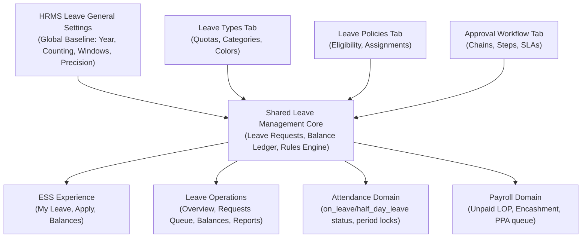
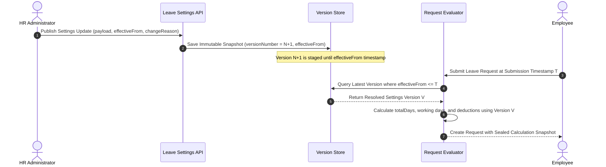

# BEZENT HRMS Leave Module — General Settings V1 Final Requirements Specification

> **Document Status:** PENDING_PRODUCT_OWNER_APPROVAL  
> **Document Version:** `1.3.1-FINAL-REVIEW-DRAFT`  
> **Target Audience:** Engineering, Architecture, Product Management, QA  
> **Module Path:** `apps/web/src/applications/hrms/settings/leave` & `apps/api/src/applications/hrms/leave`  
> **Governance:** Subservient to `AGENTS.md` and repository architectural decision records (ADR-001 through ADR-014).  
> **Effective Baseline:** Clean commit `47c667c` (`feat/auto-provision-employee-user-access`). Reference archive at `backup/leave-module-pre-cleanup` (`d571700`).

---

## Section A — Document Governance

### 1. Document Title & Purpose

This document establishes the exhaustive, binding functional specification and requirements contract for **Tab 1: General Settings V1** of the BEZENT HRMS Leave Module. It defines the company-level foundation, configuration catalog, business logic, versioning contracts, cross-domain impacts (ESS, Leave Operations, Attendance, Payroll), acceptance criteria, and UI/UX constraints.

### 2. Version & Lifecycle Status

- **Document Version:** `1.3.1-FINAL-REVIEW-DRAFT`
- **Lifecycle State:** `PENDING_PRODUCT_OWNER_APPROVAL`
- **Implementation Phase:** **Planning and Specification Only.** No application source code, database schemas, migrations, or data mutations are authorized until this document receives explicit Product Owner sign-off.

### 3. Scope & Explicit Exclusions

- **In Scope for General Settings V1:**
  1. Defining company-wide operational leave calendar cycle boundaries (`leave_year_cycle`, `custom_year_start_date`).
  2. Anchoring company activation and cut-over boundary authority (`go_live_date`).
  3. Establishing standard schedule day deduction logic (`day_counting_method`).
  4. Establishing balance display precision (`balance_precision`) and pro-rata mathematical rounding rules (`balance_rounding_rule`).
  5. Enforcing request submission boundary windows (`max_backdated_days`, `max_advance_booking_days`).
  6. Governing immutable version history, change reasoning, submission-time version resolution, monotonic version scheduling, and request calculation snapshot contracts.
- **Explicit Exclusions (Deferred or Allocated to Other Settings Tabs):**
  1. _Hour-based Leave:_ Completely excluded from V1. All leaves in V1 are measured in **days** (`0.5` half-day or `1.0` full-day increments).
  2. _Leave Types & Quotas:_ Allocated strictly to the **Leave Types** tab (Annual, Sick, Casual, Maternity, Unpaid quotas, paid/unpaid classification, color tokens).
  3. _Eligibility Rules:_ Allocated strictly to the **Leave Policies** tab (probation rules, grade/department assignments).
  4. _Approval Routing:_ Allocated strictly to the **Approval Workflow** tab. (No `default_approval_workflow_id` in General Settings).
  5. _Editable Status Badges:_ Status codes and color tokens are immutable Design System constants; not editable via General Settings.
  6. _Cross-Year / Future-Year Applications:_ Deferred. Requests spanning year boundaries are rejected; employees must submit separate requests for each year.
  7. _Location-Specific Leave Year Overrides:_ V1 enforces a single company-wide leave year cycle.
  8. _Multi-Day Half-Day Requests:_ Deferred. Half-day leave in V1 is strictly supported for single-date requests only.
  9. _Advance Booking Window Bypass:_ In V1, no user (including HR Administrators) may bypass `max_advance_booking_days`.

### 4. Confirmed Product Owner Decisions

The following thirteen architectural and product decisions are finalized and binding:

1. **Leave-Year Scope:** One company-wide leave-year configuration. Location-specific overrides are excluded from V1.
2. **Leave-Year Cycle Changes:** In V1, block changes to the leave-year cycle after initial company activation. A future controlled transition workflow requires a separate approved specification.
3. **Cross-Year Requests:** Reject requests spanning leave-year boundaries. Employees must submit separate requests for each leave year. Do not automatically split requests.
4. **Payroll-Locked Backdated Leave:** Block employee ESS submissions for payroll-locked periods. Authorized HR exceptions require explicit permissions, audit logging, and a defined Prior Period Adjustment (PPA) procedure without rewriting closed payroll or locked attendance.
5. **HR Backdated Override Cap:** Maximum 90 calendar days before the current company-local date. Requests beyond this cap are rejected, even with override permissions.
6. **Settings Versioning:** Use versioned settings with effective dates and change reasons. Historical requests retain their original calculated duration and deductions when settings change.
7. **Calculation Snapshot Immutability:** Preserve full calculation snapshots on requests upon submission. Approval does not recalculate; later HR adjustments create distinct adjustment records without overwriting original snapshots.
8. **Half-Day Sessions:** Capture `first_half` or `second_half` for half-day requests, aligned with the employee's applicable work schedule.
9. **Single-Date Half-Day Scope:** V1 supports half-day requests for a single date only (`startDate === endDate`). Multi-day requests with partial first or last days are deferred.
10. **Leave Unit:** Days only in V1. Hour-based leave is excluded.
11. **Accrual Rounding:** Use a fixed 0.5-day increment. `nearest` is the default, with half-up tie-breaking (`1.25 -> 1.50`, `1.75 -> 2.00`).
12. **Pending Reservation:** Pending leave always reserves available balance in V1. This behavior is fixed and is not configurable in General Settings.
13. **Deterministic Arithmetic:** Use fixed-point decimal or integer half-day arithmetic for balance calculations. IEEE 754 floating-point arithmetic is prohibited for authoritative ledgers.

### 5. Assumptions

- A company record (`companies.id`) exists and serves as the legal entity tenant container.
- Employees are registered under `employees` and mapped to active user credentials under `users` (`User ≠ Employee`, per ADR-009).
- Every request executed on the API carries authenticated `tenantId` and `companyId` context validated server-side.

### 6. Dependencies

- `apps/api/src/applications/hrms/attendance`: Exposes existing period lock states (`attendance_periods`) and consumes approved leave records.
- `apps/web/src/design-system`: Primitives (`Card`, `Stack`, `Table`, `Select`, `Input`, `Button`, `Badge`) and layout standards.
- Platform Rules Engine (`apps/api/src/platform/rules`): Evaluates balance sufficiency facts.

### 7. Approval Checklist

- [ ] Scope and Defaults verified against enterprise operating needs.
- [ ] Thirteen binding Product Owner decisions correctly captured without deviation.
- [ ] Day-counting and schedule evaluation mechanics verified against shift rosters.
- [ ] Versioning, monotonic scheduling, and request snapshot contracts accepted.
- [ ] Permissions aligned with BEZENT platform authorization standards.
- [ ] Acceptance criteria confirmed testable, complete, and exhaustive.

---

## Section B — Architecture and Scope

### 1. Multi-Tenant and Company Isolation

Every setting record, version history entry, and transaction belongs strictly to a tuple of `(tenantId, companyId)`. Cross-company leakage is forbidden. Frontend filtering is never treated as isolation; repositories must enforce compound tenant/company predicates on all reads and writes.

### 2. General Settings Boundaries vs Other Domains



- **General Settings:** Establishes company-level operating constraints (counting method, leave year boundaries, advance/backdated submission windows).
- **Leave Types / Policies:** Configures domain catalogs, quotas, and employee group eligibility.
- **Leave Operations:** Authorized administrative execution (queue management, HR on-behalf submissions, audit log review).
- **Employee Self-Service (ESS):** Permission-scoped personal workspace over the same underlying data.
- **Attendance:** Read-only consumer of approved leave records; provides authoritative period-lock status (`attendance_periods`).
- **Payroll:** Downstream consumer of locked pay-period leave summaries (LOP days, encashments, PPA items).

### 3. Settings Versioning Principles

- Changes to General Settings **do not** mutate existing active rows destructively.
- Every change creates an immutable, dated snapshot with:
  1. Sequential `versionNumber`
  2. ISO `effectiveFrom` timestamp in company operating timezone (normalized to UTC)
  3. Structured JSON payload of settings
  4. Mandatory `changeReason` (minimum 10 characters)
  5. Actor identity (`changedByUserId`) and client audit metadata.
- **Historical Consistency Invariant:** A leave request submitted under Version 1 retains its exact evaluated `totalDays`, duration breakdown, and deductions forever. It is **never** recalculated retroactively if General Settings Version 2 alters day-counting or rounding rules. Any later correction must create a separate, auditable adjustment record.

---

## Section C — Final V1 Settings Catalogue

The V1 catalog contains exactly **eight (8)** configurable settings.

```
┌──────────────────────────────────────────────────────────────────────────────────┐
│                             GENERAL SETTINGS V1 CATALOG                          │
├──────────────────────────┬──────────────────────────┬────────────────────────────┤
│ 1. leave_year_cycle      │ 2. custom_year_start_date│ 3. go_live_date            │
├──────────────────────────┼──────────────────────────┼────────────────────────────┤
│ 4. day_counting_method   │ 5. balance_precision     │ 6. balance_rounding_rule   │
├──────────────────────────┼──────────────────────────┼────────────────────────────┤
│ 7. max_backdated_days    │ 8. max_advance_booking_days                           │
└──────────────────────────┴───────────────────────────────────────────────────────┘
```

---

### Setting 1: `leave_year_cycle`

- **Setting Key:** `leave_year_cycle`
- **Business Purpose:** Establishes the company-wide 12-month calendar cycle for leave entitlements, annual accruals, and carry-forward reset execution.
- **Data Type & Allowed Values:** String enum:
  - `calendar_year`: January 1 to December 31.
  - `financial_year`: April 1 to March 31.
  - `custom`: User-specified fixed month/day cycle.
- **Recommended V1 Default:** `calendar_year`
- **UI Control:** `Select` dropdown.
- **Required / Optional:** Required (Mandatory).
- **Conditional Visibility & Dependencies:** None.
- **Validation & Error Handling:** Must be one of the permitted enum values. Error if unselected: `"Please select a valid leave year cycle."`
- **Activation Immutability (PO Decision #2):** In V1, once a company reaches `go_live_date` and is activated, `leave_year_cycle` is **strictly locked against modification**. Attempting to change it displays: `"Leave year cycle cannot be altered after company activation in V1. Transition workflows require a separate approved procedure."`
- **ESS Impact:** Drives annual balance quota displays, used/remaining progress bars, and reset countdown banners on ESS dashboards.
- **Leave Operations Impact:** Anchors organizational workforce balance rollups, annual usage metrics, and audit reporting periods.
- **Attendance Impact:** Aligns yearly attendance summaries with the leave accounting year.
- **Versioning / Effective-Date Behavior:** Stored in initial version; locked against subsequent version changes in V1 post-activation.
- **Permission Requirements:** View: `hrms.leave.settings.view`; Edit (pre-activation only): `hrms.leave.settings.manage`.
- **Backend Persistence Requirement:** Column / JSON property in settings version.
- **Existing Implementation Compatibility:** `employee_leave_balances` on HEAD currently has an `int('year')` column. In V1, `year` represents the calendar year or the starting year of the financial/custom cycle (e.g. `2026` for FY 2026-27).
- **Acceptance Criteria:**
  - _Given_ a company with `calendar_year`, _When_ an employee views ESS in November 2026, _Then_ balances reflect the Jan 1 – Dec 31, 2026 cycle.

---

### Setting 2: `custom_year_start_date`

- **Setting Key:** `custom_year_start_date`
- **Business Purpose:** Defines the specific calendar month and day when a custom annual leave cycle begins.
- **Data Type & Allowed Values:** String in `MM-DD` format (e.g. `07-01` for July 1).
- **Recommended V1 Default:** `null` (disabled when `leave_year_cycle !== 'custom'`).
- **UI Control:** Single Input / Sub-select (`Month` + `Day`).
- **Required / Optional:** Conditional. Mandatory if `leave_year_cycle === 'custom'`; otherwise hidden/disabled and stored as `null`.
- **Validation & Error Handling:**
  - Must satisfy both valid `MM-DD` syntax and calendar validity (see Section D.1 for complete validation logic).
  - Impossible dates like `04-31`, `06-31`, `02-30` are rejected with: `"Invalid calendar date: {date} does not exist."`
  - Leap day `02-29` is disallowed; error: `"Leap day (Feb 29) cannot be used as an annual cycle start. Please select March 1."`
- **ESS Impact:** Shifts annual balance period start to the specified month/day.
- **Leave Operations Impact:** Automated annual rollover jobs trigger on this day.
- **Attendance Impact:** None directly.
- **Versioning / Effective-Date Behavior:** Locked after initial company activation in V1.
- **Permission Requirements:** View: `hrms.leave.settings.view`; Edit (pre-activation only): `hrms.leave.settings.manage`.
- **Backend Persistence Requirement:** Column / JSON property in settings version.
- **Existing Implementation Compatibility:** Fully backward compatible; defaults to `null`.
- **Acceptance Criteria:**
  - _Given_ `leave_year_cycle` is set to `custom`, _When_ `custom_year_start_date` is `04-31`, _Then_ save is blocked with validation error: `"Invalid calendar date: 04-31 does not exist."`.

---

### Setting 3: `go_live_date`

- **Setting Key:** `go_live_date`
- **Business Purpose:** Declares the official cut-over date when BEZENT Leave becomes authoritative for the company. Historical transactions before this date belong to legacy imports.
- **Data Type & Allowed Values:** ISO Date string (`YYYY-MM-DD`).
- **Recommended V1 Default:** Company provisioning / creation date.
- **UI Control:** Date picker (`Input[type="date"]`).
- **Required / Optional:** Required (Mandatory).
- **Conditional Visibility & Dependencies:** None.
- **Validation & Error Handling:** Must be a valid ISO date.
- **Lifecycle Reconciled Immutability:**
  - _Pre-Activation (Draft):_ Editable during initial setup by administrators with `hrms.leave.settings.manage`.
  - _Post-Activation (Live):_ Once current company-local date reaches `go_live_date` (or the first live employee leave request / opening balance is created), `go_live_date` becomes **strictly immutable**. Tenant Super Admin elevation cannot silently bypass this rule via API; modifying an active cut-over date invalidates already-posted balance ledgers and historical audits. Rare corporate database corrections require an offline, auditable system migration, not an API-level runtime edit.
- **ESS Impact:** ESS date picker restricts selection: $\text{startDate} \ge \text{go\_live\_date}$.
- **Leave Operations Impact:** Anchors baseline opening balance imports. Boundary-crossing applications are rejected (see Section D.6).
- **Attendance Impact:** Attendance engine suppresses `on_leave` calculation for dates prior to `go_live_date`.
- **Versioning / Effective-Date Behavior:** Locked upon company activation. Exceptional corrections do not alter this date; they are recorded as separate opening adjustment records.
- **Permission Requirements:** Pre-activation edit: `hrms.leave.settings.manage`. Post-activation edit: Blocked for all roles.
- **Backend Persistence Requirement:** Column / JSON property in settings version.
- **Existing Implementation Compatibility:** Not present on HEAD; requires schema persistence.
- **Acceptance Criteria:**
  - _Given_ `go_live_date` is `2026-11-01` and the company is active, _When_ an employee attempts to submit leave for `2026-10-25`, _Then_ the request is rejected with error: `"Leave applications cannot precede company go-live date (2026-11-01)."`.

---

### Setting 4: `day_counting_method`

- **Setting Key:** `day_counting_method`
- **Business Purpose:** Standard baseline method for calculating total leave duration across a requested date range.
- **Data Type & Allowed Values:** String enum:
  - `working_days`: Excludes scheduled weekly offs and declared public holidays falling within the date range.
  - `calendar_days`: Counts every calendar day in the range, regardless of weekends or holidays.
- **Recommended V1 Default:** `working_days`
- **UI Control:** `Select` dropdown.
- **Required / Optional:** Required.
- **Conditional Visibility & Dependencies:** None.
- **Validation & Error Handling:** Must be one of the permitted enum values.
- **ESS Impact:** When selecting dates (e.g. Friday to Monday), ESS dynamically calculates deductible days (2 days for `working_days` vs 4 days for `calendar_days`).
- **Leave Operations Impact:** Automatically calculates balance deduction amount on approval queues.
- **Attendance Impact:** Prevents deducting balances on days where an employee was already scheduled for a weekly-off or holiday.
- **Effective-Date Resolution Rule (Submission-Time Invariant):**
  - Evaluated using the **submission timestamp** of the request in the company operating timezone.
  - Applies to all requests _submitted_ on or after the settings version's `effectiveFrom` timestamp.
  - Future-dated leave requests submitted today evaluate under today's active settings version.
  - Historical requests permanently preserve their original calculated days in their sealed calculation snapshot.
- **Permission Requirements:** View: `hrms.leave.settings.view`; Edit: `hrms.leave.settings.manage`.
- **Backend Persistence Requirement:** Column / JSON property in settings version.
- **Existing Implementation Compatibility:** HEAD `leave.service.ts` currently calculates raw calendar difference: `Math.ceil(diffTime / 86400000) + 1`. This setting upgrades the service to evaluate working days against weekly offs.
- **Acceptance Criteria:**
  - _Given_ `day_counting_method = 'working_days'`, an employee working Mon–Fri, and no holidays, _When_ applying from Friday `2026-11-06` to Monday `2026-11-09`, _Then_ `totalDays` evaluates to `2.0`.

---

### Setting 5: `balance_precision`

- **Setting Key:** `balance_precision`
- **Business Purpose:** Standard decimal precision used strictly when displaying leave balances, quotas, and ledger transactions on user interfaces.
- **Data Type & Allowed Values:** String enum:
  - `whole_numbers`: Formatted with 0 decimal places if exact integer.
  - `half`: Formatted with up to 1 decimal place (`12.5`).
  - `two_decimals`: Formatted with 2 decimal places (`12.50`).
- **Recommended V1 Default:** `two_decimals`
- **UI Control:** `Select` dropdown.
- **Required / Optional:** Required.
- **Conditional Visibility & Dependencies:** None.
- **Validation & Error Handling:** Must be one of the permitted enum values.
- **Lossless Display Behavior:**
  - `whole_numbers` suppresses trailing zeroes for integer balances (e.g. `14.00` renders as `"14"`).
  - **Critical Lossless Invariant:** If an employee possesses a non-zero fractional balance (e.g. `14.50`), `whole_numbers` **must not truncate or falsely round** the balance to `"14"` or `"15"`. The UI must losslessly render the fractional value (`"14.5"`). Formatting is strictly a presentation transformation, distinct from rounding the underlying entitlement.
- **ESS Impact:** Formats balance cards and ledger statements in ESS without altering the underlying raw numeric balance.
- **Leave Operations Impact:** Standardizes balance tables, adjustment inputs, and export reports.
- **Attendance Impact:** None.
- **Versioning / Effective-Date Behavior:** Immediate display formatting effect across all active views upon version activation.
- **Permission Requirements:** View: `hrms.leave.settings.view`; Edit: `hrms.leave.settings.manage`.
- **Backend Persistence Requirement:** Column / JSON property in settings version.
- **Existing Implementation Compatibility:** Balances on HEAD are currently typed as `int` in `employee_leave_balances`. Precision formatting requires storing balances as decimal (`decimal(6,2)`).
- **Acceptance Criteria:**
  - _Given_ balance is `14.50` and `balance_precision` is `whole_numbers`, _When_ rendered in ESS, _Then_ the string output is `"14.5"` (lossless display preserved; not truncated to `"14"`).

---

### Setting 6: `balance_rounding_rule`

- **Setting Key:** `balance_rounding_rule`
- **Business Purpose:** Mathematical rule applied during periodic pro-rata accrual calculations when fractional entitlements are generated.
- **Data Type & Allowed Values:** String enum:
  - `nearest`: Rounds to the nearest calculation increment (`0.5` days in V1; PO Decision #11).
  - `round_up`: Always rounds fractional balances up to the next `0.5` increment.
  - `round_down`: Always rounds fractional balances down (truncates to previous `0.5` increment).
- **Recommended V1 Default:** `nearest`
- **UI Control:** `Select` dropdown.
- **Required / Optional:** Required.
- **Conditional Visibility & Dependencies:** None.
- **Validation & Error Handling:** Must be one of the permitted enum values.
- **ESS Impact:** Eliminates recurring decimal discrepancies (e.g. `1.6667` becomes `1.50`).
- **Leave Operations Impact:** Guarantees deterministic accrual batch results during automated payroll cut-off jobs.
- **Attendance Impact:** None.
- **Versioning / Effective-Date Behavior:** Applies strictly to future accrual executions evaluated on or after `effectiveFrom`.
- **Permission Requirements:** View: `hrms.leave.settings.view`; Edit: `hrms.leave.settings.manage`.
- **Backend Persistence Requirement:** Column / JSON property in settings version.
- **Existing Implementation Compatibility:** No accrual batch engine exists on HEAD yet; this setting establishes the rule ahead of engine implementation.
- **Acceptance Criteria:**
  - _Given_ `balance_rounding_rule = 'nearest'`, calculation increment `0.5`, and half-up tie-breaking, _When_ an accrual formula yields `1.25` days, _Then_ the rounded entitlement is `1.50` (PO Decision #11).

---

### Setting 7: `max_backdated_days`

- **Setting Key:** `max_backdated_days`
- **Business Purpose:** Maximum number of calendar days in the past from the current company-local date for which an employee can start a retrospective leave request.
- **Data Type & Allowed Values:** Integer between `0` and `90`.
- **Recommended V1 Default:** `7` days.
- **UI Control:** `NumberInput` (Min: `0`, Max: `90`).
- **Required / Optional:** Required.
- **Conditional Visibility & Dependencies:** None. Setting to `0` completely prohibits employee backdated submissions.
- **Validation & Error Handling:** Must be an integer $\ge 0$ and $\le 90$.
- **Boundary Semantics:** Governs the request's **`startDate`**. Inclusive boundary: $\text{minStartDate} = \text{today} - \text{max\_backdated\_days}$ in company operating timezone.
- **ESS Impact:** Date picker enforces inclusive boundary. Earlier start dates are disabled.
- **Leave Operations Impact:** Evaluated independently from the 90-day HR override cap (see Section D.5).
- **Attendance Impact:** Replaces past attendance exceptions with `on_leave` or `half_day_leave` status once approved.
- **Versioning / Effective-Date Behavior:** Validated at the moment of request submission against the active settings version.
- **Permission Requirements:** View: `hrms.leave.settings.view`; Edit: `hrms.leave.settings.manage`.
- **Backend Persistence Requirement:** Column / JSON property in settings version.
- **Existing Implementation Compatibility:** HEAD currently has no backdated restriction (any past date can be submitted). This introduces required boundary enforcement.
- **Acceptance Criteria:**
  - _Given_ `max_backdated_days = 7` and today is `2026-11-10` in company timezone, _When_ an employee submits leave starting `2026-11-03` (exactly 7 days back), _Then_ submission is permitted. _When_ submitting for `2026-11-02` (8 days back), _Then_ submission is rejected with: `"Leave requests cannot be backdated more than 7 days."`.

---

### Setting 8: `max_advance_booking_days`

- **Setting Key:** `max_advance_booking_days`
- **Business Purpose:** Maximum number of calendar days into the future from the current company-local date to which an employee can extend a future leave request.
- **Data Type & Allowed Values:** Integer between `1` and `365`.
- **Recommended V1 Default:** `180` days (approx. 6 months).
- **UI Control:** `NumberInput` (Min: `1`, Max: `365`).
- **Required / Optional:** Required.
- **Conditional Visibility & Dependencies:** None.
- **Validation & Error Handling:** Must be an integer $\ge 1$ and $\le 365$.
- **Boundary Semantics:** Governs the request's **`endDate`**. Inclusive boundary: $\text{maxEndDate} = \text{today} + \text{max\_advance\_booking\_days}$ in company operating timezone.
- **Universal Enforceability:** In V1, no user (including HR Administrators) may bypass `max_advance_booking_days`.
- **ESS Impact:** Date picker enforces inclusive boundary. Later end dates are disabled.
- **Leave Operations Impact:** Prevents speculative, distant leave applications that tie up team capacity planning.
- **Attendance Impact:** None.
- **Versioning / Effective-Date Behavior:** Validated at the moment of request submission against the active settings version.
- **Permission Requirements:** View: `hrms.leave.settings.view`; Edit: `hrms.leave.settings.manage`.
- **Backend Persistence Requirement:** Column / JSON property in settings version.
- **Existing Implementation Compatibility:** HEAD currently has no advance booking limit.
- **Acceptance Criteria:**
  - _Given_ `max_advance_booking_days = 180` and today is `2026-11-01` in company timezone, _When_ applying for `2027-04-30` (exactly 180 calendar days ahead), _Then_ submission is permitted. _When_ applying for `2027-05-01` (181 calendar days ahead), _Then_ submission is rejected with: `"Leave requests cannot be scheduled more than 180 days in advance."`.

---

## Section D — Business Rules and Calculation Contracts

### 1. Leave-Year Boundaries & Calendar Interval Logic

- **Interval Contract:** All leave year periods are evaluated as **unambiguous half-open calendar intervals**:
  $$[\text{periodStartDate } 00:00:00, \text{nextPeriodStartDate } 00:00:00)$$
  evaluated in the configured company operating timezone (`company.timezone`). Second-based boundaries (`23:59:59`) are deprecated to eliminate precision-loss edge cases at midnight transitions.
- **Standard Cycle Intervals:**
  - _Calendar Year (2026):_ `[2026-01-01 00:00:00, 2027-01-01 00:00:00)`.
  - _Financial Year (2026-27):_ `[2026-04-01 00:00:00, 2027-04-01 00:00:00)`.
  - _Custom Year (`07-01` start):_ `[2026-07-01 00:00:00, 2027-07-01 00:00:00)`.
- **Custom Cycle & Leap-Year Arithmetic:**
  - Syntax validation: `^(0[1-9]|1[0-2])-(0[1-9]|[12][0-9]|3[01])$`.
  - Complete calendar validity: Must reject impossible dates (`04-31`, `06-31`, `09-31`, `11-31`, `02-30`, `02-31`). Backend validation dynamically evaluates month lengths.
  - February 29 is strictly prohibited as `custom_year_start_date` (PO Decision #8).
  - If a custom cycle spans across February (e.g. `11-01` to `11-01`), leap years naturally encompass 366 calendar days (including Feb 29) while non-leap years encompass 365 calendar days. The interval definition $[\text{start}, \text{nextStart})$ handles this deterministically without date shifting.
- **V1 Leave-Year Cycle Change Restriction (PO Decision #2):**
  - Once a company reaches `go_live_date` and live balances exist, `leave_year_cycle` is **strictly locked against modification**.
  - Transitioning live balances across misaligned year boundaries requires a separate approved transition workflow deferred to a future phase.
- **Cross-Year Request Rejection (PO Decision #3):**
  - Requests spanning across a leave-year boundary are **strictly rejected without automatic splitting**.
  - Dynamic validation error returned:
    `"Requests cannot span across leave year boundaries. Please submit separate requests for cycle {priorCycleLabel} and cycle {nextCycleLabel}."`
    _(e.g., "cycle 2026 and cycle 2027", or "cycle FY 2026-27 and cycle FY 2027-28")._

### 2. Day-Counting & Schedule Evaluation

- **Working Days Calculation Formula:**
  $$\text{Deductible Days} = \sum_{d \in [\text{startDate}, \text{endDate}]} \text{isWorkingDay}(d, \text{employeeId})$$
  Where $\text{isWorkingDay}(d, \text{employeeId}) = 1$ if and only if:
  1. Day $d$ is not a scheduled Weekly Off in the employee's active shift roster; **AND**
  2. Day $d$ is not a declared Public Holiday in the employee's assigned location holiday calendar.
- **Authoritative Data Sources & Schedule Fallback Failure (Correction I):**
  - Authoritative employee schedule: Selected from the employee's assigned shift roster for each specific calendar date. Mid-range transfers/shift changes evaluate date-by-date against the shift assigned on that calendar date.
  - Authoritative holiday calendar: Selected from the published holiday calendar mapped to the employee's assigned work location.
  - **Failure Behavior:** If shift roster or holiday data is missing, contradictory, or inaccessible for any date in range, submission is **strictly blocked with a validation failure**:
    `"Unable to calculate leave duration: Missing shift schedule or holiday calendar for date {date}. Please contact HR Administration."`
    Silent fallbacks to generic Monday–Friday schedules are prohibited.
- **Half-Day Eligibility on Non-Working Days (Correction 4):**
  - _Under `working_days`:_ Applying for a half-day on a scheduled Weekly Off or declared Holiday is **strictly rejected**.
    - Error: `"Cannot apply for leave on a non-working day (Weekly Off or Public Holiday) when working-day counting is active."`
  - _Under `calendar_days`:_ Non-working days are chargeable. A half-day on a weekend or holiday evaluates to exactly `0.5` deductible days.
- **Single-Date Half-Day Scope (PO Decision #9):**
  - In V1, half-day leave (`0.5` days) is **supported for single-date requests only** (`startDate === endDate`).
  - Multi-day requests with partial first or last days are deferred. If an employee requires a half-day followed by full days, they must submit distinct requests in V1.
- **Sandwich Rules Separation:** Sandwich rules are **strictly separated** from General Settings and evaluated as per-Leave-Type overrides.

### 3. Precision, Rounding & Deterministic Decimal Arithmetic

- **Deterministic Decimal Arithmetic (PO Decision #13):** Binary floating-point arithmetic (IEEE 754) is strictly prohibited. Intermediate formula calculations must evaluate using fixed-point decimal arithmetic (scaled to at least 4 decimal places).
- **Calculation Increment (PO Decision #11):** Fixed at **`0.5` days** for V1.
- **Accrual Rounding Rules:**
  - `nearest`: Rounds to the nearest `0.5` increment.
  - **Half-Up Tie-Breaking Rule:** When a fractional entitlement falls _exactly halfway_ between two `0.5` increments (e.g., at `.25` or `.75`), tie-breaking rounds **half-up to the higher increment** ($1.25 \to 1.50$, $1.75 \to 2.00$).
  - `round_up`: Rounds any non-zero fractional remainder up to the next `0.5` increment ($1.10 \to 1.50$).
  - `round_down`: Truncates any fractional remainder down to the preceding `0.5` increment ($1.40 \to 1.00$).
- **Stored Precision vs Decimal Capacity (Correction 9):**
  - `employee_leave_balances`: Stored as `decimal(6,2)`. Physical algebraic capacity: `-9999.99` to `+9999.99`. Maximum valid half-day value: `9999.50`.
  - `employee_leave_requests`: Stored as `decimal(5,2)`. Physical algebraic capacity: `-999.99` to `+999.99`. Maximum valid half-day value: `999.50` days. (Safely covers any valid request duration while fitting half-day precision).
- **Lossless Display Formatting (Correction 1):** `balance_precision` controls visual string representation only. Under `whole_numbers`, integer balances suppress zeroes (`14.00 -> "14"`), but any fractional balance is rendered losslessly (`14.50 -> "14.5"`).

### 4. Half-Day Attendance Integration (Correction E & PO Decision #8)

To prevent falsely marking an employee as absent for an entire day when on half-day leave, the attendance integration contract is defined as follows:

```
┌──────────────────────────────────────────────────────────────────────────────────┐
│                     HALF-DAY ATTENDANCE INTEGRATION MATRIX                       │
├──────────────┬────────────────────────┬──────────────────────────────────────────┤
│ Session      │ Expected Punches       │ Daily Attendance Status Representation   │
├──────────────┼────────────────────────┼──────────────────────────────────────────┤
│ first_half   │ In/Out for 2nd half    │ half_day_leave (if 2nd half worked) or   │
│              │ (e.g. 13:00 to 18:00)  │ half_day_leave + partial_absence (if not)│
├──────────────┼────────────────────────┼──────────────────────────────────────────┤
│ second_half  │ In/Out for 1st half    │ half_day_leave (if 1st half worked) or   │
│              │ (e.g. 09:00 to 13:00)  │ half_day_leave + partial_absence (if not)│
└──────────────┴────────────────────────┴──────────────────────────────────────────┘
```

- **Session Semantics Against Shift:**
  - `first_half`: Excuses late arrival during shift first half; punches required for second half. Late In exceptions are suppressed for the first-half punch-in.
  - `second_half`: Excuses early exit during shift second half; punches required for first half. Early Exit exceptions are suppressed for the second-half punch-out.
- **Attendance Status Representation:**
  - Daily Attendance Log represents approved half-day leave as `half_day_leave` (proposed status pending schema review), distinct from full-day `on_leave`.
  - If the employee fails to punch for the non-leave half, attendance records a partial absence exception for that unexcused half.
- **Payroll Day-Fraction:**
  - Contributes `0.5` approved leave days and `0.5` payable work days (if worked) or `0.5` unpaid absence (if unworked).
- **Storage Incompatibility & Migration Risks:**
  - In current HEAD source ([schema.ts](file:///e:/Company/bezent_ecosystem/apps/api/src/db/schema.ts#L3052-L3092)): `total_days`, `used_days`, and `pending_days` are typed as `int`, which mathematically cannot represent `0.5` days.
  - _Required Future Implementation Migration (Documented, Not Implemented):_
    1. Migrate `employee_leave_balances` fields to `decimal(6,2)`.
    2. Migrate `employee_leave_requests.total_days` to `decimal(5,2)` and add `session` enum (`first_half`, `second_half`, `null`).
    3. Update dependent SQL expressions in `leave.repository.ts`.

### 5. Application Windows, Payroll Locks & Granular Permissions (PO Decisions #4 & #5)

- **Tier 1 (Standard ESS Window):**
  - `startDate` must be $\ge (\text{today} - \text{max\_backdated\_days})$ in company operating timezone.
  - `endDate` must be $\le (\text{today} + \text{max\_advance\_booking\_days})$ in company operating timezone.
- **Tier 2 (Payroll Lock Hard Stop):**
  - Even if a request is within `max_backdated_days`, if `attendance_periods` has status `locked` or `finalized` for any date in range:
  - **Employee ESS:** Hard-blocked immediately.
  - Error: `"Submission blocked: The attendance period covering {date} has been locked for payroll processing. Please contact HR Administration."`
- **Tier 3 (Granular HR Permissions & 90-Day Cap - Correction 5):**
  - Submitting on behalf: Requires `hrms.leave.apply_on_behalf` with mandatory business reason (`behalfReason`, min 10 chars).
  - Bypassing `max_backdated_days`: Requires BOTH `hrms.leave.apply_on_behalf` AND `hrms.leave.backdated_override`, with mandatory override reason (`overrideReason`, min 20 chars).
  - **Absolute HR Backdated Cap (PO Decision #5):** Maximum **90 calendar days** prior to `today` in company operating timezone. Requests with `startDate < (today - 90 days)` are **strictly rejected for all users**, including HR Administrators.
  - Overriding Payroll Lock: Requires BOTH `hrms.leave.apply_on_behalf` AND `hrms.leave.payroll_override`, with mandatory override reason (`overrideReason`, min 20 chars).
  - **No Advance Booking Bypass:** In V1, no user (including HR Administrators) may bypass `max_advance_booking_days`.
- **Tier 4 (Payroll-Locked Attendance Non-Mutation & PPA Protocol - Correction 3 & F):**
  - An approved HR override for a locked period **must not mutate locked/finalized attendance records or rewrite closed payroll summaries**.
  - Historical punch logs and closed period summaries remain unaltered.
  - **PPA Record Generation Timing:** A `leave_payroll_adjustment` (Prior Period Adjustment) record is **generated synchronously upon final approval** of the leave override. Rejected, cancelled, or pending requests do not generate a PPA. Repeated approval retries are idempotent and do not duplicate PPA records.
  - Consistency: Created within a single database transaction or via transactional outbox with idempotency key (`requestId + approvalTimestamp`).

### 6. Company Activation & Go-Live Cut-Over

- **One-Time Boundary:** `go_live_date` serves as the authoritative demarcation line between legacy employment history and BEZENT live transactions.
- **ESS Boundary Rule:** Employees cannot apply for leave dates prior to `go_live_date`.
- **Boundary Crossing Rule:** Any leave request whose date range starts before `go_live_date` and ends after `go_live_date` is **strictly rejected**.
  - The system **does not automatically split requests**. The applicant must record historical days in legacy adjustments and submit live days as a BEZENT request.
- **Legacy Imports vs Live Operations:** Controlled opening balance imports representing pre-go-live accruals and usage are executed exclusively via dedicated administrative migration pipelines prior to activation.

---

## Section E — Versioning and Audit Contract

### 1. Technology-Neutral Versioning Architecture

To satisfy regulatory scrutiny and guarantee historical reproducibility, General Settings employs an append-only snapshot versioning model:



### 2. Version Resolution & Monotonic Scheduling (Corrections B & C)

- **Authoritative Submission-Time Resolution:** The settings version applicable to a leave request is resolved and sealed **at the authoritative server-side request submission timestamp** $T$ (converted to company local timezone):
  $$\text{Version}(T) = \arg\max_{V} \{ V.\text{versionNumber} \mid V.\text{effectiveFrom} \le T \text{ and } V.\text{tenantId} = \text{tenantId} \text{ and } V.\text{companyId} = \text{companyId} \}$$
- **Future-Dated Leave Invariant:** A future-dated leave request submitted today evaluates under today's active settings version. A future-effective settings version must never affect a request submitted before its effective timestamp.
- **Approval Lifecycle Non-Recalculation:** Approving, rejecting, or reviewing a request **does not re-evaluate settings or re-calculate duration**. The approved deduction applies the exact sealed calculation snapshot.
- **Monotonic Version Scheduling Invariants (Correction C):**
  1. `versionNumber` increases sequentially within `(tenantId, companyId)`.
  2. `effectiveFrom` must be strictly later than the preceding version's `effectiveFrom` ($V_{N+1}.\text{effectiveFrom} > V_N.\text{effectiveFrom}$). Out-of-order scheduling is rejected.
  3. **Duplicate Effective Timestamps Prohibited:** Exact duplicate timestamps are rejected with `409 Conflict`.
  4. Timestamps are compared as actual UTC instants.
  5. Future-effective versions cannot be silently edited or deleted; rescheduling is outside V1 scope.
  6. Optimistic concurrency control enforced via `expectedCurrentVersionNumber`.

### 3. Historical Request Calculation Snapshot (Corrections G & 11)

- **Sealed Request Snapshot Contract:** Every created leave request must store an immutable JSON calculation snapshot containing:
  1. `calculationId` (unique UUID)
  2. `settingsVersionId` and `versionNumber`
  3. `calculationTimestampUtc` (ISO timestamp in UTC)
  4. `companyTimezone` (e.g. `'Asia/Kolkata'`)
  5. `dayCountingMethod` (`working_days` | `calendar_days`)
  6. `calculatedDurationDays` (stored as `decimal(5,2)`, e.g. `3.50` days)
  7. `halfDaySession` (`first_half` | `second_half` | `null`)
  8. `requestedStartDate` and `requestedEndDate`
  9. `shiftRosterRef` / `shiftId`
  10. `holidayCalendarRef` / `holidayCalendarId`
  11. `rulesEngineVersion`
  12. `scheduleBreakdown`: JSON array of each date in range, recording:
      - `date` (`YYYY-MM-DD`)
      - `isWeeklyOff` (`boolean`)
      - `isHoliday` (`boolean`)
      - `holidayCode` (`string` or `null`)
      - `chargedDays` (`0.0`, `0.5`, or `1.0`)
      - `exclusionReasons`: array of strings (`['weekly_off']`, `['holiday']`, or `['weekly_off', 'holiday']` when overlapping) to ensure deterministic explanation without precedence ambiguity.
- **Audit Invariant & Adjustment Recalculation:** This calculation snapshot is permanently sealed upon request creation. If an HR administrator executes an authorized correction, the original request snapshot remains untouched, and a distinct, auditable `leave_adjustment` ledger record is created.

---

## Section F — General Settings UI Requirements

The General Settings UI resides in `apps/web/src/applications/hrms/settings/leave` and strictly observes BEZENT's **Zero Application CSS Rule** by composing Design System primitives exclusively.

### 1. Visual Hierarchy & Design System Composition

- **Page Header:**
  - Title: `"Leave Settings"`
  - Subtitle: `"Configure company-wide leave year boundaries, calculation rules, and operational constraints."`
- **Tab Navigation:**
  - Underscore variant `Tabs` with 7 tabs; Tab 1 is `"General Settings"` (Active).
- **Action Toolbar:**
  - Top-right actions: `"Discard Changes"` (Button variant `secondary`) and `"Save Settings"` (Button variant `primary`).

### 2. Layout Structure (FormGrid & Cards)

```
┌─────────────────────────────────────────────────────────────────────────────┐
│ General Settings Toolbar                                [Discard] [Save]    │
├─────────────────────────────────────────────────────────────────────────────┤
│ ┌─ Card: Leave Year & Operational Timeline ───────────────────────────────┐ │
│ │  [ Select: Leave Year Cycle (Locked after Go-Live) ]                     │ │
│ │  [ Date: Custom Start Date (Conditional) ]                               │ │
│ │  [ Date: Go-Live Effective Date (Locked after Go-Live) ]                 │ │
│ └─────────────────────────────────────────────────────────────────────────┘ │
│ ┌─ Card: Schedule Evaluation & Day Counting ──────────────────────────────┐ │
│ │  [ Select: Day Counting Method ]                                        │ │
│ └─────────────────────────────────────────────────────────────────────────┘ │
│ ┌─ Card: Balance Precision & Accrual Rounding ────────────────────────────┐ │
│ │  [ Select: Balance Precision ]   [ Select: Balance Rounding Rule ]       │ │
│ └─────────────────────────────────────────────────────────────────────────┘ │
│ ┌─ Card: Application Windows & Operational Limits ────────────────────────┐ │
│ │  [ Number: Max Backdated Days ]  [ Number: Max Advance Booking Days ]    │ │
│ └─────────────────────────────────────────────────────────────────────────┘ │
│ ┌─ Card: Version History & Audit Trail ───────────────────────────────────┐ │
│ │  [ Table: Version History (Version #, Effective From, Reason, Author) ] │ │
│ └─────────────────────────────────────────────────────────────────────────┘ │
└─────────────────────────────────────────────────────────────────────────────┘
```

### 3. Change Reason Modal

When clicking `"Save Settings"`, if form values differ from the current active version, a confirmation `Modal` prompts:

- Title: `"Confirm Settings Update"`
- Description: `"Changes will apply to all future leave requests. Enter a business reason for this update:"`
- Input: `effectiveFrom` (Date/Time picker; defaults to current time).
- Textarea: `changeReason` (Required, min 10 characters).
- Actions: `"Cancel"` (Secondary) and `"Publish New Version"` (Primary).

---

## Section G — Permissions and Auditability

### Verified vs Proposed Permissions

| Permission Key                  | Description                                                     | Target Roles                      | Verification Status                           |
| :------------------------------ | :-------------------------------------------------------------- | :-------------------------------- | :-------------------------------------------- |
| `hrms.leave.view`               | View organizational leave requests and balances                 | HR, Managers                      | **Verified on HEAD** (`accessCatalog.ts:365`) |
| `hrms.leave.approve`            | Approve or reject leave requests in queue                       | Managers, HR                      | **Verified on HEAD** (`accessCatalog.ts:368`) |
| `ess.leave.view`                | View personal balances and request history                      | All Employees                     | **Verified on HEAD** (`accessCatalog.ts:447`) |
| `ess.leave.apply`               | Submit personal leave requests                                  | All Employees                     | **Verified on HEAD** (`accessCatalog.ts:450`) |
| `hrms.leave.settings.view`      | View General Settings configuration and version history         | HR Executive, HR Manager, Auditor | **Proposed** (Requires addition to catalog)   |
| `hrms.leave.settings.manage`    | Update General Settings and publish new versions                | HR Manager, Company Admin         | **Proposed** (Requires addition to catalog)   |
| `hrms.leave.apply_on_behalf`    | Submit standard leave requests on behalf of workforce employees | HR Executive, HR Manager          | **Proposed** (Requires addition to catalog)   |
| `hrms.leave.backdated_override` | Bypass standard `max_backdated_days` window (up to 90-day cap)  | HR Manager, Super Admin           | **Proposed** (Requires addition to catalog)   |
| `hrms.leave.payroll_override`   | Bypass payroll-locked periods with mandatory audit log & PPA    | HR Manager, Super Admin           | **Proposed** (Requires addition to catalog)   |

---

## Section H — Existing System Compatibility Analysis

| Feature / Artifact                   | Classification                  | Location in Repository                                                               | Verification Notes                                                                                                                   |
| :----------------------------------- | :------------------------------ | :----------------------------------------------------------------------------------- | :----------------------------------------------------------------------------------------------------------------------------------- |
| `employee_leave_balances`            | **Verified in current source**  | `apps/api/src/db/schema.ts:3040`                                                     | Columns: `tenantId`, `companyId`, `employeeId`, `leaveType`, `totalDays` (int), `usedDays` (int), `pendingDays` (int), `year` (int). |
| `employee_leave_requests`            | **Verified in current source**  | `apps/api/src/db/schema.ts:3078`                                                     | Columns: `leaveType`, `startDate`, `endDate`, `totalDays` (int), `status` (`pending`, `approved`, `rejected`, `cancelled`).          |
| Pending Balance Reservation          | **Verified in current source**  | `apps/api/src/applications/hrms/leave/service/leave.service.ts:140`                  | Atomic reservation exists in service logic (`pendingDays = pendingDays + totalDays`).                                                |
| Date Overlap Validation              | **Verified in current source**  | `apps/api/src/applications/hrms/leave/service/leave.service.ts:68`                   | Checks against existing `pending` or `approved` requests; throws 409 Conflict.                                                       |
| Attendance `on_leave` Sync           | **Verified in current source**  | `apps/api/src/applications/hrms/attendance/repository/attendance.repository.ts:1110` | Daily attendance engine checks approved leaves covering the target date.                                                             |
| Attendance Period Locks              | **Verified in current source**  | `apps/api/src/db/schema.ts:2927` (`attendance_periods`)                              | Table contains `period_code`, `status` (`open`, `locked`, `finalized`). Ideal integration point for PO Decision #4.                  |
| Decimal Balances & Half-Day Sessions | **Not implemented**             | `apps/api/src/db/schema.ts:3092`                                                     | `total_days` is currently `int`. Needs `decimal(5,2)` and `session` enum support in future implementation.                           |
| General Settings Table               | **Not implemented**             | N/A                                                                                  | No `leave_general_settings` table exists on HEAD.                                                                                    |
| Settings Versioning Engine           | **Unverified / Reference only** | `backup/leave-module-pre-cleanup`                                                    | Reference model exists in backup branch (`leaveGeneralSettingsVersions`); not present on HEAD.                                       |
| PPA Queue / Payroll Handover         | **Not implemented**             | N/A                                                                                  | Prior Period Adjustment queue for leave overrides not yet implemented in API.                                                        |

---

## Section I — Testable Acceptance Criteria

### Scenario 1: Leave Year Boundary & Span Rejection (PO Decision #3)

- **Given** a company configured with `leave_year_cycle = 'financial_year'` (Apr 1, 2026 – Mar 31, 2027)
- **When** an employee attempts to submit a request from `2027-03-30` to `2027-04-03` (spanning two leave years)
- **Then** the request is rejected with error: `"Requests cannot span across leave year boundaries. Please submit separate requests for cycle FY 2026-27 and cycle FY 2027-28."`
- **And** the request is not automatically split.

### Scenario 2: Working Days Counting with Holiday and Weekly-Off

- **Given** `day_counting_method = 'working_days'`, an employee working Monday–Friday, and Thursday `2026-11-19` is a declared public holiday
- **When** applying for leave from Wednesday `2026-11-18` to Friday `2026-11-20`
- **Then** `totalDays` evaluates to `2.0` (Wednesday + Friday; Thursday holiday excluded).

### Scenario 3: Accrual Rounding with Half-Up Tie-Breaking (PO Decision #11)

- **Given** `balance_rounding_rule = 'nearest'`, calculation increment `0.5`, and fixed-point calculation precision
- **When** an accrual calculation generates `2.2500` days
- **Then** the half-up tie-breaker rounds to **`2.50` days**.
- **And When** an accrual calculation generates `2.1500` days
- **Then** it rounds to the closest increment: **`2.00` days**.

### Scenario 4: Lossless Whole Numbers Display (Correction 1)

- **Given** `balance_precision = 'whole_numbers'`
- **When** an employee has a balance of `14.00` days, it renders as `"14"`.
- **And When** an employee has a balance of `14.50` days
- **Then** it renders as `"14.5"` (lossless display preserved; not truncated or rounded to `"14"` or `"15"`).

### Scenario 5: Single-Date Half-Day Session Selection (PO Decisions #8 & #9)

- **Given** an employee applies for a half-day leave on `2026-11-12`
- **When** the employee selects `session = 'first_half'`
- **Then** the request is accepted with `totalDays = 0.5`.
- **And When** an employee attempts to submit a multi-day half-day request from `2026-11-12` to `2026-11-13`
- **Then** the submission is blocked with: `"Multi-day half-day requests are not supported in V1. Please submit single-date requests for half-days."`.

### Scenario 6: Half-Day Eligibility on Non-Working Day (Correction 4)

- **Given** `day_counting_method = 'working_days'`, and Sunday `2026-11-15` is a scheduled Weekly Off
- **When** an employee attempts to apply for a half-day leave on `2026-11-15`
- **Then** the submission is blocked with: `"Cannot apply for leave on a non-working day (Weekly Off or Public Holiday) when working-day counting is active."`.
- **And When** `day_counting_method = 'calendar_days'`, applying on Sunday `2026-11-15` evaluates to `0.5` days.

### Scenario 7: Submission-Time Version Resolution & Future-Dated Leaves (Correction B)

- **Given** active Version 1 (`day_counting_method = 'working_days'`), and Version 2 is scheduled for `2027-01-01 00:00:00 UTC` (`day_counting_method = 'calendar_days'`)
- **When** an employee submits a request on `2026-11-15` for leave dates in February 2027
- **Then** the request evaluates under Version 1 (`working_days`) because submission timestamp is prior to Version 2's effective timestamp.
- **And When** a request is submitted on `2027-01-01 00:00:01 UTC`
- **Then** it evaluates under Version 2 (`calendar_days`).

### Scenario 8: Settings Version Resolution at Submission & Approval Invariance (Correction 2)

- **Given** a request is submitted on `2026-11-10` resolving Version 1 with `calculatedDurationDays = 3.0`
- **When** Version 2 activates on `2026-11-12` changing day counting rules
- **And When** the manager approves the request on `2026-11-13`
- **Then** the approved request applies the exact sealed calculation snapshot (`3.0` days) without re-evaluating Version 2.

### Scenario 9: Real-Time Pending Reservation & Over-Booking Prevention (PO Decision #12)

- **Given** an employee has `10.0` available Annual Leave days
- **When** they submit a request for `6.0` days
- **Then** `pendingDays` increments to `6.0` and immediate `Available Balance` drops to `4.0` days.
- **And When** they immediately attempt to submit a second request for `5.0` days
- **Then** the second request is rejected with `409 Conflict: Insufficient available leave balance`.

### Scenario 10: Payroll-Locked Period Hard Block (ESS) (PO Decision #4)

- **Given** attendance period `2026-10` is marked as `locked` in `attendance_periods`
- **When** an employee attempts to submit a backdated sick leave request for `2026-10-28`
- **Then** the request is blocked with error: `"Submission blocked: The attendance period covering 2026-10-28 has been locked for payroll processing. Please contact HR Administration."`.

### Scenario 11: Authorized HR Override on Locked Period with PPA Record (Correction F)

- **Given** attendance period `2026-10` is marked as `locked`
- **When** an HR Administrator with `hrms.leave.apply_on_behalf` and `hrms.leave.payroll_override` submits leave on behalf of the employee with an audit reason
- **And When** the request reaches final approval
- **Then** closed attendance records remain un-mutated, and a Prior Period Adjustment (PPA) record is generated synchronously for the payroll handover queue.
- **And When** the request is rejected or cancelled before final approval
- **Then** no PPA record is created.
- **And When** an approval retry occurs
- **Then** the PPA creation is idempotent and zero duplicate records are created.

### Scenario 12: Advance Booking Inclusive Boundary & HR Non-Bypass (Correction 5)

- **Given** `max_advance_booking_days = 180` and today is `2026-11-01` in company timezone
- **When** an employee submits leave ending `2027-04-30` (exactly 180 calendar days ahead)
- **Then** the request is accepted.
- **And When** any user (including HR Admin) attempts to submit leave ending `2027-05-01` (181 calendar days ahead)
- **Then** the request is rejected with: `"Leave requests cannot be scheduled more than 180 days in advance."`.

### Scenario 13: Backdated Booking Inclusive Boundary Validation

- **Given** `max_backdated_days = 7` and today is `2026-11-10` in company timezone
- **When** an employee submits leave starting `2026-11-03` (exactly 7 days back)
- **Then** the request is accepted.
- **And When** an employee submits leave starting `2026-11-02` (8 days back)
- **Then** the request is rejected with: `"Leave requests cannot be backdated more than 7 days."`.

### Scenario 14: Absolute 90-Day HR Backdated Override Cap (PO Decision #5)

- **Given** today is `2026-11-10` in company timezone
- **When** an HR Administrator with `hrms.leave.apply_on_behalf` and `hrms.leave.backdated_override` submits leave starting `2026-08-12` (exactly 90 calendar days back)
- **Then** the request is accepted with mandatory audit reason.
- **And When** the HR Administrator attempts to submit leave starting `2026-08-11` (91 calendar days back)
- **Then** the submission is rejected with: `"Requests cannot be backdated beyond the absolute system cap of 90 calendar days."`.

### Scenario 15: Go-Live Boundary and Split Requirement

- **Given** `go_live_date` is `2026-11-01`
- **When** an employee attempts to submit leave from `2026-10-30` to `2026-11-03`
- **Then** the request is rejected with: `"Leave requests cannot cross company go-live date boundary (2026-11-01). Please submit separate requests for pre-go-live legacy adjustments and live leave."`.

### Scenario 16: Post-Activation Go-Live Date Immutability (Correction 6)

- **Given** a company has reached `go_live_date` of `2026-11-01` and live requests exist
- **When** any administrator (including Tenant Super Admin) attempts to modify `go_live_date` via the settings API
- **Then** the request is rejected with: `"Go-live date is strictly immutable once company activation is complete."`.

### Scenario 17: Out-of-Order Version Scheduling & Duplicate Timestamp Rejection (Correction C)

- **Given** Version 1 is active, and Version 2 is scheduled for `2027-01-01 00:00:00 UTC`
- **When** an administrator attempts to publish Version 3 with timestamp `2026-12-01 00:00:00 UTC` (out-of-order)
- **Then** the request is rejected with: `"Effective timestamp must be strictly later than the latest scheduled version (2027-01-01 00:00:00 UTC)."`.
- **And When** an administrator attempts to publish Version 3 with duplicate timestamp `2027-01-01 00:00:00 UTC`
- **Then** the request is rejected with `409 Conflict: A settings version with effective timestamp 2027-01-01 00:00:00 already exists`.

### Scenario 18: Invalid Custom Calendar Dates (Correction D)

- **Given** `leave_year_cycle = 'custom'`
- **When** an administrator inputs `custom_year_start_date = '04-31'`
- **Then** save is blocked with: `"Invalid calendar date: 04-31 does not exist."`.
- **And When** an administrator inputs `custom_year_start_date = '02-29'`
- **Then** save is blocked with: `"Leap day (Feb 29) cannot be used as an annual cycle start. Please select March 1."`.

### Scenario 19: Missing Schedule or Holiday Data Failure (Correction I)

- **Given** `day_counting_method = 'working_days'`
- **When** an employee applies for leave on a date where no shift roster is assigned
- **Then** submission is blocked with: `"Unable to calculate leave duration: Missing shift schedule or holiday calendar for date {date}. Please contact HR Administration."`.

### Scenario 20: Half-Day Attendance Punch Validation (Correction E)

- **Given** an employee has approved `first_half` leave for shift 09:00–18:00
- **When** the employee punches in at 13:00 and punches out at 18:00
- **Then** daily attendance status records `half_day_leave` with zero late exceptions.
- **And When** the employee fails to punch in at 13:00
- **Then** attendance records a partial absence exception for the unworked second half.

---

## Section J — Risks, Deferred Features and Open Questions

### 1. Deferred Features (Post-V1 Roadmap)

1. **Hour-Based Leave:** Excluded from V1 (Days only).
2. **Location-Specific Leave Year Overrides:** Excluded from V1 (Single company-wide cycle).
3. **Cross-Year Applications:** Deferred until annual rollover engine and multi-year entitlement architectures are established.
4. **Projected Balance Forecasting:** Deferred to Accruals Tab specification.
5. **Multi-Day Half-Day Requests:** Deferred. Half-day leave supported for single-date requests only.
6. **Post-Activation Leave Year Cycle Transitions:** Deferred. Cycle changes locked after company activation in V1.
7. **Scheduled Version Replacement/Rescheduling:** Deferred. Ordinary editing of future-effective versions is prohibited in V1.

### 2. Remaining Unresolved Decisions (For Future Phases)

1. **PPA Handover Payload Schema:** While the requirement for an auditable Prior Period Adjustment record is established, the exact JSON/file schema contract with Payroll will be specified during the Payroll module design phase.
2. **Sandwich Rule Catalog Placement:** Confirmed kept completely out of General Settings; will be specified per Leave Type in Tab 2.

---

## Section K — Approval Checklist (For Product Owner)

Please review and confirm each item prior to authorizing the Data Contract & Schema phase:

- [ ] **Confirmed Decisions:** All 13 Product Owner decisions correctly reflected without deviation.
- [ ] **Accrual Rounding & Lossless Display:** Fixed `0.5` increment, half-up tie-breaking, and lossless `whole_numbers` display confirmed.
- [ ] **Submission-Time Resolution:** Resolving settings version at submission time confirmed.
- [ ] **Monotonic Scheduling:** Sequential `versionNumber`, strictly increasing `effectiveFrom`, and duplicate timestamp rejection confirmed.
- [ ] **Custom Date Validation:** Full calendar date validity verification confirmed.
- [ ] **Half-Day Attendance Integration:** Explicit `half_day_leave` status and shift punch validation confirmed.
- [ ] **Payroll Lock & Synchronous PPA:** Synchronous PPA creation upon final approval without mutating locked records confirmed.
- [ ] **90-Day HR Override Cap & Advance Booking Non-Bypass:** Absolute 90-day backdated cap and universal advance-booking boundary confirmed.
- [ ] **Cycle Change & Go-Live Immutability:** Post-activation locking of `leave_year_cycle` and `go_live_date` confirmed.
- [ ] **Deterministic Arithmetic:** Fixed-point decimal arithmetic requirement accepted.
- [ ] **Acceptance Criteria:** All 20 Given/When/Then scenarios accurately reflect expected system behavior.

---

_End of Revised Requirements Document. Awaiting explicit Product Owner review and approval._
