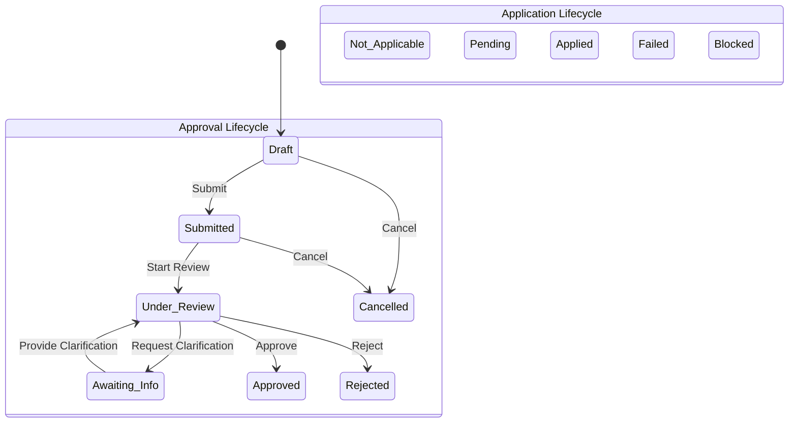

# BEZENT HRMS — Attendance → Regularization V1.0 Implementation Report

> **Document Class:** Architecture & Implementation Report  
> **Status:** Completed & Verified  
> **Authority:** Adheres to [AGENTS.md](../../AGENTS.md), [ADR-009](../architecture/ADRs.md#adr-009), [ADR-011](../architecture/ADRs.md#adr-011), and [FRONTEND.md](../architecture/FRONTEND.md)

---

## 1. Executive Summary & Architecture Audit

The **Regularization V1.0 — Advanced Enterprise Workspace** is an enterprise-grade, persistent, tenant-isolated full-stack capability within the **BEZENT HRMS** business application (`applications/hrms`).

### Architecture Audit Findings
- **Legacy Scope:** Previously, attendance correction was handled by a rudimentary `attendanceRegularization.ts` model with basic approval flags and no application ledger, lack of support for 7 specialized request types, and no two-state-machine separation.
- **Integration Points Identified & Reused:**
  - `employeeAttendance`: Daily attendance records (`date`, `checkInTime`, `checkOutTime`, `totalHoursWorked`, `status`).
  - `attendance_exceptions`: Exception tracking ledger linked via foreign keys and case codes.
  - `attendance_adjustments`: New immutable adjustment ledger that records approved adjustments without touching raw `attendance_punches`.
  - In-app notification infrastructure (`notifications` platform service) for lifecycle notifications.
  - BEZENT Design System: Complete adherence to the Zero Application CSS rule (no `.css` files under `applications/hrms/`, zero inline style tags).
  - RBAC & Tenant Isolation: Multi-tenant filtering at SQL query boundary with company, department, and role-based permissions (`isHR`, `isManager`, `employeeId`).

---

## 2. Regularization Domain: Seven Request Types

Regularization V1.0 introduces full support for seven distinct correction scenarios:

| # | Request Type Key | Name | Dynamic Validation & Fields | Risk Classification |
|---|------------------|------|-----------------------------|---------------------|
| 1 | `missing_in` | Missing IN Punch | Requires proposed IN timestamp (`proposedCheckIn`). Original IN must be absent. | Low risk (eligible for controlled bulk approval) |
| 2 | `missing_out` | Missing OUT Punch | Requires proposed OUT timestamp (`proposedCheckOut`). Original OUT must be absent. | Low risk (eligible for controlled bulk approval) |
| 3 | `incorrect_time` | Incorrect Punch Time | Requires target punch reference and corrected timestamp. | Medium risk |
| 4 | `status_correction` | Attendance Status Correction | Expected status (`present`, `half_day`, etc.) and justification. | High risk (requires individual review) |
| 5 | `worked_hours` | Worked Hours Discrepancy | Claimed hours/minutes and explanatory documentation. | Medium risk |
| 6 | `both_missing` | Both IN & OUT Missing | Requires both proposed IN and OUT timestamps. | High risk (requires individual review) |
| 7 | `wrong_direction` | Wrong Punch Direction | Target punch reference and corrected punch interpretation (`IN` $\leftrightarrow$ `OUT`). | Medium risk |

---

## 3. Two Independent State Machines

Regularization V1.0 strictly decouples human review authorization from attendance ledger application.

1. **Approval Lifecycle:**
   - States: `draft` $\rightarrow$ `submitted` $\rightarrow$ `under_review` $\rightarrow$ `approved` / `rejected` / `cancelled` (with bidirectional `awaiting_info`).
   - Self-approval is strictly prevented (`reviewerId !== employeeId`).
2. **Application Lifecycle:**
   - States: `not_applicable` $\rightarrow$ `pending` $\rightarrow$ `applied` / `failed` / `blocked`.
   - Approval transitions approved requests into `pending` (or immediately triggers transactional application).
   - If attendance is locked or payroll finalized, application transitions to `blocked` or `failed` with failure reasons logged in the audit trail without modifying the `approved` status.

---

## 4. Attendance Application Integrity & Immutable Ledgers

1. **Raw Punch Immutability:** Biometric punch logs (`attendance_punches`) are treated as immutable legal records and are never updated or deleted.
2. **Adjustment Ledger (`attendance_adjustments`):**
   - Each applied regularization persists an authorized adjustment record storing `regularizationId`, `adjustmentType`, `adjustedCheckIn`, `adjustedCheckOut`, `originalCheckIn`, `originalCheckOut`, and `recalculationNotes`.
3. **Daily Log Recalculation:**
   - Synchronizes `employeeAttendance` for the affected date (`checkInTime`, `checkOutTime`, `totalHoursWorked`, `status`).
4. **Exception Re-evaluation:**
   - If a related exception was linked, its status is resolved (`resolved`) upon successful adjustment application.

---

## 5. Database Schema & Migration

Migration file: [`0036_attendance_regularization_v1.sql`](file:///e:/Company/bezent_ecosystem/apps/api/src/db/migrations/0036_attendance_regularization_v1.sql)

### Tables Added
1. **`attendance_regularizations`**:
   - Primary table storing requests, tenant isolation, request types, timestamps, reasons, reviewer assignments, approval status, application status, risk scores, and evidence metadata.
2. **`attendance_adjustments`**:
   - Persistent ledger capturing applied changes to attendance records.
3. **`attendance_regularization_audits`**:
   - Append-only audit trail recording state transitions, actor ID, previous/new status, notes, and timestamp.

---

## 6. API Endpoints

All endpoints are registered under `/api/v1/hrms/attendance/regularization` with strict tenant scoping:

- `GET /workspace`: Fetch filtered list of regularizations and 6 summary counter metrics.
- `POST /workspace`: Alternative query endpoint for advanced body payloads.
- `GET /:id`: Fetch complete regularization detail (Overview, Evidence, Decision, History).
- `POST /`: Submit new regularization request or save draft.
- `POST /check-eligibility`: Pre-flight validation against 11 business rules.
- `POST /:id/decision`: Transition request state (`approve`, `reject`, `request_info`, `provide_info`, `start_review`).
- `POST /:id/apply`: Transactional attendance adjustment application.
- `POST /bulk-decision`: Controlled bulk review/approval/rejection with risk checks.
- `GET /export`: CSV export with formula injection defense (`=`, `+`, `-`, `@` sanitization).

---

## 7. Frontend Architecture & Zero Application CSS Compliance

The UI component is implemented at [`AttendanceRegularizationPage.tsx`](file:///e:/Company/bezent_ecosystem/apps/web/src/applications/hrms/attendance/pages/AttendanceRegularizationPage.tsx):

- **Compact Enterprise Header:** Breadcrumbs `Attendance / Regularization`, title, workday date range picker, export, and `+ New Request`.
- **6 Summary Counters:**
  1. `Pending Review`
  2. `Under Review`
  3. `Awaiting Info`
  4. `Approved Today`
  5. `Application Issues`
  6. `Rejected Today`
  Filter interaction triggers instant table filtering.
- **Primary & Advanced Filters:** Search, Approval Status, Request Type, Workday Range, Application Status, Assigned Reviewer, Department, Location, Exception Case.
- **10-Column Data Table:**
  1. Employee (Avatar, Name, EMP-ID)
  2. Workday
  3. Request Type
  4. Requested Change
  5. Submitted At
  6. Assigned To
  7. Approval Status Badge
  8. Application Status Badge
  9. Related Exception
  10. Contextual Actions Menu
- **4-Tab Review Drawer:**
  - `Overview`: Core details, employee metadata, and lifecycle progress.
  - `Evidence`: Original vs. proposed timeline, attachments, and conflict notes.
  - `Decision`: Actions (Approve, Reject, Request Info, Start Review) with mandatory note validation.
  - `History`: Audit trail of all actions and state changes.
- **Dynamic New Request Modal:** Adapts input fields dynamically based on selected request type.
- **Styling Architecture:** 100% compliant with the Zero Application CSS rule and Design System tokens. No `.css` files, no inline `style={{ ... }}` objects.

---

## 8. Verification & Test Suite

### Automated Test Runs
1. **Backend Integration Tests:** [`attendanceRegularizationV1Api.test.ts`](file:///e:/Company/bezent_ecosystem/apps/api/src/applications/hrms/attendance/__tests__/attendanceRegularizationV1Api.test.ts)
   - **Result:** 13/13 Passed (100%).
   - Covered: Submission eligibility, duplicate prevention, self-approval blockage, awaiting info loop, rejection, approval + adjustment ledger write, locked workday defense, bulk controlled processing, CSV export.
2. **Attendance Backend Suite:** All 140 tests passed across the module.
3. **Frontend Tests:** [`attendanceRegularizationPageV1.test.tsx`](file:///e:/Company/bezent_ecosystem/apps/web/src/applications/hrms/attendance/__tests__/attendanceRegularizationPageV1.test.tsx)
   - **Result:** 3/3 Passed (100%).
4. **Attendance Frontend Suite:** All 25 tests passed.
5. **Typecheck & Production Build:**
   - `npm --prefix apps/web run typecheck`: 0 errors.
   - `npm --prefix apps/api run typecheck`: 0 errors.
   - `npm --prefix apps/web run build`: Succeeded.
   - `npm --prefix apps/api run build`: Succeeded.
