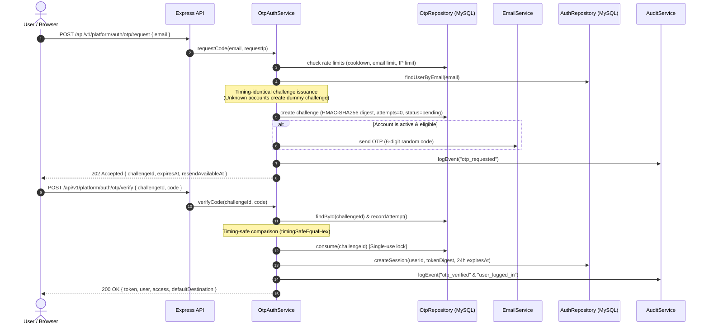
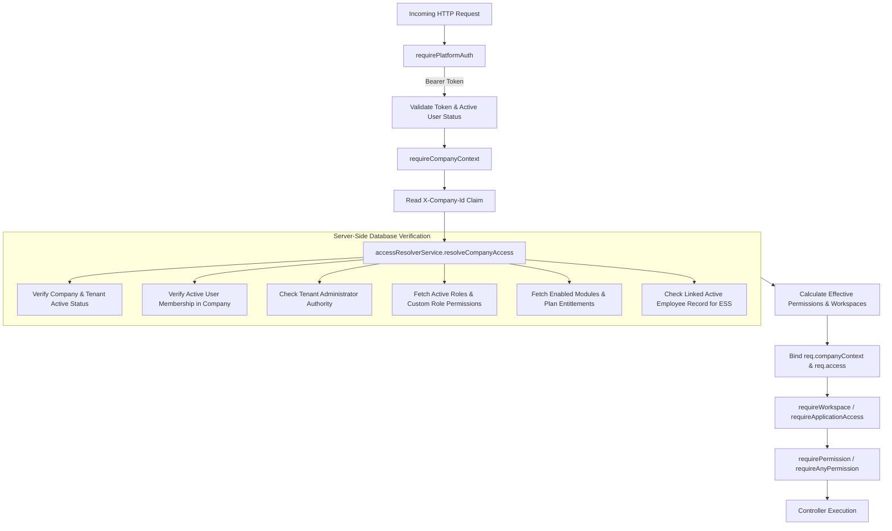

# BEZENT Ecosystem — Authentication, Authorization & SaaS Security Audit

> **Document Type:** Independent Security Architecture & Full-Stack Audit  
> **Auditor Role:** Senior SaaS Security Architect and Full-Stack Auditor  
> **Target Repository:** `bezent_ecosystem` (`apps/web`, `apps/api`, `db`)  
> **Stack:** React 18 + Vite + TypeScript, Express 4 + TypeScript, Drizzle ORM, MySQL 8.4  
> **Evaluation Mode:** Read-Only Source Code Analysis & Non-Destructive Test Execution  
> **Audit Date:** 2026-10-15  
> **Status:** COMPLETED  

---

## 1. Executive Summary

An exhaustive, read-only security audit of the BEZENT Ecosystem was performed focusing on **Authentication, Authorization (RBAC/PBAC), Multi-Tenant Isolation, Application Entitlements, and Session Security**. 

The architecture follows architectural principles established under **ADR-017 (Unified Company-Scoped Authorization & Effective Permissions)** and **ADR-018 (Unified Passwordless Email-OTP Authentication & Single-Session Foundation)**.

### Key Audit Findings & High-Level Posture

1. **Authentication (ADR-018):**
   - Traditional password authentication has been intentionally retired (`/api/v1/platform/auth/login` returns HTTP `410 Gone`).
   - A single, universal Passwordless Email-OTP mechanism is enforced across all roles (Super Admin, Tenant Admin, Company Admin, HR, Manager, Employee).
   - OTP secrets are protected using keyed HMAC-SHA256 digests (`digestOtpCode`); raw OTP codes and bearer session tokens are never stored in plain text in the database (`sessions` stores `sha256:<hex>`).
   - Rate limiting, attempt counting, challenge expiration, single-use consumption, and audit logging are implemented at the persistence layer (`authOtpChallenges`).

2. **Authorization & RBAC (ADR-017):**
   - The authorization architecture is strictly **deny-by-default** and resolved **per request** against the database without fragile client-side trust.
   - The client-supplied `X-Company-Id` header is treated strictly as an unverified claim. The backend (`requireCompanyContext` and `accessResolverService`) re-evaluates active membership, company status, tenant status, role assignments, and application entitlements from MySQL on every request.
   - Global Super Admin oversight is bounded to company administration (`SUPER_ADMIN_COMPANY_OVERSIGHT`) and explicitly denies access to HRMS business domain workflows and Employee Self-Service without an active company membership.

3. **Multi-Tenant Isolation:**
   - Multi-tenancy is enforced at the database level with composite unique indexes and mandatory `tenant_id` and `company_id` column constraints across all business tables.
   - Cross-tenant data isolation is enforced at the controller and repository layers. Tenant ID is derived server-side from verified membership and company records, preventing tenant spoofing.
   - The legacy insecure development context (`devContext.ts`) has been completely removed from application code.

4. **Identified Vulnerabilities & Operational Risks:**
   - **High Risk:** Express server lacks `trust proxy` configuration while rate limiting relies on `x-forwarded-for`, permitting IP spoofing.
   - **Medium Risk:** Session tokens are stored in browser `localStorage`, exposing bearer tokens to Cross-Site Scripting (XSS) exfiltration.
   - **Medium Risk:** Standalone HRMS utility routes in the frontend router (`/hrms/administration/onboarding/registration` and `/hrms/settings/forms`) omit frontend workspace and permission guards, although backend endpoints enforce authorization.
   - **Medium Risk:** Public media route `/api/v1/platform/media/*` serves files without authentication or tenant boundary checks.
   - **Medium Risk:** Per-request database access resolution triggers 6 to 10 sequential database queries per authenticated HTTP request, posing database resource exhaustion risks under high concurrent traffic.

---

## 2. Current Authentication Architecture

### 2.1 Passwordless Email-OTP Flow (ADR-018)

Authentication in BEZENT is consolidated into a single passwordless Email-OTP flow. There are no secondary login mechanisms.



### 2.2 Password Retirement & Legacy Hash Security

- **Legacy Hash Support:** While password authentication is disabled (`authRouter.post('/auth/login', authController.passwordLoginDisabled)` returning 410), password hashing utilities exist in [security.ts](file:///e:/Company/bezent_ecosystem/apps/api/src/platform/auth/security.ts#L11-L31) using Node.js native `crypto.scryptSync` with 16-byte random salts and 64-byte derived keys with timing-safe verification.
- **Unusable Credentials:** Newly created users are assigned cryptographically random unusable password hashes via `createUnusableCredential()` ([security.ts](file:///e:/Company/bezent_ecosystem/apps/api/src/platform/auth/security.ts#L39-L41)) to satisfy `NOT NULL` database constraints without exposing any known password.

### 2.3 Token, Session & Cookie Lifecycle

- **Session Tokens:** 32-byte cryptographically secure random hexadecimal strings (64 characters, `generateSessionToken()`).
- **Database Storage:** Sessions are stored as SHA-256 digests (`sha256:<hex>`). The raw token is returned to the client upon sign-in and never retained on the server.
- **Expiration & Revocation:** Sessions carry a strict 24-hour TTL (`SESSION_TTL_HOURS = 24`). Revocation sets `revoked_at = NOW()` via `authService.logout()`.
- **Client Storage:** Handled by [session.ts](file:///e:/Company/bezent_ecosystem/apps/web/src/platform/auth/session.ts#L12-L41) using `localStorage.getItem('bezent_platform_token')`.

---

## 3. Current Authorization Architecture

### 3.1 Authorization Evaluation Model (ADR-017)

BEZENT implements a **Unified Company-Scoped Authorization Model**. Authorization is not stored in static tokens; rather, effective permissions are resolved dynamically on every request.



### 3.2 Authorization Enforcement Primitives

Backend enforcement in [access.middleware.ts](file:///e:/Company/bezent_ecosystem/apps/api/src/platform/access/middleware/access.middleware.ts):

| Middleware | Target Scope | Security Function | Behavior on Denial |
| :--- | :--- | :--- | :--- |
| `requirePlatformAuth` | Global | Validates Bearer token in MySQL `sessions` and checks `users.status === 'active'`. | `401 Unauthorized` |
| `requireSuperAdmin` | Platform | Checks `req.user.isSuperAdmin === true`. | `403 Forbidden ('Super Admin privileges required')` |
| `requireTenantAdmin` | Tenant | Checks active entry in `tenant_admins` table and verifies tenant status. | `403 Forbidden ('Tenant Administrator authority required')` |
| `requireCompanyContext` | Company | Resolves client claim `X-Company-Id` against MySQL `memberships`, `companies`, and `tenants`. | `400 Bad Request` (missing) / `403 Forbidden` |
| `requireWorkspace` | Workspace | Validates caller's effective workspaces include target (`super_admin`, `tenant_admin`, `company_admin`, `hrms`, `ess`). | `403 Forbidden (Opaque error code)` |
| `requireApplicationAccess` | Application | Validates company entitlement for application code and user workspace entry. | `403 Forbidden ('MODULE_DISABLED' or 'FORBIDDEN_WORKSPACE')` |
| `requireModuleEntitlement` | Module | Validates specific sub-module within application is entitled under tenant plan. | `403 Forbidden ('MODULE_ENTITLEMENT_DENIED')` |
| `requirePermission` | Action | Validates effective permission list includes required canonical key or alias. | `403 Forbidden ('FORBIDDEN_PERMISSION')` |
| `requireAnyPermission` | Action | Passes if user holds any of the listed permissions. | `403 Forbidden ('FORBIDDEN_PERMISSION')` |
| `requireReadWrite` | REST Resource | Enforces read permissions for GET/HEAD; enforces write permission for POST/PUT/PATCH/DELETE. | `403 Forbidden ('FORBIDDEN_PERMISSION')` |

---

## 4. Role-Permission Matrix

System roles are defined immutably in code ([accessCatalog.ts](file:///e:/Company/bezent_ecosystem/apps/api/src/platform/access/catalog/accessCatalog.ts#L502-L530)) while role identity lives in the `roles` table.

| Capability / Permission Area | Super Admin | Tenant Admin | Company Admin | HR Manager | Manager | Employee (ESS) |
| :--- | :---: | :---: | :---: | :---: | :---: | :---: |
| **Platform Tenant Management** | YES | NO | NO | NO | NO | NO |
| **Platform Provisioning & Plans** | YES | NO | NO | NO | NO | NO |
| **Platform Governance & Audit** | YES | NO | NO | NO | NO | NO |
| **Tenant Profile & Capacity** | YES | YES | NO | NO | NO | NO |
| **Tenant Company Creation** | YES | YES | NO | NO | NO | NO |
| **Tenant Admin Assignment** | YES | YES (peer) | NO | NO | NO | NO |
| **Company Profile & Branding** | YES (Oversight) | YES | YES | NO | NO | NO |
| **Company User Invitation & Roles** | YES (Oversight) | YES | YES | NO | NO | NO |
| **Company Custom Role Creation** | YES (Oversight) | YES | YES | NO | NO | NO |
| **HRMS Organization Masters** | NO | NO | Read/Write | Read/Write | View Only | NO |
| **HRMS Employee Management** | NO | NO | Full Admin | Full Admin | Direct Reports | NO |
| **HRMS Attendance & Punches** | NO | NO | Full Admin | Full Admin | Team View | Self View/Punch |
| **HRMS Overtime & Comp-Off** | NO | NO | Full Admin | Full Admin | Team Approvals | Self Claim |
| **HRMS Leave Management** | NO | NO | Full Admin | Full Admin | Team Approvals | Self Apply |
| **HRMS Onboarding Workflows** | NO | NO | Full Admin | Full Admin | NO | NO |
| **HRMS Form Engine Customization** | NO | NO | Full Admin | Full Admin | NO | NO |
| **ESS Personal Profile Changes** | NO | NO | NO | NO | NO | Self Request |

*Note on Super Admin Invariant:* Super Admin receives only `SUPER_ADMIN_COMPANY_OVERSIGHT` in a company where they have no direct membership. They cannot view or manage employee PII, attendance, or payroll data unless an explicit company membership is provisioned.

---

## 5. Tenant and Application Access Flow

### 5.1 End-to-End Request Pipeline

```
[Browser Request]
  │
  ├── 1. Transport Layer: TLS / HTTP Header Inspection
  │      └── Helmet security headers applied
  │      └── CORS origin validation (Allowed origins whitelist)
  │      └── JSON / Raw body parsing (10MB limit)
  │
  ├── 2. Authentication Boundary: /api/v1/hrms/*, /api/v1/company-admin/*, /api/v1/tenant-admin/*
  │      └── requirePlatformAuth
  │          └── Authorization header Bearer token extracted
  │          └── Token format validated (/^[0-9a-f]{64}$/)
  │          └── Active session queried from MySQL (hashed token, unrevoked, unexpired)
  │          └── User account status confirmed 'active'
  │          └── req.user populated with AuthenticatedUser
  │
  ├── 3. Tenant & Company Context Resolution
  │      └── requireCompanyContext (or requireTenantAdmin / requireEssAuth)
  │          └── Client X-Company-Id extracted as claim
  │          └── Database lookup for company and tenant
  │          └── Membership verified (user must belong to company or be Tenant Admin/Super Admin)
  │          └── Company status confirmed not 'suspended'
  │          └── Tenant status confirmed not 'suspended'
  │          └── Server binds req.companyContext { tenantId, companyId }
  │
  ├── 4. Application Entitlement Verification
  │      └── requireApplicationAccess('hrms', 'hrms')
  │          └── Check if tenant subscription & company enables 'hrms'
  │          └── If disabled: 403 Forbidden ('MODULE_DISABLED')
  │          └── Check if effective permissions grant workspace 'hrms'
  │          └── If missing: 403 Forbidden ('FORBIDDEN_WORKSPACE')
  │
  ├── 5. Action Permission Enforcement
  │      └── requirePermission(actionKey) / requireAnyPermission(...)
  │          └── Evaluate effective permissions list (canonical + aliases)
  │          └── Deny-by-default: If permission missing: 403 Forbidden
  │
  └── 6. Controller & Repository Execution
         └── Scoped queries: WHERE tenant_id = req.companyContext.tenantId AND company_id = req.companyContext.companyId
```

---

## 6. Endpoint Protection Coverage

| Router Prefix | Mount Path | Authentication Guard | Authorization Guard | Tenant Isolation Enforcement |
| :--- | :--- | :--- | :--- | :--- |
| **Health** | `/api/v1/health` | None (Public) | None | N/A (Static health check) |
| **Auth** | `/api/v1/platform/auth` | Public (request/verify) / `requirePlatformAuth` (logout, me) | Single-use OTP digest | Account status checks |
| **Reference** | `/api/v1/platform/reference` | None (Public metadata) | None | Global non-sensitive reference data |
| **Media** | `/api/v1/platform/media` | None (Public) | Path traversal protection (`..`) | **None (Gap: unauthenticated asset access)** |
| **Super Admin** | `/api/v1/platform/*` | `requirePlatformAuth` | `requireSuperAdmin` | Platform-wide administrative governance |
| **Tenant Admin** | `/api/v1/tenant-admin` | `requirePlatformAuth` | `requireTenantAdmin` | Verified against `tenant_admins` table |
| **Company Admin** | `/api/v1/company-admin` | `requirePlatformAuth` | `requireWorkspace('company_admin')` | Verified against `memberships` & `companies` |
| **ESS** | `/api/v1/ess` | `requirePlatformAuth` | `requireEssAuth` | Bound to authenticated user's linked `employees` record |
| **HRMS Root** | `/api/v1/hrms/*` | `requirePlatformAuth` | `requireApplicationAccess('hrms')` | Bound to verified `req.companyContext` |
| **Workforce** | `/api/v1/hrms/workforce` | Inherited from `/hrms` | `requireAnyPermission` | `req.companyContext` tenant/company scoping |
| **Employees** | `/api/v1/hrms/employees` | Inherited from `/hrms` | `requirePermission` | `req.companyContext` tenant/company scoping |
| **Attendance** | `/api/v1/hrms/attendance` | Inherited from `/hrms` | Route-level permissions | `req.companyContext` tenant/company scoping |
| **Onboarding** | `/api/v1/hrms/onboarding` | Inherited from `/hrms` | Route-level permissions | `req.companyContext` tenant/company scoping |
| **Documents** | `/api/v1/hrms/employee-documents` | Inherited from `/hrms` | `requireReadWrite` | `req.companyContext` tenant/company scoping |
| **Forms** | `/api/v1/hrms/settings/forms` | Inherited from `/hrms` | `requireReadWrite` | `req.companyContext` tenant/company scoping |

---

## 7. Security Findings and Evidence

### FINDING-01: Express `trust proxy` Setting Missing for Rate Limiter IP Detection

- **Finding ID:** SEC-FINDING-01
- **Severity:** High
- **Status:** Verified
- **File Reference:** [createApp.ts:31-71](file:///e:/Company/bezent_ecosystem/apps/api/src/app/server/createApp.ts#L31-L71), [rateLimiter.middleware.ts:28-32](file:///e:/Company/bezent_ecosystem/apps/api/src/platform/auth/middleware/rateLimiter.middleware.ts#L28-L32)
- **Evidence:**
  ```typescript
  // rateLimiter.middleware.ts:28-32
  const clientIp =
    (req.headers['x-forwarded-for'] as string)?.split(',')[0]?.trim() ||
    req.socket.remoteAddress ||
    'unknown_ip';
  ```
- **Reproduction Conditions:** Send `X-Forwarded-For: 1.2.3.4` with varying IP addresses to `/api/v1/platform/auth/otp/request` or `/api/v1/platform/tenants/invitations/:token/accept`. Without `app.set('trust proxy', ...)`, Express allows arbitrary client-provided headers to spoof the client IP.
- **Security Impact:** An attacker can bypass the sliding-window rate limiters (such as `MAX_REQUESTS_PER_IP = 30` or `invitationAcceptanceRateLimiter`), enabling brute-force and email-bombing attacks against the OTP delivery infrastructure.
- **Recommended Fix:** Configure Express `trust proxy` setting according to the production infrastructure topology:
  ```typescript
  app.set('trust proxy', 1); // Or specify trusted proxy CIDR ranges
  ```
  And extract client IP using Express's validated `req.ip`.
- **Suggested Regression Test:** Send request with forged `X-Forwarded-For` and verify `req.ip` resolves correctly according to trust proxy configuration.

---

### FINDING-02: Bearer Session Tokens Stored in Browser `localStorage` (XSS Exposure)

- **Finding ID:** SEC-FINDING-02
- **Severity:** Medium
- **Status:** Verified
- **File Reference:** [session.ts:21-41](file:///e:/Company/bezent_ecosystem/apps/web/src/platform/auth/session.ts#L21-L41)
- **Evidence:**
  ```typescript
  // session.ts:21-29
  function read(key: string): string | null {
    try {
      const val = typeof localStorage === 'undefined' ? null : localStorage.getItem(key);
      if (val !== null) return val;
      return key === SESSION_TOKEN_KEY ? inMemoryToken : inMemoryCompanyId;
    } catch { ... }
  }
  ```
- **Reproduction Conditions:** Open browser developer console on an authenticated session and execute `localStorage.getItem('bezent_platform_token')`.
- **Security Impact:** In the event of an XSS vulnerability in any frontend dependency or user-rendered field, an attacker can access the session token and impersonate the user across all BEZENT workspaces.
- **Recommended Fix:** Migrate session token transmission to `HttpOnly`, `Secure`, `SameSite=Lax` cookies, with anti-CSRF protections on mutation requests.
- **Suggested Regression Test:** Verify frontend authenticates via secure cookies without storing raw bearer tokens in browser `localStorage`.

---

### FINDING-03: Standalone HRMS Utility Routes Lack Frontend Workspace Guards

- **Finding ID:** SEC-FINDING-03
- **Severity:** Medium
- **Status:** Verified
- **File Reference:** [AppRouter.tsx:164-192](file:///e:/Company/bezent_ecosystem/apps/web/src/app/router/AppRouter.tsx#L164-L192)
- **Evidence:**
  ```typescript
  // AppRouter.tsx:164-192
  {
    element: (
      <RequireAuth>
        <StandaloneUtilityLayout />
      </RequireAuth>
    ),
    children: [
      { path: '/calendar', element: <CalendarPage /> },
      { path: '/tasks', element: <TasksPage /> },
      { path: '/approvals', element: <ApprovalsPage /> },
      { path: '/notes', element: <NotesPage /> },
      {
        path: '/hrms/administration/onboarding/registration',
        element: <EmployeeRegistrationPage />,
      },
      {
        path: '/hrms/settings/forms',
        element: <FormEditorPage />,
      },
    ],
  }
  ```
- **Reproduction Conditions:** Log in as an Employee (ESS role only, holding no HR permissions). Directly navigate in browser to `/hrms/administration/onboarding/registration` or `/hrms/settings/forms`.
- **Security Impact:** The frontend router renders the complete administrative interface. While subsequent API requests to `/api/v1/hrms/*` are blocked with HTTP 403 Forbidden by backend middleware, the administrative UI form structure and UI controls are leaked to unauthorized roles.
- **Recommended Fix:** Wrap HRMS standalone routes with `<RequireHrmsWorkspace>` or explicit `<RequirePermission>` guards in `AppRouter.tsx`.
- **Suggested Regression Test:** Add test in `workspaceShellIsolation.test.tsx` verifying navigation to `/hrms/administration/onboarding/registration` redirects unprivileged users to `/ess`.

---

### FINDING-04: Unauthenticated Media Asset Route `/api/v1/platform/media/*`

- **Finding ID:** SEC-FINDING-04
- **Severity:** Medium
- **Status:** Verified
- **File Reference:** [media.routes.ts:10-41](file:///e:/Company/bezent_ecosystem/apps/api/src/platform/data/routes/media.routes.ts#L10-L41), [routes.ts:23](file:///e:/Company/bezent_ecosystem/apps/api/src/platform/routes.ts#L23)
- **Evidence:**
  ```typescript
  // media.routes.ts:10-14
  mediaRouter.get('/*', async (req: Request, res: Response) => {
    try {
      const rawPath = req.params[0] || '';
      if (!rawPath || rawPath.includes('..')) {
        res.status(400).json({ error: 'Invalid media path' });
        return;
      }
      const provider = getStorageProvider();
      const result = await provider.get(rawPath);
  ```
- **Reproduction Conditions:** Issue `GET /api/v1/platform/media/<path>` without an `Authorization` header.
- **Security Impact:** The route serves files directly from the underlying storage provider without authentication or tenant checks. While path traversal (`..`) is prevented, any file saved in the storage bucket (e.g., if employee documents are ever stored there) can be accessed anonymously if the path is known.
- **Recommended Fix:** Explicitly restrict `/media/*` to public branding assets only (e.g. `media/branding/*`), and require authenticated, tenant-scoped URLs for private media.
- **Suggested Regression Test:** Verify non-branding assets reject unauthenticated access with 401/403.

---

### FINDING-05: N+1 Database Query Amplification During Per-Request Access Resolution

- **Finding ID:** SEC-FINDING-05
- **Severity:** Medium / Architectural
- **Status:** Verified
- **File Reference:** [accessResolver.service.ts:45-216](file:///e:/Company/bezent_ecosystem/apps/api/src/platform/access/service/accessResolver.service.ts#L45-L216)
- **Evidence:** Each authenticated request to `/api/v1/hrms/*` executes:
  1. `sessions` lookup (join `users`)
  2. `companies` & `tenants` lookup
  3. `tenantAdminRepository.hasActiveTenantAdmin()`
  4. `accessRepository.listActiveRolesForUser()`
  5. `moduleService.getEnabledModules()` (queries `tenant_subscriptions` and overrides)
  6. `effectiveEntitlementService.resolveEffectiveEntitlements()` (looping across all enabled applications)
  7. `accessRepository.listCustomRolePermissions()`
  8. `accessRepository.findEssEligibleEmployee()`
- **Security Impact:** Lack of caching ensures immediate revocation, but exposes the database to Denial of Service (DoS) under load spikes. An authenticated attacker could flood endpoints with concurrent requests to exhaust the MySQL connection pool.
- **Recommended Fix:** Implement short-lived (e.g., 10-30 seconds) in-memory or Redis caching for resolved `CompanyAccess` objects, invalidated via event hooks whenever memberships, roles, or subscriptions are modified.
- **Suggested Regression Test:** Load test verifying MySQL connection pool utilization remains within bounds under concurrent authenticated requests.

---

### FINDING-06: UAT Fixed OTP Non-Production Bypass Safeguard

- **Finding ID:** SEC-FINDING-06
- **Severity:** Low / Informational
- **Status:** Verified
- **File Reference:** [otpAuth.service.ts:174-183](file:///e:/Company/bezent_ecosystem/apps/api/src/platform/auth/service/otpAuth.service.ts#L174-L183)
- **Evidence:**
  ```typescript
  const isUatFixedMatch =
    env.nodeEnv !== 'production' &&
    env.enableUatFixedOtp &&
    typeof env.uatFixedOtp === 'string' &&
    env.uatFixedOtp.length > 0 &&
    challenge.userId !== null &&
    code.length === env.uatFixedOtp.length &&
    crypto.timingSafeEqual(Buffer.from(code), Buffer.from(env.uatFixedOtp));
  ```
- **Analysis:** The fixed OTP bypass is guarded by `env.nodeEnv !== 'production'` and `env.enableUatFixedOtp`. However, if staging environments run with sanitized production data, accounts could be compromised if the UAT fixed OTP is shared or predictable.
- **Recommended Fix:** Ensure `ENABLE_UAT_FIXED_OTP` cannot be enabled unless `NODE_ENV === 'test'` or `NODE_ENV === 'development'`. Add an assertion in `assertProductionAuthConfig` failing fast on startup if flags collide.
- **Suggested Regression Test:** Automated unit test verifying `verifyCode` rejects UAT OTP when `NODE_ENV === 'production'`.

---

## 8. Missing Test Coverage & Audit Inventory

### 8.1 Inventory of Existing Passing Security Tests

Safe, non-destructive test execution verified **120 passing security tests** across 6 test suites:
- `apps/api/src/platform/__tests__/otpAuth.test.ts` (OTP issuance, cooldown, attempt limits, timing-safe checks, UAT flag guards)
- `apps/api/src/platform/__tests__/auth.test.ts` (Session validation, token revocation, account suspension checks)
- `apps/api/src/platform/__tests__/rbac.test.ts` (Permission catalog, system roles, permission expansion)
- `apps/api/src/platform/__tests__/companyAccessV1.test.ts` (Company access resolution, membership boundaries, Super Admin oversight)
- `apps/web/src/platform/auth/__tests__/workspaceBoundary.test.ts` (Frontend workspace permission matrix)
- `apps/web/src/platform/auth/__tests__/workspaceShellIsolation.test.tsx` (Frontend workspace routing isolation and shell navigation redirects)

### 8.2 Missing Negative & Edge Case Tests

The following test scenarios are recommended for inclusion in CI test suites:

1. **Cross-Tenant IDOR Integration Tests:**
   - User from Company A (Tenant A) submitting requests targeting resource IDs (e.g. employeeId, punchId, caseId, regularizationId) owned by Company B (Tenant B). Expected: 403 or 404.
2. **Session Revocation In-Flight Test:**
   - Active user session revoked concurrently during long-running request. Next request must fail with 401 Unauthorized immediately.
3. **Application Entitlement Revocation Test:**
   - When HRMS module is disabled for a company via `moduleService.disableModule()`, verify subsequent API requests to `/api/v1/hrms/*` return 403 Forbidden with code `MODULE_DISABLED`.
4. **Tenant Suspension Cascade Test:**
   - Suspending a tenant via `tenantController.suspend` must immediately reject all company members with `TENANT_SUSPENDED`.
5. **Rate Limiter Header Spoofing Test:**
   - Test verifying that changing `X-Forwarded-For` header values does not reset IP rate limits on OTP endpoints.

---

## 9. Prioritized Remediation Roadmap

```
Phase 1: Immediate Hardening (Within 1-2 Weeks)
  ├── 1. Configure Express `trust proxy` in createApp.ts (SEC-FINDING-01)
  ├── 2. Add `<RequireHrmsWorkspace>` to Standalone Utility routes in AppRouter.tsx (SEC-FINDING-03)
  └── 3. Enforce production startup assertion blocking ENABLE_UAT_FIXED_OTP (SEC-FINDING-06)

Phase 2: Authentication & Storage Enhancement (Within 1 Month)
  ├── 1. Migrate session token storage from localStorage to HttpOnly, SameSite cookies (SEC-FINDING-02)
  ├── 2. Partition public media assets from private documents; enforce authentication on media storage (SEC-FINDING-04)
  └── 3. Implement automated negative cross-tenant IDOR integration tests in CI (Section 8.2)

Phase 3: Scale & Performance Architecture (Pre-General Availability)
  └── 1. Implement short-lived (10-30s) in-memory/Redis access resolution cache with event-based invalidation (SEC-FINDING-05)
```

---

## 10. Production Readiness Verdict

```
╔═══════════════════════════════════════════════════════════════════════════╗
║                      PRODUCTION READINESS VERDICT                         ║
╠═══════════════════════════════════════════════════════════════════════════╣
║                                                                           ║
║                        VERDICT: CONDITIONAL PASS                          ║
║                                                                           ║
║  The BEZENT architecture demonstrates exceptional core design:           ║
║  - Universal passwordless OTP with single-use digests and timing safety   ║
║  - Deny-by-default server-side access resolution on every request        ║
║  - Robust multi-tenant company and employee scoping across controllers    ║
║  - Strict separation of Super Admin oversight from business domain data   ║
║                                                                           ║
║  CONDITIONS REQUIRED BEFORE PRODUCTION LAUNCH:                            ║
║  1. Resolve SEC-FINDING-01: Configure Express trust proxy settings to      ║
║     prevent IP rate-limiting bypass via forged X-Forwarded-For headers.   ║
║  2. Resolve SEC-FINDING-03: Wrap standalone HRMS utility routes in        ║
║     AppRouter.tsx with workspace/permission guards.                      ║
║  3. Complete Phase 1 remediation items before onboarding live tenants.    ║
║                                                                           ║
╚═══════════════════════════════════════════════════════════════════════════╝
```

---

## Summary of Strengths, Critical Gaps & Top 5 Recommended Actions

### Verified Strengths
1. **Zero Client Trust in Tenant Identity:** Client-supplied `X-Company-Id` is strictly a claim; true `tenantId` is always queried server-side from verified database relationships.
2. **Timing-Safe Single-Use OTP Authentication:** Keyed HMAC-SHA256 digests, single-use database consumption (`recordAttempt` + `consume`), and uniform response times prevent account enumeration.
3. **Real-Time Entitlement Enforcement:** No stale in-memory authorization cache; disabled applications or suspended accounts take effect on the very next HTTP request.
4. **Clean Domain Separation:** Super Admin privileges do not automatically bypass HRMS business domain rules or view employee self-service records.
5. **Automated Test Integrity:** 120 automated security tests pass with 100% success rate across OTP authentication, session management, RBAC, and workspace isolation.

### Critical Gaps
1. **Unprotected Reverse-Proxy IP Rate Limiting:** Missing Express `trust proxy` configuration allows attackers to spoof `X-Forwarded-For` and bypass IP-level rate limits.
2. **Client-Side Session Token Storage in `localStorage`:** Bearer tokens are exposed to browser JavaScript, creating vulnerability to potential XSS exfiltration.
3. **Unguarded Standalone Frontend Routes:** Unprivileged roles can render standalone onboarding and form-builder interfaces.
4. **Unauthenticated Media Route:** Generic file retrieval endpoint lacks tenant-level ownership checks.
5. **Database Overhead Under Concurrent Load:** 6-10 database queries executed on every authenticated request to evaluate access permissions.

### Top Five Recommended Actions
1. **Configure `app.set('trust proxy', 1)`** in `createApp.ts` to secure IP rate limiting against header spoofing.
2. **Add `<RequireHrmsWorkspace>`** to the standalone utility route definitions in `AppRouter.tsx`.
3. **Migrate Session Token Storage** from browser `localStorage` to `HttpOnly`, `Secure`, `SameSite=Lax` cookies.
4. **Add Dedicated IDOR Negative Test Suite** asserting cross-tenant resource requests return 403/404 across all modules.
5. **Introduce Short-Lived Access Cache** (10-30 seconds) in `accessResolverService` with cache eviction on role/membership updates.
